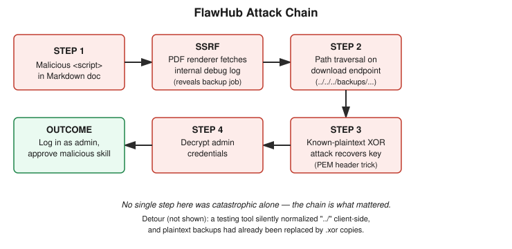

# Chapter 1: FlawHub — Chaining SSRF, Path Traversal, and a Known-Plaintext XOR Attack

## Learning objectives

By the end of this chapter, you will be able to:
- Explain how a server-side document/PDF renderer can become a Server-Side Request Forgery (SSRF) vector when it executes attacker-supplied script.
- Identify and test for path traversal on a filename-based download endpoint, including how to avoid a testing tool silently rewriting your payload.
- Perform a known-plaintext XOR attack to recover an encryption key from a predictable file-format header.
- Describe why chained, moderate-severity bugs often produce more real-world impact than any single critical finding.

## The concept

This chapter covers a single hands-on lab, run on the SecureCodeWarrior platform, against a deliberately vulnerable application called FlawHub — a fictional marketplace where users upload "skills" for AI agents, and other users browse, download, and run them. The lab's framing is realistic and worth sitting with for a moment: the team behind FlawHub had a public incident, panicked, and rushed out new security features with heavy reliance on AI-assisted development. That setup matters, because every bug in this chapter is the kind of bug that shows up when speed is prioritized over careful review — not exotic zero-days, but ordinary mistakes compounding on each other.

The objective handed to me as the attacker was concrete: upload a malicious skill, and find a way to get it approved so it ships to every user in the library. Reaching that objective required four distinct steps, each teaching a different vulnerability class, chained end to end.

The first weakness lived somewhere nobody usually looks for one: a documentation field. FlawHub lets you write a skill's documentation in Markdown, and — like many Markdown renderers — it passes raw HTML straight through unescaped. On its own, that's a modest finding; an attacker controlling HTML in a page mostly affects whoever views that page in a browser. But FlawHub also offers a "download documentation as PDF" feature, and PDF generation like this is almost always implemented by pointing a real, headless browser (in this case, a tool called Puppeteer) at the rendered page and capturing it. That headless browser runs *on FlawHub's own server*, inside FlawHub's own network — and it executes JavaScript exactly like any other browser would.

That's the pivot point. By embedding a `<script>` tag in the Markdown documentation that performs a `fetch()` call to an internal address, and then triggering a PDF export, I got FlawHub's server to make an HTTP request on my behalf — into a part of its network I could never reach directly from the outside. This is Server-Side Request Forgery, or SSRF: tricking a server-side component into issuing requests that serve the attacker's purposes rather than the application's. The entry point here wasn't a backend API or a webhook handler — the two places most people are trained to look for SSRF — it was a PDF export button. That's the lesson worth internalizing: any server-side feature that fetches or renders attacker-influenced content is a potential HTTP client, whether or not anyone thought of it that way when building it.

The SSRF leaked an internal diagnostics log, and that log described a backup job: a scheduled process that takes several sensitive files — a TLS certificate, a couple of log files, and an environment file full of secrets — and writes "encrypted" copies of them into a backup directory, using XOR. Keep that detail in mind; it becomes the key to the whole chapter by the end.

With that backup directory's path known, the second step targeted a completely ordinary, public-facing feature: downloading a skill as a zip file. That request looked like `GET /api/skills/download?filename=test-2-bundle.zip` — a filename passed directly as a query parameter. Any time user-controlled input looks like a filename or file path being handed to a server, it's worth testing whether you can substitute a different path entirely. This is path traversal: using sequences like `../` to climb out of the directory a developer intended and reach somewhere else on the filesystem.

## Hands-on lab recap — REAL LAB

This was a real, hands-on SecureCodeWarrior lab exercise, performed live against a running FlawHub instance — not a conceptual walkthrough. Two genuine debugging detours happened along the way, and both are worth recounting in detail because they're realistic obstacles, not scripted lab friction.

The first detour: initial traversal attempts (`filename=../../../backups/backup_id/error.log`) returned the identical error — `{"error":"Bundle not found","code":"bundle_not_found"}` — no matter how many `../` segments were added, removed, or percent-encoded. The natural assumption was a server-side filter blocking the traversal. The actual cause was different and, in hindsight, obvious: the HTTP testing tool's own URL input field was silently normalizing and collapsing `../` sequences *before the request ever left the tool* — the same way a browser address bar quietly resolves `..` in a typed URL. The fix was to stop typing payloads into that field and instead fire requests directly with a raw `fetch()` call from the browser's own developer console, scoped to FlawHub's page — bypassing any "helpful" client-side rewriting entirely.

The second detour, once the first was fixed: requests for `error.log` still failed. Going back to the leaked debug log from step one provided the answer — the backup job doesn't just copy files, it *replaces* them with XOR-encrypted `.xor` versions. The plaintext `error.log` simply didn't exist on disk anymore; only `error.log.xor` did. Switching to the correct filenames, combined with exactly three levels of `../`, produced successful `200` responses containing the encrypted certificate and environment files.

With the encrypted files in hand, the third step was cryptanalysis rather than web exploitation. XOR encryption works by combining each byte of data with a repeating key byte, and it has a well-known weakness: `ciphertext = plaintext XOR key`, which rearranges to `key = plaintext XOR ciphertext`. If an attacker can predict even a fragment of the original plaintext, the key falls out directly. Every `.pem` certificate file begins with the identical, publicly documented header `-----BEGIN CERTIFICATE-----` — a guaranteed piece of known plaintext. XORing that header against the leaked `ssl-cert-backup.pem.xor` file recovered the key byte by byte; the recovered bytes began repeating after a short, fixed length, confirming the exact key size.

Applying that recovered key to the second encrypted file, `dev.env.xor`, decrypted it back to plain text — revealing the administrator's email and password. Logging in with those credentials and approving the previously-uploaded malicious skill completed the scenario: the attacker's skill was now published to every user in FlawHub's library.

## Review questions

1. Why was a "download documentation as PDF" feature a more dangerous SSRF entry point than it might first appear, compared to an obvious backend HTTP client?
2. During the path traversal step, every traversal depth produced an identical error. What did that consistency actually indicate, and why was it misleading at first?
3. Why does XOR encryption fail so completely against a known-plaintext attack, and what made the certificate file's header a perfect source of known plaintext?

### Answers

1. Because it's a feature nobody typically threat-models as a network client. A PDF/document renderer that executes attacker-influenced script runs a real browser engine server-side, giving it the same request-making capability as any backend HTTP client — but it's far less likely to be reviewed for SSRF, since its stated purpose ("render this document") looks nothing like "make an HTTP request."
2. An unchanging result across varied inputs usually means something upstream of the actual target is short-circuiting the test — here, the testing tool's own URL field was silently collapsing `../` before the request was sent. It's a general signal: if changing your input never changes the output, suspect the tool or pipeline between you and the target, not that your technique is fundamentally wrong.
3. XOR encryption directly exposes the key the moment any plaintext is known, because `plaintext XOR ciphertext = key` is pure algebra, not a computational hardness assumption. A `.pem` certificate's `-----BEGIN CERTIFICATE-----` header is a fixed, universally documented string present in every valid certificate file, making it a guaranteed, zero-guesswork source of known plaintext.

## Operational takeaway

> When a test result refuses to change no matter what you vary, stop tweaking the payload and start questioning the tool sitting between you and the target.

## Today in the broader scw-flawhub-lab journey

This is the first chapter in this track, and it was chosen deliberately to show a complete, realistic attack chain end to end rather than a single isolated vulnerability class. It builds directly on general web-security fundamentals (input handling, HTTP semantics) assumed from prior training, and it sets a pattern this track will likely keep returning to: moderate individual findings — an unsanitized documentation field, a filename parameter, weak home-rolled crypto — combining into full compromise. Future chapters in this track should keep testing whether a given day's lab is "one bug" or "several ordinary bugs standing on each other's shoulders," since that framing is what turns disconnected findings into a genuinely useful mental model for real-world assessment work.
