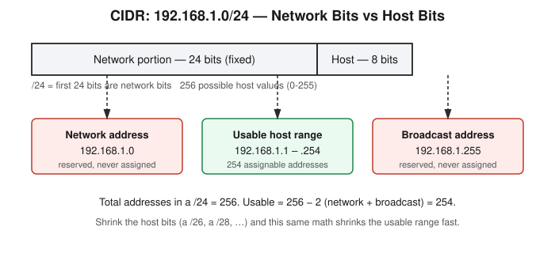

# Chapter 1: IP Addressing, CIDR, and the Interface Flags Nobody Explains

## Learning objectives

By the end of this chapter, you will be able to:
- Split any IPv4 address and CIDR prefix into its network portion and host portion.
- Calculate the network address, broadcast address, and usable host range for any CIDR block.
- Explain the difference between a MAC address and an IP address, and why both are needed.
- Distinguish an interface's administrative state (`UP`) from its physical link state (`LOWER_UP`).

## The concept

Every piece of networking, scanning, and segmentation logic in this book rests on one skill: given an IP address and a CIDR prefix, knowing instantly which addresses belong to the same network and which don't. It looks like arithmetic trivia the first time you see it. It isn't — it's the foundation everything else assumes you already have solid.

An IP address by itself is just a number. What actually defines a network is the *combination* of an address and a subnet mask. The subnet mask (or its CIDR shorthand, the `/24` in `192.168.1.0/24`) tells you how many bits of the address are the **network portion** — fixed, shared by every device on that network — and how many are the **host portion**, the part that varies device to device. A `/24` dedicates the first 24 bits to the network and leaves 8 bits for hosts, which is 256 possible values.

Not all 256 of those values are usable, though. Every CIDR block reserves exactly two addresses: the **network address** (all host bits zero — it identifies the network itself and is never assigned to a device) and the **broadcast address** (all host bits one — used to address every device on the segment at once, also never assigned to a device). Everything in between is the usable range. For a `/24`, that's 256 total minus 2 reserved, leaving 254 usable addresses. The diagram below works through this for `192.168.1.0/24`.

The same logic applies at any prefix length — it just scales. A `/26` has only 6 host bits (64 total addresses, 62 usable). A `/28` has 4 host bits (16 total, 14 usable). Every time you shrink the host-bit count by one, the usable range cuts roughly in half. This is literally the math network engineers use to carve up address space for departments, VLANs, or environments — a skill that comes back constantly once this book reaches reconnaissance and network segmentation.

A second, separate idea from this day: **MAC addresses versus IP addresses**. An IP address is a logical address — assigned, and it can change depending on what network you're on. A MAC address is burned into the network interface hardware itself and is used for addressing on the local network segment, one hop at a time. IP addresses get a packet across networks; MAC addresses get it the last short hop to a specific physical device. Exactly how those two cooperate is the subject of Chapter 2, once ARP enters the picture.

Finally, a small but genuinely useful detail: interface status flags. When you inspect a network interface, you'll often see both `UP` and `LOWER_UP`, and it's tempting to read them as the same thing. They aren't. `UP` means the interface has been *administratively* enabled — software says it should be active. `LOWER_UP` means there is an actual physical link detected — a cable plugged in, a radio link established, something real on the other end. An interface can absolutely be `UP` but not `LOWER_UP`: enabled in software, with nothing physically connected. That distinction matters the moment you're troubleshooting connectivity, or later in this book, when deciding whether a target host is actually reachable versus merely configured to look that way.

## Hands-on lab recap — SIMULATED

This day's "hands-on" component was a set of worked subnetting problems rather than a running lab environment — there was no server or container to build yet, since the goal was pure address-math fluency before anything gets connected. The exercise walked through `192.168.1.0/24` broken into its network address (`192.168.1.0`), broadcast address (`192.168.1.255`), and usable range (`.1` through `.254`), then repeated the same process for `/25`, `/26`, and `/28` blocks to see how fast the usable range shrinks as host bits disappear. All of the worked examples came out correct on the first pass — a solid confidence builder for the rest of the networking phase.

## Review questions

1. For the network `10.0.0.0/28`, what is the network address, the broadcast address, and how many usable host addresses are there?
2. What's the practical difference between an IP address and a MAC address, in terms of what each one is actually used for?
3. If an interface shows `UP` but not `LOWER_UP`, what does that tell you — and what would you check next?

### Answers

1. Network address `10.0.0.0`, broadcast address `10.0.0.15`, and 14 usable addresses (`10.0.0.1`–`10.0.0.14`) — a `/28` has 4 host bits, 16 total addresses, minus 2 reserved.
2. An IP address is a logical, assignable address used to route traffic across networks; a MAC address is a hardware address burned into the network interface, used to deliver frames on the local network segment itself.
3. It means the interface is administratively enabled but has no physical link — the cable is unplugged, the radio link isn't established, or the physical layer otherwise isn't connected. The next step is to check the physical connection itself, not the software configuration.

## Operational takeaway

> Always check interface state before trusting that an IP is reachable — `UP` alone doesn't mean connected.

## Today in the broader CEH journey

This chapter opens Phase 1 — Foundations, and everything in it is deliberately unglamorous on purpose: subnet math, address ranges, interface flags. None of it is exciting yet, but every later chapter in this book — scanning in Phase 2, segmentation questions in vulnerability assessment, even reading a lab's Docker network diagram — assumes this math is instant and automatic. Chapter 2 picks up exactly where this one stops: once you know which network an address belongs to, what actually happens when a packet needs to leave that network?
