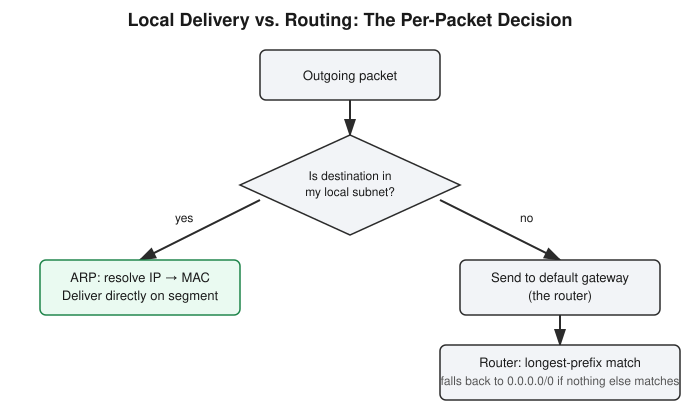

# Chapter 2: Local Delivery, ARP, and How Routers Actually Decide

## Learning objectives

By the end of this chapter, you will be able to:
- Explain the local-vs-routed delivery decision every outgoing packet makes.
- Describe what ARP does and why local delivery depends on it.
- Read a routing table and apply longest-prefix-match logic correctly.
- Explain what the default route `0.0.0.0/0` is for and when it actually gets used.

## The concept

Chapter 1 established how to tell which addresses share a network. This chapter answers the next question: once your computer knows which network a destination is on, what actually happens?

Every outgoing packet starts with exactly one check: *is the destination address inside my own local network range, or not?* Your computer already knows its own range from its IP address and subnet mask, so this is a simple comparison. If the destination falls inside that range, delivery is **local** — the packet goes straight there on the local network segment, no router involved. If it falls outside that range, your computer can't deliver it directly; it needs help, and that help is the **default gateway**.

Local delivery has its own hidden step, though. Your computer only knows the destination's *IP* address — it doesn't automatically know the destination's *MAC* address, which is what's actually required to deliver a frame on a local segment. That's the job of **ARP**, the Address Resolution Protocol: your computer broadcasts a request effectively asking "who has this IP address," the owning device answers with its MAC address, and delivery can now actually happen. ARP is the missing piece that makes local delivery work in practice, not just in theory — and it's why Chapter 1's distinction between IP and MAC addresses matters immediately, not just academically.

When the destination isn't local, your computer hands the packet to its default gateway — almost always the router. The router doesn't blindly forward everything to one place; it keeps a **routing table**, a list of known destination networks and which direction to send traffic for each one. When more than one entry in that table could technically match a destination, the router doesn't pick the first one or the most recently added one — it uses **longest-prefix-match**: the most specific matching route always wins over a broader, less specific one. A route for `10.0.0.0/24` beats a route for `10.0.0.0/16` for a packet headed to `10.0.0.5`, even though both technically match, because `/24` is more specific.

Every routing table also carries one guaranteed fallback entry: the **default route**, written `0.0.0.0/0`. It's the least specific route possible — it matches literally everything — which is exactly why it's only used when nothing more specific matches. It's the "I don't know a better path, so send it toward the internet" rule.

The useful mental correction here: it's tempting to picture "the router" as one all-knowing thing that magically knows how to reach everything on the internet. It doesn't. It has a table of known routes and one simple precedence rule, applied over and over, hop after hop. The apparent intelligence of internet-scale routing is really just this same small decision repeated at scale.

## Hands-on lab recap — SIMULATED

Today's exercise was conceptual rather than a built lab: working through routing-table scenarios by hand to apply longest-prefix-match correctly, and reasoning through what happens at each hop for a packet leaving a local network. No containers or real network infrastructure were built for this session — the goal was building the mental model that Chapter 3 then plugs into a real request flow, and that later chapters' Docker lab networks assume you already have.

## Review questions

1. If a router has both a route for `10.0.0.0/24` and a route for `10.0.0.0/16`, and a packet is headed to `10.0.0.5`, which route wins, and why?
2. What specific protocol resolves an IP address into a MAC address for local delivery?
3. What is the actual purpose of the `0.0.0.0/0` route, and when does a router actually use it?

### Answers

1. The `10.0.0.0/24` route wins — it's more specific (longer prefix) than `10.0.0.0/16`, and routers always prefer the most specific matching route.
2. ARP — the Address Resolution Protocol.
3. It's the default/catch-all route, matching every destination. A router only falls back to it when no more specific route in the table matches the destination.

## Operational takeaway

> Your computer never assumes it can reach something directly — it always checks "is this local" first, and only reaches for the router when the answer is no.

## Today in the broader CEH journey

Still inside Phase 1 — Foundations, this chapter is the connective tissue between Chapter 1's address math and Chapter 3's full request flow. Routing and ARP explain *how* a packet physically gets somewhere; Chapter 3 adds the two remaining pieces — DNS and TCP — and chains everything into one continuous story, from typing a URL to a page actually loading.
