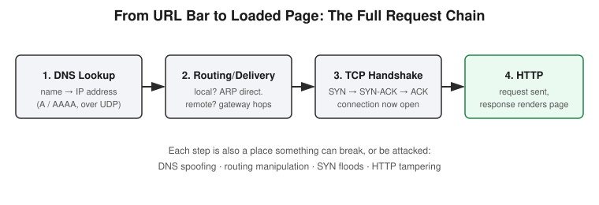

# Chapter 3: TCP, DNS, and the Full Request Flow

## Learning objectives

By the end of this chapter, you will be able to:
- Explain the difference between TCP and UDP and when each is the right tool.
- Walk through the TCP three-way handshake, including the sequence/acknowledgment numbers.
- Explain what the 4-tuple is and why all four parts are necessary.
- Trace a complete web request as one chain: DNS, routing, TCP, then HTTP.

## The concept

This chapter closes out the networking phase by adding the two missing pieces — TCP and DNS — and then, more importantly, chaining everything from the first three chapters into one continuous story.

Start with **TCP versus UDP**. TCP is connection-oriented and reliable: it guarantees data arrives, arrives in order, and resends anything lost. UDP is the opposite — no connection setup, no guarantees, just fire-and-forget packets. Neither is "better"; they're built for different jobs. TCP is right when correctness matters more than speed, like loading a web page. UDP is right when speed matters more than occasionally dropping a packet, like a quick DNS lookup or a live video stream.

TCP's reliability starts with the **three-way handshake**, and it's worth knowing the actual mechanics, not just the acronym. The client sends a `SYN` packet carrying an initial sequence number. The server responds with `SYN-ACK`, carrying its own sequence number plus an acknowledgment number equal to the client's sequence number plus one. The client finishes with `ACK`, acknowledging the server's sequence number plus one. Only after all three packets complete is the connection considered open and ready to carry real data.

Two more pieces fill out the picture: **well-known ports** (fixed, predictable ports a server listens on, like 80 for HTTP or 443 for HTTPS) versus **ephemeral ports** (temporary, randomly assigned ports the client side uses). Both ports, combined with both IP addresses, form the **4-tuple** — source IP, source port, destination IP, destination port — which is how an operating system tells apart hundreds of simultaneous connections that might all be headed to the same website.

Before any of that handshake happens, there's usually a **DNS lookup**, translating a human-readable name into an IP address via `A` records (IPv4) or `AAAA` records (IPv6). A detail worth sitting with: DNS runs over UDP, not TCP. That seems backwards — isn't reliability important? But a DNS lookup is small and needs to be fast; if a response is lost, the client just asks again. That's exactly the situation UDP is built for, which ties directly back to the TCP-vs-UDP distinction above.

The real payoff of this chapter is treating DNS, routing, TCP, and HTTP not as four separate topics but as **one continuous chain**: first, DNS resolves the domain name to an IP address. Second, using Chapter 2's routing logic, the packets get delivered — locally via ARP, or routed through gateways using longest-prefix-match — toward that IP address. Third, once packets can reach the destination, the TCP three-way handshake establishes a reliable connection. Only after that handshake completes does an HTTP request actually go out and a page start loading. Seeing it as one chain instead of four disconnected lessons matters because every step in that chain is also a place something can break or be attacked: DNS can be spoofed, routing can be manipulated, a TCP handshake can be abused for SYN floods, and HTTP itself can be tampered with. None of that makes sense without the full chain in view first.

The useful self-correction from this day: it's easy to let DNS "just happen" invisibly and stop thinking about it. The better habit is to treat DNS as a real step with its own protocol, its own transport choice, and its own failure modes — not just an invisible prerequisite. Skipping past it mentally is exactly how DNS-based attacks get missed later.

## Hands-on lab recap — SIMULATED

This session was a conceptual walkthrough rather than a built lab: tracing the full DNS → routing → TCP → HTTP chain by reasoning through each stage in order, including working out the handshake's sequence/acknowledgment numbers by hand. No live servers or packet captures were used yet — that comes in Chapter 7, once HTTP itself is on the table and a real server exists to connect to.

## Review questions

1. Why does DNS use UDP instead of TCP?
2. In the three-way handshake, what does the server's `SYN-ACK` acknowledgment number actually equal?
3. Name all four parts of the 4-tuple, and explain why all four are needed instead of just the two IP addresses.

### Answers

1. DNS lookups are small and need to be fast; if a response is lost, the client simply retries. That tradeoff — speed over guaranteed delivery — is exactly what UDP is designed for.
2. The client's initial sequence number, plus one.
3. Source IP, source port, destination IP, destination port. Two IP addresses alone can't distinguish between multiple simultaneous connections between the same two machines (e.g. several browser tabs open to the same site); the port numbers are what make each individual connection unique.

## Operational takeaway

> Every real connection is a chain of distinct steps — DNS, routing, the TCP handshake, then the actual protocol — and knowing that chain is what lets you reason about where things break or get attacked.

## Today in the broader CEH journey

This chapter closes Phase 1's networking block. Chapters 1 through 3 now form a complete mental model: addressing, delivery, and the full request chain. Chapter 4 pivots into Linux fundamentals — the operating system layer that everything from here on runs on top of — starting with the permission system that governs who can touch what on a machine.
