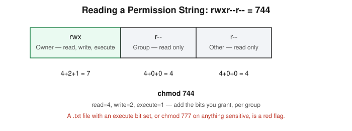

# Chapter 4: The Linux Filesystem and the rwx Permission String

## Learning objectives

By the end of this chapter, you will be able to:
- Name the purpose of the core Linux filesystem directories (`/bin`, `/etc`, `/home`, `/var`, `/tmp`, `/root`).
- Decode a permission string like `rwxr--r--` into owner/group/other access.
- Convert between the letter form and octal form of permissions, and use `chmod` correctly.
- Recognize a disguised-executable red flag and explain why `chmod 777` is a bad quick fix.

## The concept

This chapter opens Phase 1's Linux block with a question that sounds almost too simple: why would a plain text file ever need permission to execute? It wouldn't — and the moment you see one that can, that's a warning sign worth noting, not a curiosity.

Before getting to permissions, it's worth a quick pass on protocol hygiene, since the same pattern shows up again and again: some protocols send everything — including credentials — in plain readable text, and some encrypt it. Telnet and plain SMTP fall into the plaintext category; SSH is the encrypted replacement for the exact remote-access job Telnet used to do. This is the same pattern as HTTP versus HTTPS, which Chapter 7 proves empirically with a real packet capture. The lesson isn't new information so much as reinforcement: any plaintext protocol in a real environment is worth flagging.

The core Linux filesystem layout matters because a huge amount of security work boils down to one question: *does this file belong where it is, with the permissions it should have for that location?* `/bin` holds essential command binaries. `/etc` holds system-wide configuration. `/home` holds individual users' personal directories. `/var` holds variable data that changes over time, like logs. `/tmp` is temporary, usually world-writable storage, cleared periodically. `/root` is specifically the home directory for the root user, separate from everyone else's home directory under `/home`.

The heart of this chapter is the **permission string**. Every file and directory has a string made of three groups of three: read, write, and execute, for the owner, the group, and everyone else ("other"). `rwxr--r--` breaks down as: owner can read/write/execute; group can only read; other can only read.

That same structure can be written as a three-digit **octal** number, which is what `chmod` actually uses: read is worth 4, write is worth 2, execute is worth 1, summed per group. `rwx` becomes 7, `r--` becomes 4, so `rwxr--r--` becomes `744`. `chmod 700` grants full access to the owner and nothing to anyone else — correct for a sensitive script nobody else should touch. `chmod 777` grants full read, write, and execute to literally everyone on the system.

The mistake worth internalizing here is a habit, not a factual error: treating `777` as a quick fix whenever a permission error pops up. It does technically make the error go away — by removing all access control from the file entirely. The real fix is almost always narrower: adding one specific user to a group, or using `700` if the file should only ever be touched by its owner. Connecting `777` directly to real risk is the point: any user, any process, or any attacker who gets even low-level access to the system can now read, modify, or execute that file.

## Hands-on lab recap — SIMULATED

This session worked through permission strings and octal math by hand — decoding `rwxr--r--`, computing `chmod 700`, `chmod 744`, and `chmod 777`, and reasoning about a disguised `.txt` file with an execute bit set. No live filesystem or container was built for this exercise; it's foundational reasoning that Chapter 5 and Chapter 6 then apply to a real user/process model and a real privilege-escalation chain.

## Review questions

1. What does `chmod 644` actually grant, broken down by owner, group, and other?
2. Why is `chmod 700` the right call for a sensitive script instead of something looser?
3. If you saw a `.txt` file with permissions `rwxrwxrwx`, what two separate problems would you flag about it?

### Answers

1. `644` = owner read+write (6 = 4+2), group read-only (4), other read-only (4). No one but the owner can modify or execute it.
2. `700` grants the owner full access and denies everyone else entirely — appropriate when a script shouldn't be readable, writable, or runnable by any other account on the system, minimizing who could tamper with it or learn its contents.
3. First, a `.txt` file has no legitimate reason to be executable at all — an execute bit on a plain-text file is itself a red flag. Second, `777` means every user on the system (and any process running as any user) can read, modify, and execute it — there's no access control left on the file whatsoever.

## Operational takeaway

> Don't just read permission strings, question them — a file's permissions should always match what that file is actually supposed to do, and the moment they don't, that's worth investigating.

## Today in the broader CEH journey

This is the first of three Linux fundamentals chapters inside Phase 1. Permissions are the foundation Chapter 5 builds on (who a file belongs to) and Chapter 6 weaponizes into a full privilege-escalation chain (what happens when the "wrong" permissions meet a scheduled task running as root).
