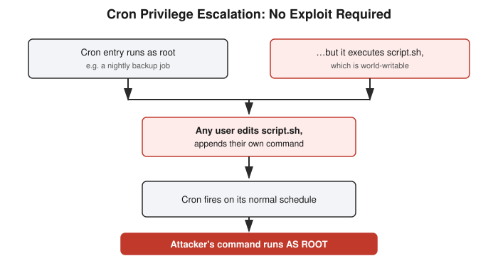

# Chapter 6: Cron Privilege Escalation — No Exploit Required

## Learning objectives

By the end of this chapter, you will be able to:
- Read cron's five time fields in order and decode a schedule correctly.
- Explain the full cron-to-root privilege escalation chain and the two conditions that both have to be true for it to work.
- Explain what package-manager GPG verification actually protects against.
- Identify the auth-log pattern that signals a successful brute-force login.

## The concept

Here's a common way attackers get root on a Linux system that involves no exploit at all — no buffer overflow, no zero-day, nothing clever. Just a scheduled job and a file permission mistake. This chapter closes out the Linux fundamentals block with that exact attack chain, worked through end to end in a real, isolated lab.

Reading cron syntax first: a cron entry has five time fields, followed by the command to run — minute, hour, day of month, month, and day of week, in that order. Once you know the order, almost any schedule becomes readable. `0 0 1 * *` reads as minute zero, hour zero, day-of-month one, any month, any day of week — in plain terms, "run once, at midnight, on the first day of every month."

The core lesson is the privilege-escalation chain itself. Say a cron job is configured to run **as root** — extremely common, since jobs that handle backups, cleanup, or system maintenance often need root-level access to do their job. Now say the script that job actually executes has permissions that let **any user write to it**. Those two facts combined are the entire vulnerability: any user can open that script and add whatever command they want. The next time cron fires that job on schedule, it runs the script as root — including the attacker's injected command — with full root privilege, no questions asked.

What makes this important to really internalize is that there's no exploit in the traditional sense here. Nothing is "hacked" in the dramatic sense. It's a permission misconfiguration being automatically and faithfully executed by a scheduler that has no concept of "should I trust what's in this file." The same mechanism that makes cron useful for system administration — reliably running things on a schedule — is exactly what makes this misconfiguration dangerous. It's also a common way attackers maintain **persistence** after a compromise: planting a cron job that quietly re-establishes access even if the original foothold gets cleaned up.

A critical mental correction belongs here: assuming "root-owned" automatically means "safe." A cron job being owned by root only tells you *who it runs as* — it tells you nothing about whether the script it executes is protected from modification by someone else. Ownership of the schedule entry and permissions on the actual script file are two completely separate questions, and conflating them is exactly how this vulnerability gets missed.

Two supporting topics round out the Linux phase. First, **package verification**: `apt` and `yum` verify a GPG signature on each package against trusted repository keys before installing anything — a cryptographic guarantee the package came from where it claims and hasn't been tampered with. Installing a `.deb` directly with `dpkg -i`, or manually running a downloaded binary, skips that verification by default — not automatically malicious, but it does mean you're trusting the source yourself instead of having that trust verified for you.

Second, **log sources**: `/var/log/auth.log` (or `/var/log/secure` on some distributions) records authentication events — logins, `sudo` usage, SSH connections. `/var/log/syslog` (or `/var/log/messages`) records general system activity more broadly. A specific pattern worth recognizing: a string of repeated failed login attempts from the same IP, followed by a success, is the textbook signature of a successful brute-force attack — exactly the pattern that feeds real alerting rules and tools like `fail2ban`.

## Hands-on lab recap — REAL LAB

This was a real, hands-on privilege-escalation lab built on an isolated local container, following the same containment pattern used throughout this course: a root-owned cron job was configured to execute a script, and that script was left world-writable. Editing the script to append an attacker-controlled command, then waiting for cron's next scheduled run, produced arbitrary code execution as root — reproducing, start to finish, exactly the chain described above rather than just reading about it. The full attack chain was worked out independently before it was fully explained, including correctly identifying that "root-owned" and "world-writable script" are two separate conditions that both have to hold for the exploit to work.

## Review questions

1. What two separate conditions both have to be true for the cron privilege escalation to actually work?
2. What does a package manager's GPG signature check actually protect you from that a manual install doesn't?
3. What specific log pattern indicates a brute-force login attempt that succeeded, and where would you look for it?

### Answers

1. A cron job must run as root (or another privileged user), *and* the script or file that job executes must be writable by someone other than that privileged owner. Either condition alone is not exploitable — both have to hold together.
2. It cryptographically verifies the package came from a trusted source and hasn't been tampered with in transit — a manual install (`dpkg -i`, or running a downloaded binary) skips that verification, so you're trusting the source yourself instead of having it proven.
3. A string of repeated "Failed password" entries from the same IP address, followed by an "Accepted password" entry from that same IP — found in `/var/log/auth.log` (or `/var/log/secure`).

## Operational takeaway

> Never assume a root-owned scheduled task is automatically safe — check the permissions on everything that task actually touches, because the ownership of the schedule and the protection of the script are two different questions.

## Today in the broader CEH journey

This chapter closes out Phase 1's Linux block and is this book's first REAL LAB — a real privilege-escalation chain built and exploited in an isolated container rather than simulated. It sets the pattern every later lab in this book follows: build it for real, exploit it for real, fix it, and re-verify. Chapter 7 closes Phase 1 entirely with HTTP fundamentals, proving a related point — that "plaintext means readable" — with an actual packet capture.
