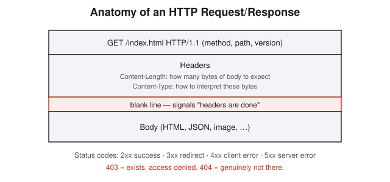
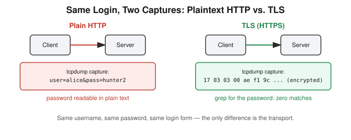

# Chapter 7: HTTP Fundamentals — Proving TLS Matters With a Packet Capture

## Learning objectives

By the end of this chapter, you will be able to:
- Describe the structure of a raw HTTP request/response, including why the blank line matters.
- Explain the cookie round trip (`Set-Cookie` / `Cookie`) and what the `HttpOnly` flag protects against.
- Correctly distinguish a `403 Forbidden` from a `404 Not Found`.
- Explain, with real evidence rather than assertion, why TLS protects credentials on the wire.

## The concept

This chapter closes Phase 1 — Foundations, and it earns that closing with a genuinely striking piece of evidence: the same username and password, logged in twice, once over plain HTTP and once over TLS, captured both times with a packet sniffer. On the plaintext capture, the password is sitting there in clear, readable text. On the TLS capture, searching that same file for the same password returns nothing — not scrambled, gone. That's not a diagram or an assertion; it's a real password showing up or not showing up on screen.

Start with the anatomy of a real HTTP request, inspected with `curl -v` against a real nginx server instead of a diagram. A request is a method (`GET`), a path, and a version number, followed by a block of headers, then a completely blank line, and then the body. That blank line isn't decoration — it's the one signal telling the receiving computer "headers are done, everything after this is content." Get that wrong and the whole parser breaks.

Two headers matter a lot here. `Content-Length` tells the receiver exactly how many bytes of body to expect, so it knows when to stop reading. `Content-Type` tells it how to interpret those bytes — HTML, JSON, an image, whatever. A `Server` header in the response happily announces the exact web server software and version — a small detail in isolation, but a big deal later: that's literally how attackers fingerprint what software a target is running before searching for a known vulnerability in it.

**Status codes** aren't arbitrary. `2xx` means success, `3xx` means "look somewhere else," `4xx` means the client did something wrong, `5xx` means the server broke. This simple categorization turns out to be the backbone of a security distinction that's easy to get wrong the first time (more on that below).

**Cookies and sessions** work as a simple round trip: the server responds to a first request with a `Set-Cookie` header; the client stores it; on the very next request, the client automatically sends that same cookie back in a `Cookie` header, with no extra code required. That round trip is the entire mechanism behind "staying logged in" on every website. The `HttpOnly` flag on a cookie blocks JavaScript running on the page from reading that cookie at all — only the browser's own request machinery can touch it. That's a direct defense against cross-site scripting stealing a session, a topic this book returns to later in Phase 4.

Then the TLS proof itself: two logins to a test server, identical username and password, captured with `tcpdump`. The first ran over plain HTTP. The second ran over TLS, using a self-signed certificate. On the plaintext capture, the raw packet data contained the login string in plain readable characters. On the TLS capture, a `grep` for that exact password string returned zero matches — not hidden elsewhere in the file, genuinely absent, because the entire payload was encrypted before it ever touched the network.

## Hands-on lab recap — REAL LAB

This was a real, hands-on lab: a real nginx web server running in an isolated Docker container, probed with `curl -v` to inspect live request/response structure, with real `200` and `404` responses observed directly. A custom Python HTTP server was built to watch a session cookie get created and echoed back in real time, including its `HttpOnly` flag. Most notably, a real TLS proof was carried out with `openssl s_server` generating a self-signed certificate and `tcpdump` capturing two separate login attempts — one plaintext, one TLS — with the password visible in the first capture and completely absent from the second when searched for directly.

The one mistake worth flagging honestly: on first seeing a `403 Forbidden` response, the initial instinct was "that's a wrong password." It's not. A `403` means the server found the resource and is deliberately blocking access to it — it exists, access is denied. A `404` means there's genuinely nothing there. That distinction is exactly the signal an attacker uses to map out which hidden pages or admin panels actually exist on a server, just by watching which status code comes back — and it's a mistake worth catching now, since Chapter 8 moves straight into real reconnaissance.

## Review questions

1. What's the practical difference between a `403` and a `404` response, and why would an attacker care about that difference?
2. What does the `HttpOnly` flag actually prevent?
3. If `Content-Length` is missing or wrong on a response, what problem could that cause for the client reading it?

### Answers

1. `403` means the resource exists but access is deliberately denied; `404` means nothing exists at that path at all. An attacker cares because this difference lets them map which protected resources (and therefore which paths are worth attacking) actually exist on a server, just by observing status codes.
2. It prevents JavaScript running on the page from reading that cookie's value at all — only the browser's own HTTP request machinery can send it, which blocks a common session-theft technique via cross-site scripting.
3. The client wouldn't know exactly how many bytes of body to read — it could cut the response off early (truncated content) or hang waiting for bytes that will never arrive, depending on how the mismatch runs.

## Operational takeaway

> "Private" doesn't mean "protected" — a network you trust is not the same as a network that's encrypted, and a real packet capture proves that with an actual password, not a slide.

## Today in the broader CEH journey

This chapter closes Phase 1 — Foundations entirely. Addressing, routing, TCP/DNS, Linux permissions and privilege, and now HTTP and TLS are all established. Every later chapter in this book — Phase 2's reconnaissance, Phase 3's vulnerability assessment, and Phase 4's web application attacks — assumes this foundation is solid. Chapter 8 opens Phase 2 by turning this same HTTP fluency outward, toward real reconnaissance against real infrastructure.
