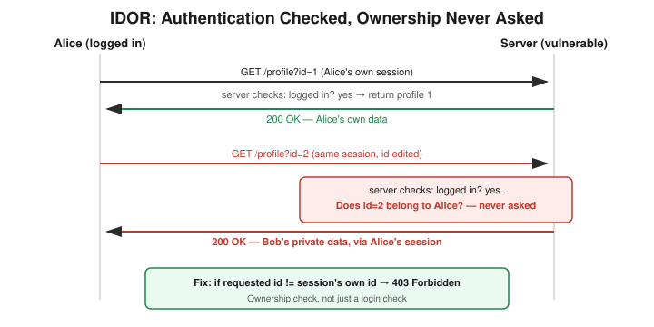

# Chapter 11: Why a Clean Scan Can Still Miss a Critical Bug

## Learning objectives

By the end of this chapter, you will be able to:
- Name the three reasons a vulnerability scan can report "clean" when it isn't.
- Explain exactly which of those three problems a credentialed scan does and doesn't fix.
- Define IDOR and explain why it falls under Broken Access Control.
- Explain why "zero critical findings" is not the same as "secure."

## The concept

Chapter 10 covered false positives — a scanner wrongly flagging something that's actually fine. This chapter is the more dangerous flip side: **false negatives**, where a scanner misses something that's actually broken.

There are three main reasons a scanner can report "clean" when it isn't. First, the scan was **unauthenticated** — if a scanner only ever visits a site as an anonymous visitor, it never sees what happens once you're logged in, so a vulnerability that only exists behind a login is simply invisible to it. Second, **custom application logic** — scanners work by matching known patterns (known bad versions, known bad paths, known bad headers), and a bug unique to how a specific app was built has no pattern to match; there's no CVE number for "this user ID isn't checked against the session." It's not that the scanner performs badly — this category of bug is outside its job description entirely. Third, **active defenses blocking the scan itself** — a web application firewall or rate limiter can detect scanning behavior (rapid requests, a recognizable scanner user-agent) and throttle or drop that traffic, so the scanner reports "no issues found" when the truth is it was never actually let through the door.

A useful test to work through: if you upgrade to a **credentialed scan** — one configured with valid login credentials — which of those three problems does that actually fix? Only the first one. Credentials solve a *visibility* problem — the scanner can now reach logged-in pages. They don't solve an *understanding* problem — the scanner still has no idea what "my own data" is supposed to mean in a given app. And they don't solve an *interference* problem — a WAF doesn't care whether a request is logged in, it cares whether the traffic pattern looks automated, and logging in doesn't change that signature.

To make this concrete: a tiny real application with a login page and a profile page at a URL like `/profile?id=1`. Logging in redirects to your own profile using your own user ID. Running a real, widely used scanner against this app with no login at all checks thousands of items and finds exactly two things — both trivial and both beside the point. Then, logging in as a real user and loading your own profile works correctly. One more request — same session cookie, same login, nothing escalated — just changing the number in the URL from your own ID to a different user's ID — and it works. Another user's private data, through your own ordinary session, just by editing a number in a URL.

That's an **IDOR** — an Insecure Direct Object Reference. The bug isn't that authentication was missing; the session was fully, legitimately logged in. The bug is that the app never checked whether the record being requested actually belonged to the requester. It checked "are you logged in," and stopped there — it never asked "is this yours." IDOR falls under the broader OWASP category called **Broken Access Control**, which Chapter 13 names formally.

The fix is a single comparison: instead of trusting whatever ID shows up in the URL, the server looks up the ID that belongs to the current session and rejects any request for a different one. Applying that fix and re-running the exact same attack produces a clean `403 Forbidden` — fixed, and verified, not just patched and hoped.

The mistake worth flagging from this session: when first reasoning through which false-negative cause a credentialed scan fixes, the WAF-blocking scenario was initially included too — "well, now it's a legitimate logged-in request, so it should get through." That mixes up two completely different things a security control checks. Authentication answers "who are you." A WAF or rate limiter answers a totally different question: "does this traffic pattern look automated." Those are independent checks, and fixing one doesn't touch the other — a reminder to ask precisely which problem a given fix solves, rather than assuming any one fix is a cure-all.

## Hands-on lab recap — REAL LAB

This was a real lab: a small real application with a login page and an ID-based profile page, running in an isolated Docker container. A real, widely used scanner (nikto) was run against it unauthenticated and checked over 6,500 items, reporting only two minor findings. A real login was then performed via `curl`, saving a genuine session cookie, and a second real `curl` request — same cookie, only the `id` parameter changed — pulled another user's private data. The fix (an ownership check comparing the requested ID against the session's own ID) was applied for real, the container rebuilt, and the exact same attack re-run to confirm it now failed cleanly while legitimate login still worked.

## Review questions

1. Your vulnerability scan comes back with zero critical findings, and your manager wants to ship based on that report. What's your one-sentence pushback?
2. In this lab, the app checked "are you logged in" but never checked what specific thing — and what's the general name for that vulnerability class?
3. Why couldn't a generic scanner have found this IDOR bug, even if handed a valid, logged-in session cookie to scan with?

### Answers

1. A clean unauthenticated scan only proves there's nothing visible to an anonymous user — a small fraction of the real attack surface — so a credentialed scan plus manual testing is needed before calling anything secure.
2. The missing check was whether the requested record actually belongs to the logged-in user — that's Broken Access Control, specifically an IDOR (Insecure Direct Object Reference).
3. Because there's no signature, no CVE, no generic pattern for "this app's specific business rule is broken" — catching it requires something that actually understands what the app is supposed to do, which is exactly what a signature-matching scanner doesn't do.

## Operational takeaway

> A clean scan report is not a security sign-off. It only proves the scanner's signatures found nothing within the access level it was given — authorization bugs like this almost always require manual or credentialed, logic-aware testing to catch.

## Today in the broader CEH journey

Still inside Phase 3 — Vulnerability Assessment, this chapter's real IDOR lab becomes a recurring reference point: Chapter 12 uses it directly to illustrate credentialed-versus-uncredentialed scanning, and Chapter 13 formally names this exact bug class as Broken Access Control, the OWASP Top 10's number one category, right as Phase 4 begins.
