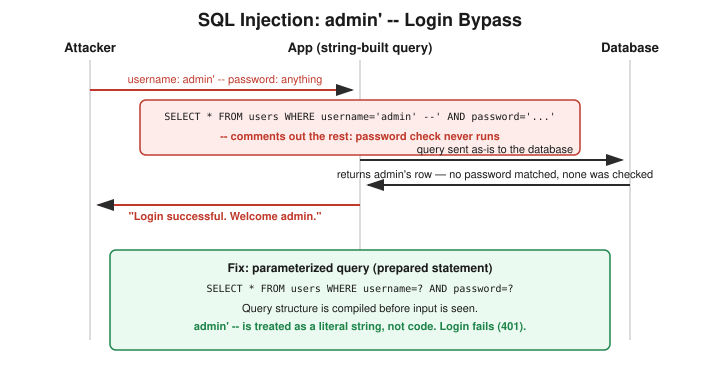

# Chapter 13: SQL Injection — Building, Exploiting, and Fixing a Real Login Bypass

## Learning objectives

By the end of this chapter, you will be able to:
- Define Broken Access Control and distinguish authentication from authorization precisely.
- Explain the SQL injection mechanism: how unsanitized input changes a query's logic.
- Explain why operator precedence (`AND` binding tighter than `OR`) can silently break a naive injection payload.
- Explain why parameterized queries fix SQL injection at a mechanical, structural level.

## The concept

This chapter opens Phase 4 — Web Security and the OWASP Top 10, the industry-standard list of the most critical web application security risks, and it starts by closing a loop from Chapter 11.

That earlier lab had a bug where changing a number in a URL let any logged-in user view someone else's private data — the exploit and the mechanism were both understood, but not yet its official industry name. That name is **Broken Access Control**, literally the number one category in the OWASP Top 10. The key distinction underneath it: **authentication** asks "who are you" — did you prove your identity, usually via login. **Authorization** asks a completely separate question: "now that I know who you are, what are you allowed to do." The Chapter 11 bug passed authentication perfectly — the session really was logged in — but failed authorization, because the app never checked whether that session was allowed to view the specific resource requested. Broken Access Control, in one sentence: authentication succeeds, the permission check on the resource doesn't happen.

From there, this chapter moves into one of the most historically damaging web vulnerabilities there is: **SQL injection**. The core idea is that a lot of web apps build database queries by directly pasting user input into a string instead of treating that input as pure data. If an attacker controls part of that string, they can inject their own SQL logic into the query. Take a classic login query: select everything from the users table where username equals whatever was typed, and password equals whatever was typed. If the app concatenates raw input straight into that string, typed input doesn't just supply a username — it can change what the query actually *does*.

The classic payload is a single quote followed by `OR '1'='1'`. The mechanism: the quote closes the string the developer's code already opened, so the SQL still parses correctly. Then `OR '1'='1'` adds a condition that's always true for any row — comparing the literal text "1" to itself, unrelated to any real data. Connected with `OR`, if either side of the condition is true, the whole thing is true, so every row suddenly satisfies the `WHERE` clause.

Here's where it gets genuinely interesting — and this chapter's most valuable lesson is a mistake caught and corrected in real time, not a clean explanation delivered the first time. Proposing the payload `' OR '1'='1'` with nothing extra at the end, against a query checking both username **AND** password, runs into a precedence trap: in SQL, `AND` binds tighter than `OR` — the same way multiplication binds tighter than addition in ordinary math. The query doesn't evaluate left to right; it groups as `username-check OR (the-true-condition AND password-check)`. If the password guess is wrong, that entire `AND` group is false, leaving just the original (also false) username check — the clever-looking bypass actually fails. The real, working version adds a SQL comment marker — two dashes — right after the injected condition. That comment deletes everything after it in the query, including the entire `AND password` check, so the database never evaluates a password at all. The comment isn't decoration; it's doing the actual work of removing the competing condition that precedence would otherwise let survive.

Building and exploiting a real vulnerable login app (Flask + SQLite, in an isolated container, with the query built via an f-string exactly like the textbook vulnerable pattern) makes this concrete. `' OR '1'='1' --` in the username field logs in as whichever account comes back first from the database — not necessarily a chosen target, since the app only reads the first matching row. To specifically target the admin account, the precise payload `admin' --` works better: it matches the real username "admin" directly, then comments out the password check entirely, skipping the `OR` trick altogether. The result is a login as admin and access to its private data, using a password that belonged to a completely different account.

The fix is **parameterized queries**, also called prepared statements — not "sanitize the input" in some vague sense, but a structural change: the username and password are passed as separate bound parameters using placeholder question marks in the query, and the database compiles the query's structure *before* it ever sees the input. There's no parsing step left where a quote or comment marker could change what the query does. Rebuilding the app with this fix and re-running the exact same exploit fails cleanly with a login error, while a legitimate login still works perfectly.

## Hands-on lab recap — REAL LAB

This was a real, hands-on lab: a vulnerable Flask and SQLite login app, built from scratch and run in an isolated Docker container on its own network — the same containment pattern used in every lab throughout this book. A normal login was confirmed working first. The exploit `' OR '1'='1' --` was then run for real, followed by the more targeted `admin' --`, which produced a genuine admin-level login and access to admin's real (lab) secret data. The fix — converting the vulnerable f-string query to a parameterized query — was applied for real, the container rebuilt, and the exact same exploit re-run to confirm it now failed cleanly (a `401`) while legitimate login continued to succeed. UNION-based injection and blind/time-based injection were introduced by name as further escalation paths but were not lab-exercised this session — they're parked for a future dedicated session.

## Review questions

1. What's the difference between authentication and authorization, and which one did the Chapter 11 access-control bug fail, versus which one would a "no login required at all" bug fail?
2. In your own words, why does `' OR '1'='1' --` work as a SQL injection payload — what are the two separate things that payload is doing to the query?
3. What is the actual fix for SQL injection, and why does it work at a mechanical level — what does the database do differently with it?

### Answers

1. Authentication asks "who are you"; authorization asks "what are you allowed to do." The Chapter 11 bug failed authorization — the session was genuinely logged in, but the app never checked ownership of the requested resource. A "no login required at all" bug would instead be an authentication failure.
2. The `OR '1'='1'` portion adds a condition that's always true for every row, bypassing the intended username/password match logically; the trailing `--` comment strips out everything after it in the query — including any competing `AND password` check that operator precedence would otherwise leave intact — so the database never evaluates a password at all.
3. Parameterized queries (prepared statements): the query's structure is compiled by the database before the input values are ever substituted in, so user input is always treated as literal data, never as part of the query's logic — removing the parsing step that injection payloads depend on.

## Operational takeaway

> Never build a SQL query by concatenating user input into the query string — always use parameterized queries, so the database separates code from data at the structural level, not just through input filtering a clever payload might slip past.

## Today in the broader CEH journey

This chapter opens Phase 4 — Web Security and the OWASP Top 10, the newest and (as of this writing) most recent phase of the course. It formally names Broken Access Control (first seen hands-on in Chapter 11) and delivers this book's most detailed exploit-build-fix cycle yet. The syllabus's next likely stops — Cross-Site Scripting, CSRF, and session attacks — continue Phase 4 and will form the next chapters of this book as the course progresses.
