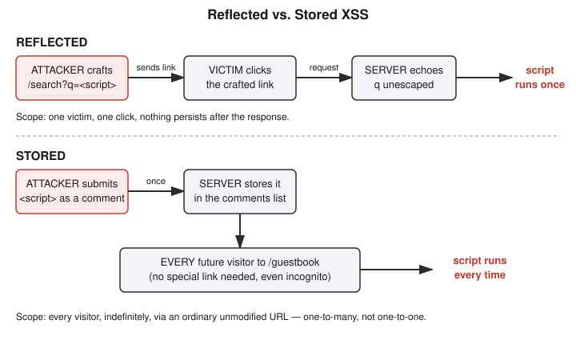

# Chapter 14: Cross-Site Scripting — Making the Victim's Own Browser Betray Them

## Learning objectives

By the end of this chapter, you will be able to:
- Explain Cross-Site Scripting (XSS) as the same class of bug as SQL injection, but targeting the browser instead of a database.
- Distinguish reflected XSS from stored XSS by blast radius and delivery mechanism, not just by definition.
- Explain what `HttpOnly` does and does not protect against.
- Explain why auto-escaping and parameterized queries share a goal but use different mechanisms.

## The concept

Chapter 13 covered SQL injection: untrusted input getting concatenated into a database query, which the database then executes as code instead of treating as plain data. **Cross-Site Scripting (XSS)** is the same family of bug, with one thing swapped out — instead of tricking a database into running attacker-controlled code, XSS tricks the **victim's own browser** into running attacker-controlled JavaScript, inside the trusted context of the real site. That's what makes it dangerous: the script doesn't run as some anonymous outsider — it inherits whatever the logged-in victim's browser already has access to, including cookies, active sessions, and the ability to make requests as that user.

There are three recognized flavors. **Reflected XSS** happens when the malicious payload rides in on the request itself — typically a URL query parameter — and the server immediately echoes it back into the response, unescaped. **Stored XSS** happens when the payload gets saved server-side (a comment, a profile field, anything persisted) and then served to every visitor who later loads that page. **DOM-based XSS** is a variant where the vulnerability lives entirely in client-side JavaScript writing untrusted data into the page (e.g. via `innerHTML`) without the server being involved in that particular round-trip at all; this chapter's lab covers reflected and stored, with DOM-based XSS introduced here only by name for a future session.

The practical difference between reflected and stored comes down to blast radius and how the payload is delivered. Reflected XSS requires the attacker to get a specific victim to trigger a specific crafted request — usually by clicking a link, since manually retyping a long malicious URL is unrealistic. That makes reflected XSS fundamentally a **one-to-one**, social-engineering-dependent attack: the hook (a shortened link, a phishing email, a QR code) matters as much as the payload itself, and the attack lives in the delivery channel even when the underlying vulnerable category never changes. Stored XSS needs none of that. The attacker submits the payload once, it gets saved into the application's own data, and from then on **every** visitor who loads that page gets attacked automatically via a perfectly ordinary, unmodified URL — no suspicious link required, no trickery needed beyond doing what any normal visitor would do anyway. That's a **one-to-many** attack with, in the worst case, an unbounded number of victims for as long as the payload stays stored.

## Hands-on lab recap — REAL LAB

This was a real, hands-on lab, deliberately run **without** Docker this time — a plain Python virtual environment and a Flask dev server, from a working directory at `/yml/install/security-learn/xss-lab/`. Unlike the privilege-escalation and SQL injection labs earlier in this book, nothing here touches the filesystem, a database, or needs process/user isolation, so a bare local server was a reasonable and faster choice for this specific vulnerability class.

The vulnerable app had two routes. `/search` took a `q` query parameter and rendered it back into the page inside a Jinja2 template using the `|safe` filter — a filter that explicitly tells Flask "skip your normal auto-escaping and render this as raw HTML." `/guestbook` did the same thing with a `name` field submitted via a form, appending it to an in-memory list of comments and rendering every entry with `|safe` as well. Flask auto-escapes template variables by default specifically to prevent this class of bug, so recreating the vulnerability meant deliberately switching that protection off — a realistic stand-in for the kind of legacy or careless code where `|safe` (or an equivalent "trust this string" escape hatch) gets added for formatting convenience and never revisited.

The reflected exploit: navigating to `/search?q=` produced a real JavaScript alert popup in the browser, proving the payload executed as code rather than displaying as literal text. The stored exploit: submitting the same `` payload as a guestbook entry triggered the alert immediately on submission, and — critically — fired again on every subsequent page load, including in a completely fresh incognito browser window with no prior cookies or session state. That incognito confirmation is what makes stored XSS's persistence tangible rather than theoretical: the payload lives in the server's data now, not in anyone's individual browsing history.

The fix mirrored Chapter 13's lesson precisely, just with a different mechanism: remove `|safe` from both templates and let Flask's default auto-escaping do its job, converting characters like `<` and `>` into their HTML-encoded equivalents (`&lt;`, `&gt;`) before they ever reach the browser's HTML parser. After the fix, restarting the app and re-running both exploits produced the literal text of the script tag printed harmlessly on the page — no alert, no execution, confirmed in both the reflected and stored cases.

One important boundary discussed alongside the fix: escaping assumes the goal is plain text output. A feature that legitimately needs to allow *some* HTML — a rich-text comment box with bold or italic formatting, for instance — can't just escape everything, since that would break the intended formatting too. That case needs a proper HTML sanitizer library that allow-lists specific safe tags and attributes, rather than either extreme of "escape everything" or "trust everything."

A related mechanism question came up directly: is escaping "the same fix" as Chapter 13's parameterized queries? The honest answer is that they share a *goal* — never let untrusted data be interpreted as code or structure — but they achieve it through genuinely different *mechanisms*. Parameterized queries never mix the data into the query string at all; the query's structure and the data travel to the database separately, so the data is never parsed as SQL syntax in the first place. HTML escaping still embeds the data directly into the same HTML document, but transforms the dangerous characters so the parser can't interpret them as markup. One is out-of-band separation; the other is in-band encoding. Both get to the same place, but knowing which mechanism is in play tells you what else it does or doesn't protect against.

That distinction connects to one more thing worth being precise about: the `HttpOnly` cookie attribute, introduced back in Chapter 7's HTTP fundamentals. `HttpOnly` tells the browser to exclude a cookie from anything JavaScript can read — so `document.cookie` simply won't include it, even on a page where an XSS payload is proven to run. The browser still attaches that cookie to outgoing HTTP requests automatically, exactly as before. `HttpOnly` doesn't stop XSS from happening at all — it only removes session-cookie theft as *one specific payoff* of an XSS bug that already exists. It's a damage-limitation control, not a fix for the underlying vulnerability.

## Review questions

1. A web app's `/profile?bio=...` reflects the `bio` parameter back into the page unescaped. An attacker can't get the victim to click a link directly, but the victim copies and pastes a URL from a text message into their browser. Is this still exploitable, and does it change which XSS category it falls under?
2. Why does fixing XSS by auto-escaping work differently than fixing SQL injection by parameterized queries — are they the same fix conceptually, or genuinely different mechanisms?
3. If `document.cookie` returns an empty string even on a page where you've proven `alert(document.cookie)` fires, what server-side setting most likely explains that?

### Answers

1. Yes, still exploitable, and it's still **reflected** XSS — the vulnerability category is defined by where the payload lives (in the request, not persisted server-side), not by the exact delivery channel. Changing the channel (SMS/text instead of a clicked hyperlink) only changes the social-engineering method used to get the victim to trigger the crafted request.
2. They share the same underlying goal — don't let untrusted data be interpreted as code or structure — but use different mechanisms. Parameterized queries separate the query's structure from its data entirely, so the data is never parsed as SQL in the first place (out-of-band separation). Auto-escaping still embeds the data directly in the HTML document but encodes dangerous characters so the browser's parser can't interpret them as markup (in-band encoding).
3. The `HttpOnly` attribute on that cookie. It instructs the browser to hide the cookie from JavaScript (so `document.cookie` won't include it) while still sending it automatically with ordinary HTTP requests — it blocks cookie theft via XSS specifically, without fixing the XSS vulnerability itself.

## Operational takeaway

> Escaping and parameterization both exist to stop untrusted data from being interpreted as code — but they do it by different means (in-band encoding vs. out-of-band separation), and knowing which mechanism you're relying on tells you exactly what it does and doesn't protect against.

## Today in the broader CEH journey

This chapter continues Phase 4 — Web Security and the OWASP Top 10, following directly from Chapter 13's SQL injection lab and reusing the exact same pedagogical arc: build a real vulnerable app, exploit it for real, fix it, and re-verify. It also reaches back to Chapter 7's cookie and `HttpOnly` groundwork, putting that earlier concept to real use for the first time. The syllabus's next likely stops in Phase 4 — CSRF, SSRF, and session hijacking — build directly on both the cookie/session foundation from Chapter 7 and this chapter's XSS mechanics, since stolen or forged sessions are often the actual payoff an attacker is chasing when they invest in finding an XSS bug in the first place.
