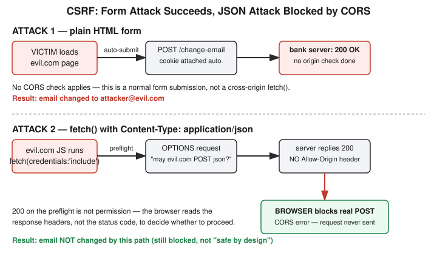

# Chapter 15: CSRF — When the Victim's Own Browser Signs the Attacker's Check

## Learning objectives

By the end of this chapter, you will be able to:
- Explain Cross-Site Request Forgery (CSRF) and why it needs no code execution on the target site at all, unlike XSS.
- Explain why a plain HTML form cannot forge a `Content-Type: application/json` request, and what role CORS preflight plays when JavaScript tries anyway.
- Distinguish "the browser can *send* a cross-origin request" from "the browser's JavaScript can *read* a cross-origin response" — two separate protections, often confused as one.
- Explain how a per-session CSRF token defeats the attack even when the cookie itself is still sent automatically.

## The concept

Chapter 14 covered XSS: tricking the victim's own browser into running attacker-controlled *code* inside the trusted site. **Cross-Site Request Forgery (CSRF)** is a different trick that reaches a similar outcome without needing any code execution on the target site whatsoever. CSRF abuses a simple, otherwise-useful browser behavior: cookies are attached to a request based on the *destination* domain, not the page that triggered the request. If you're logged into `bank.example.com` and a completely unrelated page you're merely *visiting* — `evil.com` — contains a hidden form that auto-submits to `bank.example.com/transfer`, your browser dutifully attaches your real session cookie to that request, because as far as the browser's cookie jar is concerned, the request really is going to `bank.example.com`. It doesn't matter that the page that triggered it has nothing to do with the bank.

The key distinction from XSS: XSS needs the attacker's script to actually execute inside the target site's own page. CSRF needs none of that — it only needs the victim's browser to still be logged in (holding a valid cookie) and to visit *any* page the attacker controls, even one that looks like a harmless prize page.

Not every endpoint is equally exposed. A GET-based action like `<a href="/delete?id=5">` — or even an auto-loading `` — fires the instant the browser loads it, no click and no JavaScript required at all. A JSON-based API is naturally harder to forge with a *plain* HTML form, but the reason is more specific than "APIs are harder to understand": an HTML `<form>` element can only submit as `application/x-www-form-urlencoded`, `multipart/form-data`, or `text/plain` — there is no form encoding type for `application/json`. A browser simply will not let a plain form send that content type.

That doesn't fully close the door, though. An attacker's own JavaScript, running on `evil.com`, genuinely *can* construct a `fetch()` call with `Content-Type: application/json` — nothing stops a script from building that request. But because the request is now cross-origin and uses a "non-simple" header, the browser inserts a **CORS preflight** check first: it sends an `OPTIONS` request asking the target server, in effect, "do you permit `evil.com` to send you this kind of request?" If the target server's response doesn't explicitly include `Access-Control-Allow-Origin` (and, since the attack also tried `credentials: 'include'`, `Access-Control-Allow-Credentials: true`) naming that origin, the browser refuses to send the real request at all. Critically, a `200` status on the preflight response does **not** mean permission was granted — the browser is reading specific *headers* in that response, not the status code, to make its decision.

There's a second, easily-conflated protection worth separating out clearly: the browser blocking a cross-origin request from being *sent* at all (the CORS preflight case above) is different from the Same-Origin Policy blocking an attacker's JavaScript from *reading the response body* of a cross-origin request it did manage to send. An attacker's page can often trigger a request toward the target — that's the entire premise of CSRF — without necessarily being able to see what comes back. This "send vs. read" distinction is exactly what makes CSRF tokens work as a defense, as the lab below demonstrates.

## Hands-on lab recap — REAL LAB

This was a real, hands-on, non-Docker lab at `/yml/install/security-learn/csrf-lab/`, using two separate Flask apps to simulate two genuinely different websites: `bank.py` (the victim site, originally on port 5000) and `evil.py` (the attacker site, originally on port 5001). Getting there involved working through three realistic environment hurdles in sequence — each one a small lesson in its own right. First, Flask wasn't installed at all (`ModuleNotFoundError`). Second, a plain `pip3 install flask` failed with Debian's PEP 668 "externally-managed-environment" protection, resolved properly with a virtual environment (`python3 -m venv venv && source venv/bin/activate`) rather than forcing `--break-system-packages`. Third, because this session ran inside a VS Code remote environment with automatic port forwarding, the literal port numbers `5000`/`5001` didn't work directly in the browser — VS Code remapped them to different local forwarded addresses (`127.0.0.1:5001` and `127.0.0.1:5002` respectively). Once the forwarded addresses were substituted into the attack page's target URLs, the lab proceeded exactly as designed — and the two apps were still on genuinely different ports, so the cross-origin premise of the lab held regardless of the renumbering.

**Attack 1 — plain HTML form.** The bank app exposed `/change-email`, a POST endpoint that trusted the session cookie alone with no check that the request actually originated from the bank's own pages. The evil app served a page with a hidden auto-submitting form targeting that endpoint, with `email=attacker@evil.com` baked in. Visiting the evil page — which looked like nothing more than a "Free Prizes!" message, no click required — silently changed the account's email. Reloading `/account` confirmed it: `Current email on file: attacker@evil.com`. No password was touched; in a real attack, the next move would typically be a password-reset flow sent to the now-attacker-controlled email address.

**Attack 2 — JSON via `fetch()`.** The evil page also attempted a second attack against a parallel `/api/change-email` endpoint, using `fetch()` with `Content-Type: application/json` and `credentials: 'include'`. Watching this in the browser's DevTools Network tab (with "Preserve log" enabled, since the form's own navigation would otherwise clear the log before the fetch's result could be observed) showed exactly three relevant entries: the form's `POST /change-email` succeeding with `200`, then an `OPTIONS` preflight to `/api/change-email` also returning `200`, followed by the actual `POST /api/change-email` showing as a CORS error — the browser never sent it, because the preflight response carried no `Access-Control-Allow-Origin` header permitting `evil.com`. Reloading `/account` confirmed the JSON attack left no trace: the email was still whatever Attack 1 had set it to, not the second, JSON-attack-specific value. This made the "preflight 200 ≠ permission granted" distinction concrete rather than theoretical — the status code told us the server responded; the missing header is what actually stopped the attack.

**The fix.** A per-session CSRF token, generated with `secrets.token_hex(16)` and embedded as a hidden field on the bank's *real* `/change-email-form` page, checked on every POST to `/change-email` against a server-side record of the expected value for that session. Re-running the unmodified evil page's form attack after the fix produced a `403 Forbidden` — the attacker's form had no way to know or supply the token, so the request failed the check, and `/account` still read `victim@example.com`. Submitting the legitimate form (the one that actually carries the real token) was then re-verified to still work normally, confirming the fix blocked the forgery without breaking the real feature.

The reason the attacker's page can't just read the token off the real form and copy it into a forged request connects directly back to the "send vs. read" distinction raised in the concept section above: even if the attacker's JavaScript tried to `fetch()` the bank's `/change-email-form` page to scrape the token out of the HTML, the Same-Origin Policy would block that script from reading the response body of that cross-origin request — session cookie or not. The attacker's page can make *something* happen on the bank's server (that's the CSRF premise), but it can't see what the bank's server sends back unless the bank explicitly opts in via CORS. That's precisely why a secret embedded in a page only the legitimate, authenticated browser can actually read is a real defense, rather than a speed bump.

## Review questions

1. Why does the attacker's browser successfully attach the victim's real session cookie to a request sent from a completely unrelated site?
2. A JSON-based `fetch()` attack with `credentials: 'include'` was blocked. Was it blocked because JSON requests are inherently restricted to same-origin callers, or for a more specific reason?
3. Why can't the attacker's page simply read the CSRF token off the bank's legitimate form page and include it in a forged request?

### Answers

1. Cookies are scoped to the *destination* domain, not the page that triggered the request. The browser doesn't check where a request came from before attaching a cookie — only where it's going — so the bank's cookie gets attached regardless of which site actually initiated the request.
2. The more specific reason: setting `Content-Type: application/json` makes the browser treat the request as "non-simple," triggering a CORS preflight `OPTIONS` request first. The browser only allows the real request through if the server's preflight response explicitly includes `Access-Control-Allow-Origin` (and, for credentialed requests, `Access-Control-Allow-Credentials: true`) naming the calling origin. It's not that JSON itself is restricted to same-origin — a misconfigured server with permissive CORS headers would let this exact attack through.
3. The Same-Origin Policy separately blocks an attacker's JavaScript from *reading the response body* of a cross-origin request, even though the browser may still *send* that request (with cookies attached). Sending a forged request and reading back a page's contents are two different protections — CSRF relies on the first gap existing, and CSRF tokens rely on the second gap staying closed.

## Operational takeaway

> Any state-changing endpoint that relies on a cookie alone to decide "is this really you?" is forgeable by any page the victim merely visits — pair cookie-based session auth with a CSRF token (or a `SameSite=Strict`/`Lax` cookie policy) on every request that changes state.

## Today in the broader CEH journey

This chapter continues Phase 4 — Web Security and the OWASP Top 10, following the same build-exploit-fix-reverify arc established in Chapters 13 and 14, and reaching back directly to Chapter 7's cookie groundwork to put the cookie-scoping behavior introduced there to real, adversarial use for the first time. It also introduces CORS and preflight mechanics as a genuine CEH-relevant topic in their own right, arising naturally as a side effect of trying — and failing — to extend the CSRF attack to a JSON API. The next likely stop in this phase, SSRF, flips the direction of this chapter's "who makes the request" question: instead of the victim's browser making a forged request, SSRF tricks the *server itself* into making a request on the attacker's behalf — a natural contrast that will also be a good place to revisit the "send vs. read" distinction introduced here with a fresh, non-CSRF example.
