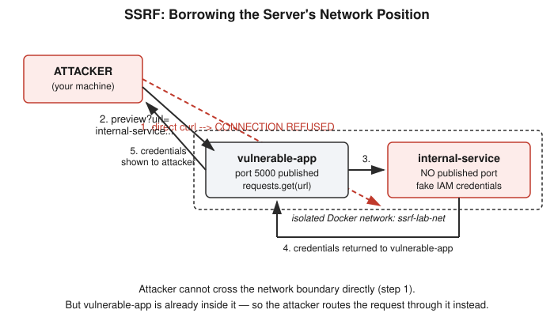

# Chapter 16: SSRF — Making the Server Attack Its Own Network

## Learning objectives

By the end of this chapter, you will be able to:
- Explain Server-Side Request Forgery (SSRF) and precisely how it differs from CSRF in terms of who actually sends the forged request.
- Explain why cloud instance metadata endpoints (like `169.254.169.254`) are the single highest-value SSRF target, and the real-world breach this pattern caused.
- Explain how IMDSv2's token-handshake requirement defeats the classic "just feed it a URL" SSRF exploit pattern without eliminating SSRF as a vulnerability class.
- Explain why an allowlist (default-deny) is structurally more robust against SSRF than a denylist (default-allow), even when the denylist works correctly in testing.

## The concept

Chapter 15 covered CSRF: tricking the *victim's browser* into sending a forged request using a session cookie it already holds. **Server-Side Request Forgery (SSRF)** is the mirror image of that idea, aimed at a different victim entirely. Instead of fooling a browser, SSRF fools a *server*. Many web applications include a feature that takes a URL from a user and fetches it server-side — a "preview this link" box, an image-import tool, a webhook tester, a PDF generator that renders a remote page. If that feature places no restrictions on which URLs it's willing to fetch, an attacker can hand it a URL the attacker's own browser could never reach directly — an address on the server's internal network — and the server, sitting inside that network with legitimate access, fetches it and hands the result back.

The useful way to hold the CSRF/SSRF contrast in your head: in neither attack does the attacker ever send the forged request themselves. In CSRF, the *victim's browser* sends it, borrowing the victim's session cookie. In SSRF, the *vulnerable server* sends it, borrowing the server's network position. The attacker crafts the trigger in both cases; a third party actually transmits the request. SSRF's specific damage, though, comes from what "network position" means for a server — it can often reach things the public internet simply cannot, which is precisely the trust boundary SSRF abuses. It has nothing to do with browser Same-Origin Policy at all; it's a perimeter-bypass bug, not a browser-security bug.

This is where cloud infrastructure turns an ordinary SSRF bug into a severe one. Every major cloud provider — AWS, Azure, GCP — exposes a special, non-internet-routable address, `169.254.169.254`, to every virtual machine it runs. This is the **instance metadata service**, and among the things it serves are temporary, auto-issued credentials the instance uses to call other cloud services (storage, databases, and so on) without a human hardcoding a password anywhere. Reaching this address from outside the instance is normally impossible — but a server with an unrestricted URL-fetching feature can reach it from the *inside*, and if an SSRF bug lets an attacker steer that fetch, the attacker walks away not with a webpage but with live cloud credentials. This exact chain — an SSRF bug, a metadata-endpoint fetch, stolen IAM credentials, then a pivot into cloud storage using those credentials — is what caused the 2019 Capital One breach, exposing over a hundred million customer records.

Cloud providers responded with **IMDSv2**, a hardened version of the metadata service. The older IMDSv1 served metadata to any plain `GET` request, no authentication required — which is exactly what made the classic SSRF-to-credential-theft pattern so easy. IMDSv2 requires a two-step handshake instead: first a `PUT` request to `/latest/api/token` carrying a custom header to obtain a short-lived session token, then a `GET` request that includes that token as a header. The significance is specific: most real-world SSRF bugs only give an attacker control over the *URL* passed to a `GET` request inside an existing feature — they don't let the attacker inject an arbitrary prior `PUT` request or set custom headers. IMDSv2 doesn't make SSRF impossible as a vulnerability class, but it closes off the easy, header-free exploit path that made Capital One possible.

## Hands-on lab recap — REAL LAB

This was a real, hands-on Docker lab at `/yml/install/security-learn/ssrf-lab/`, built with two containers on a dedicated isolated network, `ssrf-lab-net`, created with `docker network create ssrf-lab-net`.

The first container, `internal-service`, simulates something an attacker should never reach directly — standing in for an internal admin panel or, conceptually, the cloud metadata endpoint itself. It served a fake JSON response containing simulated IAM-style credentials at a path styled after the real AWS metadata API. Critically, it was launched with no `-p` flag at all: `docker run -d --name internal-service --network ssrf-lab-net internal-service`. No port was ever published to the host, meaning the service exists only inside the Docker network — not reachable from outside it by any means.

The second container, `vulnerable-app`, is a small Flask app with exactly the kind of feature SSRF loves: a "preview this URL" form that takes a `url` parameter and calls `requests.get(url)` server-side, with no validation at all on what `url` is allowed to be. Unlike `internal-service`, this container's port *was* published (`-p 5000:5000`), so it's reachable like any normal web app.

The perimeter was confirmed before attempting anything: `docker ps` showed `internal-service` running with an empty `PORTS` column, and `curl http://localhost:5000/` aimed at where it would be returned `Failed to connect to localhost port 5000` — proof that nothing outside the Docker network could reach it directly.

**The exploit.** Using the vulnerable app's own feature, the URL `http://internal-service:5000/latest/meta-data/iam/security-credentials/` was submitted — the container name is resolvable via Docker's internal DNS only from inside `ssrf-lab-net`, which `vulnerable-app` is a member of. The server fetched it without hesitation and returned the full JSON payload of fake credentials directly in the HTTP response. The attacking machine never had any direct line to `internal-service` at any point; it borrowed the vulnerable server's network membership to get there.

**The fix.** The straightforward but naive fix — blocking the literal string `"internal-service"` — was explicitly rejected as fragile, because an attacker could simply address the same container by its raw IP instead, never triggering a string match at all. The real fix resolved the hostname to its actual IP address with `socket.gethostbyname()` and checked that address against Python's `ipaddress` module for private, loopback, or link-local ranges, rejecting the request before any fetch occurred. Rebuilding and re-testing confirmed both halves of the fix: a legitimate preview of `http://example.com` still worked normally, while the identical attack request against `internal-service` now returned "Blocked: internal/private addresses are not allowed," with no fetch taking place.

One practical hiccup during the fix is worth recording plainly: an early attempt spliced only the new `preview()` function into the existing file, which silently dropped the line `app = Flask(__name__)` and crashed the container with `NameError: name 'app' is not defined`. The fix was to replace the entire file at once rather than patch a fragment — a small but genuinely useful lesson for any short lab file, where a full-file replacement costs nothing and avoids an entire class of self-inflicted debugging detours.

A live, unplanned real-world confirmation landed mid-session: a `curl` run against a genuine, authorized AWS sandbox instance's real metadata endpoint returned `401 Unauthorized` — direct, first-hand evidence that the instance was running IMDSv2 rather than the older, vulnerable IMDSv1. Before treating that as acceptable groundwork for the lesson, it was worth confirming explicitly that the instance was a company-owned test/sandbox cluster, isolated from production and corporate resources, that the user was authorized to test — a useful reminder that even a simple diagnostic `curl` deserves an authorization check before running, and that any *exploit*-style testing belongs in a fully local, self-owned sandbox like the Docker lab above, not on shared infrastructure, regardless of how low-risk a single command feels.

The deeper lesson from the fix generalizes well beyond SSRF: a **denylist** approach ("allow everything except what I explicitly block") is only as safe as the completeness of the list — it has to anticipate every evasion technique an attacker might think of, from private IP ranges to DNS rebinding to numeric IP encodings. An **allowlist** ("deny everything except what I explicitly permit") flips the burden: an attacker trying any evasion technique still lands on something simply absent from the list, and fails by default, without the defender needing to have predicted the specific trick in advance. This default-deny principle, not mere convenience, is the real argument for allowlisting over denylisting wherever it's practical to build one.

## Review questions

1. In one sentence, what's the structural difference between CSRF and SSRF, in terms of who actually sends the forged request?
2. Why did IMDSv2's token requirement (a `PUT` plus a custom header, before any `GET`) specifically defeat the classic SSRF exploit pattern, even though SSRF itself wasn't "fixed"?
3. If the fix had only blocked requests by the literal hostname string `"internal-service"` instead of checking the resolved IP address, how could an attacker still have reached it through the same vulnerable app?

### Answers

1. In CSRF, the victim's own browser sends the forged request, using a session cookie it already holds. In SSRF, the vulnerable server sends the forged request, using its own network position. The attacker crafts the trigger in both cases but never transmits the request directly in either one.
2. Classic SSRF bugs typically only give an attacker control over the URL passed into an existing `GET` request inside a feature — they don't let the attacker inject a separate prior `PUT` request or attach custom headers. IMDSv2 requires exactly that combination (a token-granting `PUT` with a special header, then a `GET` carrying the resulting token) before it will serve any metadata, which falls outside what a simple "control the fetched URL" bug can produce.
3. By addressing the same container using its raw IP address on the Docker network instead of its hostname. Since the literal string `"internal-service"` never appears anywhere in that request, a denylist keyed on that exact string would never trigger, and the fetch would proceed unblocked.

## Operational takeaway

> When validating a user-supplied URL server-side, always check the *actual resolved IP address* against policy — not just the hostname string — and recheck it at connect time rather than only at validation time, or the check can be defeated by DNS rebinding.

## Today in the broader CEH journey

This chapter continues Phase 4 — Web Security and the OWASP Top 10, following the same build-exploit-fix-reverify arc established in Chapters 13 through 15, and directly extends Chapter 15's "who actually sends the request" question by flipping the actor from the victim's browser to the vulnerable server itself. It also closes the loop on Chapter 15's Same-Origin Policy "send vs. read" distinction, which was deliberately re-taught here with a fresh, non-CSRF example before the lab began and confirmed solid on the first check question. The real AWS IMDSv2 diagnostic that surfaced mid-session gives this chapter a genuine real-world anchor — a live, present-day instance of the exact defense invented in response to the Capital One breach the lab was designed to illustrate. The next stop in this phase, session hijacking, moves from "forging a single request" to "stealing or fixating an entire authenticated session," and offers a natural opening to revisit this chapter's CSRF-vs-SSRF precision point in a fresh comparison.
