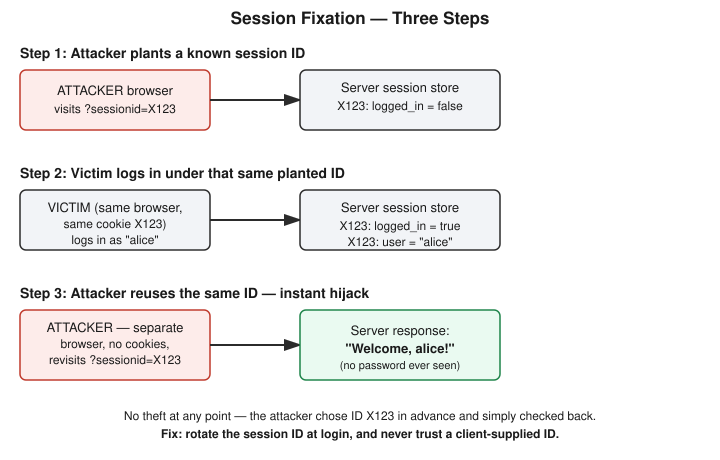

# Chapter 17: Session Hijacking — Setting a Trap Instead of Picking a Pocket

## Learning objectives

By the end of this chapter, you will be able to:
- Explain what a session ID actually is and why possessing it is functionally equivalent to being logged in as that user.
- Distinguish session fixation from classic cookie-theft session hijacking, specifically in terms of what the attacker must obtain and when.
- Identify the two independent vulnerabilities that make a session-fixation attack possible, and explain why fixing either alone breaks the attack.
- Explain why session ID rotation at login (and logout) is the structural fix, not merely a hardening option.

## The concept

Every chapter so far in Phase 4 has exploited some feature of how the web communicates trust: Chapter 13's SQL injection exploited trust in user input reaching a database query, Chapter 14's XSS exploited trust in user input being rendered as a page, Chapter 15's CSRF exploited the fact that a browser automatically attaches a session cookie to any request regardless of who asked for it, and Chapter 16's SSRF exploited a server's own trusted network position. Today's topic, session hijacking, goes straight at the thing all of those cookie-based attacks were ultimately trying to reach: the session itself.

When you log into a website, the server doesn't re-check your password on every click. Instead, right after a successful login, it hands your browser a **session ID** — usually sitting inside a cookie, something like `session_id=abc123`. From that point forward, your browser automatically attaches that cookie to every request, and the server looks the ID up in its own internal session store to know who it's talking to. The session ID functions as a bearer token: whoever holds it, the server treats as that person, full stop, with no further password check. Think of it as a wristband at a concert — security doesn't re-check your ID at every gate, they just look for the wristband.

**Session hijacking**, broadly, means an attacker obtains a *valid* session ID belonging to someone else and uses it to impersonate them — without ever needing that person's password. There are two structurally different routes to that outcome. The first is the one most people picture first: interception or theft of an ID that already exists. This could mean sniffing unencrypted traffic, or — as in Chapter 14 — exploiting a stored or reflected XSS bug to run `document.cookie` and ship the result to an attacker-controlled server. Either way, the attacker steals something that's already in motion.

The second route, **session fixation**, is a different shape of attack entirely, and it's the one this chapter builds and exploits for real. Instead of stealing an existing session ID, the attacker *forces* the victim to use a session ID the attacker already knows, chosen and planted *before* the victim ever logs in. If the application doesn't issue a fresh session ID at the moment of authentication, the attacker's pre-chosen ID becomes a fully authenticated session the instant the victim logs in — and the attacker was holding that exact ID the entire time, simply waiting to see if it worked. The cleanest way to hold this distinction in your head: classic hijacking is stealing something already in motion; fixation is setting a trap and checking back later to see if it sprung. Critically, fixation requires the attacker to obtain nothing from the victim at any point — no interception, no script injection, no credential of any kind. They only need to control the ID in advance and get the victim to use it, often via nothing more than a crafted link.

## Hands-on lab recap — REAL LAB

This was a real, hands-on lab using a non-Docker Flask app, built at `/yml/install/security-learn/session-fixation-lab/` — a plain local dev server was sufficient here since the vulnerability lives entirely in session-cookie handling logic, with no privilege escalation or filesystem risk requiring container isolation. Setup followed this environment's now-standard pattern: a Python virtual environment (`python3 -m venv venv && source venv/bin/activate`) to satisfy the system's PEP 668 externally-managed-environment restriction, then `pip install flask` with the corporate-network `--trusted-host` flags already established in earlier labs.

The vulnerable application had two independent bugs stacked on top of each other. First, its session-lookup logic would accept a session ID supplied directly via a URL query parameter — `?sessionid=ATTACKER123` — and simply trust it as valid, creating a server-side entry for it if one didn't already exist. Second, and more fundamentally, its `/login` route never issued a new session ID at the moment of authentication; it just flipped `logged_in` to `True` on whatever session ID was already active, whatever its origin.

**The exploit, run end to end for real.** Playing the attacker first, the lab visited the app at `http://<host>:5000/?sessionid=ATTACKER123`. This instantly created a new, unauthenticated session on the server under that exact chosen ID — confirmed via a `/debug/sessions` endpoint built into the app for observing server-side state, which showed `"ATTACKER123": {"logged_in": false, "user": null}`. Then, still in that very same browser tab — which now carried the attacker's planted cookie — the lab played the victim and submitted the login form as "alice." Checking the debug endpoint again showed `"ATTACKER123": {"logged_in": true, "user": "alice"}`: the attacker's planted ID was now a fully authenticated session belonging to Alice. The final, decisive step was opening a second, completely separate browser — a private window carrying no cookies at all — and navigating to the same URL, `?sessionid=ATTACKER123`. It loaded instantly as "Welcome, alice!" A browser that had never touched Alice's traffic, never run a line of injected script, and never seen her password was now fully authenticated as her.

**The fix.** Two changes closed the hole, and — notably — either one alone would have stopped this specific attack, which is a useful fact for reasoning about defense in depth. First, the session-lookup logic was changed to read the session ID exclusively from the server-issued cookie, never from a query parameter or any other client-supplied channel. Second, and more structurally important as a general principle, the login route was rewritten to mint a brand-new session ID at the exact moment of authentication and discard the old one (`sessions.pop(old_sid, None)`), rather than reusing whatever ID happened to be active beforehand. After restarting the server with both fixes applied, the entire attack chain was re-run from scratch: the second browser, attempting the same `?sessionid=ATTACKER123` URL, was shown the login page rather than Alice's authenticated session — the exploit no longer worked, while a genuine login still succeeded normally.

One small but genuinely useful correction surfaced during the review discussion: describing the vulnerability as "the browser was reading the session ID from `request.args`" is backwards. Browsers don't interpret cookies or sessions at all — they only store and resend whatever bytes a server instructs them to. It was the *server's* own code reading `request.args` that created the vulnerability. This distinction — precisely separating what a client does from what a server does — is the same underlying skill Chapter 16 flagged as worth sharpening when comparing CSRF and SSRF, and it's worth carrying forward again here.

## Review questions

1. What were the two separate vulnerabilities in this lab's application, and would fixing just one of them alone have been enough to stop the attack?
2. What is the fundamental difference between what an attacker must obtain in session fixation versus classic cookie-theft session hijacking?
3. Besides login, name one other point in an application's lifecycle where rotating the session ID is also good practice, and explain why.

### Answers

1. The server trusted a session ID supplied via a URL query parameter as valid, and the login route reused the existing session ID instead of issuing a new one upon authentication. Fixing either vulnerability alone would have stopped this specific attack: refusing query-parameter session IDs removes the attacker's only means of planting a chosen ID in this lab, while rotating the ID at login invalidates any pre-planted ID regardless of how it arrived. In a real system you'd still want both, since there are other ways to plant a cookie (such as an XSS bug, or a cooperating subdomain) that query-parameter blocking alone wouldn't stop.
2. Session fixation requires the attacker to obtain nothing from the victim at all — the attacker already controls the session ID because they chose it themselves in advance, and they simply wait to see if the victim authenticates under it. Classic cookie-theft hijacking requires the attacker to actually intercept or steal an ID that already belongs to the victim, through traffic sniffing or an XSS exploit.
3. Logout. Rotating the session ID at logout invalidates the old ID so that a copy of it — left behind in browser history, a shared or public computer, or a cached request — can't be reused to resume a session the legitimate user believed had ended.

## Operational takeaway

> Never trust a session identifier the client could have chosen or supplied before authentication — always mint a fresh one at the moment privilege changes, whether that's login, logout, or a password reset.

## Today in the broader CEH journey

This chapter closes out the core trio of session-based web attacks that make up a large slice of the OWASP Top 10's practical surface area: CSRF (Chapter 15) forges a request using a session that already exists; SSRF (Chapter 16) borrows a server's trust using its own position on the network; and session fixation (this chapter) skips stealing anything at all by getting the victim to authenticate into a session the attacker already controls. It also gives a first real workout to the "who actually sends/does what" precision that Chapter 16 flagged as a soft spot — the fixation-versus-theft framing here ("set a trap and wait" versus "steal something already in motion") is the same reasoning muscle as correctly separating CSRF's victim-browser-sends from SSRF's vulnerable-server-sends. With the three core session/request-forgery attacks now built, exploited, and fixed end to end, the remaining Phase 4 follow-ups — UNION-based and blind SQL injection, DOM-based XSS, a dedicated SameSite-cookie defense lab, and DNS-rebinding bypasses of SSRF denylists — sit ready to be slotted in before this course moves on from Web Security into Identity and Access Management.
