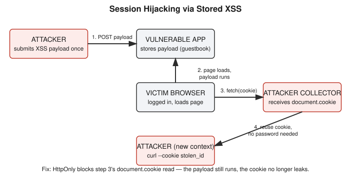

# Chapter 18: Session Hijacking via XSS — Stealing a Cookie Instead of a Password

## Learning objectives

By the end of this chapter, you will be able to:
- Distinguish classic cookie-theft session hijacking from Chapter 17's session fixation, in terms of what the attacker must obtain and when.
- Explain how a stored XSS bug becomes a mechanism for stealing a live session ID, not just for popping an alert box.
- Explain precisely what the `HttpOnly` cookie attribute does and does not protect against.
- Explain why `SameSite` and `HttpOnly` are separate controls solving separate problems, rather than interchangeable "cookie security" settings.

## The concept

Chapter 17 covered session fixation: an attacker who plants a session ID *before* the victim ever logs in, then waits to see if it becomes authenticated. This chapter covers the other, more commonly pictured route to session hijacking — stealing a session ID that's already live, out of a browser that's already logged in. The mechanism for that theft is one you've already built: Chapter 14's cross-site scripting.

The underlying idea connects two things already taught separately. A session ID sitting in a cookie is functionally equivalent to being logged in — whoever holds it, the server trusts, no further password check required. And an XSS bug lets an attacker run their own JavaScript inside the victim's browser, in the trusted context of the real site. Put those together, and the payoff becomes obvious: if an attacker's script can run on a page the victim is logged into, that script can read `document.cookie` and ship the value off to a server the attacker controls. No interception of network traffic is needed, no credential is ever touched — the victim's own browser hands over the key, because nothing told it not to.

This is also a useful moment to be precise about a cookie-attribute mix-up that's easy to make, and that this chapter's lab actually tripped over in real time. `HttpOnly`, introduced back in Chapter 7 and put to real use in Chapter 14, restricts one specific thing: whether JavaScript running on a page can *read* a cookie's value via `document.cookie`. `SameSite`, mentioned in Chapter 15's CSRF discussion, restricts a completely different thing: whether the browser *attaches* a cookie to a request that's crossing from one site to another. Neither one substitutes for the other. A script running on the vulnerable site's own page, reading a cookie belonging to that same site, is never a cross-site event at all — so `SameSite` has nothing to say about it, no matter how strict its setting. `HttpOnly` is the control that actually matters here, because it's the one that governs script-level read access regardless of where the script came from.

## Hands-on lab recap — REAL LAB

This was a real, hands-on lab, reusing and extending the Day 14 `xss-lab` Flask app at `/yml/install/security-learn/xss-lab/`. Two deliberate vulnerabilities were built in on purpose: the Day 14 stored-XSS hole was reintroduced on the guestbook route (the `|safe` filter, which disables Flask's normal auto-escaping, put back after having been removed as that chapter's fix), and a small login system was added that issued a session cookie with `httponly=False` — i.e., explicitly readable by JavaScript.

**The exploit.** Playing the attacker, the payload `` was submitted as a guestbook entry. The broken image source guarantees the `onerror` handler fires, which is a standard technique for running JavaScript without needing a literal `<script>` tag that a naive filter might catch. A second, separate local process — Python's built-in `http.server` on port 8000, started inside the same lab directory under `xss-lab/attacker-collector/` — stood in for the attacker's collection endpoint; it wasn't built to receive stolen data, but it logs every incoming request's full URL to the terminal, which was sufficient to observe the theft. Playing the victim, logging in as `alice` and loading the guestbook page triggered the stored payload, and the collector terminal showed a real request: `GET /steal?c=session_id=<the actual live session ID>`.

The decisive verification step came next: from a **third**, completely separate terminal — one that had never opened a browser, logged in, or touched a cookie — a single command, `curl --cookie "session_id=<stolen value>" http://127.0.0.1:5000/`, returned `Welcome, alice!`. The stolen session ID was proven to be a fully working, reusable credential, obtained with zero password and zero direct contact with the victim.

**The fix.** The one-line change `resp.set_cookie("session_id", sid, httponly=True)` was applied to the login route. After restarting the app and re-running the identical exploit, the collector received `GET /steal?c=` — an empty value, since `document.cookie` no longer included the protected cookie at all. Crucially, this fix was explicitly **not** treated as having fixed the underlying vulnerability: the stored XSS injection point in the guestbook was still fully live and would still execute any other payload an attacker chose to submit. `HttpOnly` removed this one specific payoff (cookie exfiltration for later reuse), not the root-cause bug.

A genuine mix-up surfaced during the review questions and is worth recording as a teaching moment in its own right: asked whether `SameSite=Strict` would have prevented this attack, the first answer reasoned that it would, on the theory that `SameSite` blocks cross-site script execution. That's incorrect, for the reason laid out in the concept section above — the payload ran on the vulnerable site's own page, never crossing a site boundary, so `SameSite` was never a relevant control here at all. The mistake was caught and corrected in the same session, and it's a useful one to sit with precisely because it's such an easy trap: two cookie attributes with superficially similar-sounding "cookie security" branding, doing genuinely unrelated jobs.

A real-world extension also came up unprompted during this session, worth noting even though it wasn't lab-exercised: if two browser sessions use the identical session token but one is routed through a VPN exit node in a different country, some real applications will flag or block that second session as anomalous. This works by binding extra signals to a session beyond the raw token — source IP, geolocation, ASN, device/browser fingerprint — and challenging or rejecting requests where those signals shift drastically from how the session was originally established (often called "impossible travel" detection). This is a risk-based, heuristic layer, not a structural fix like token rotation or `HttpOnly`, and it previews concepts that Phase 5's Identity and Access Management material will cover properly.

## Review questions

1. What's the structural difference between this chapter's attack and Chapter 17's session fixation, in terms of what the attacker needs to obtain, and when?
2. Does `HttpOnly` stop a browser from sending a cookie on a normal request — for example, a `fetch()` call made with `credentials: 'include'`? Why or why not?
3. Would `SameSite=Strict` have prevented this chapter's specific attack — a stored XSS payload stealing a cookie on the same site the cookie belongs to? Why or why not?

### Answers

1. This chapter's attack (classic hijacking) requires an existing, live, authenticated session to steal from — the attacker obtains the ID only after the victim is already logged in, typically via XSS or traffic sniffing. Session fixation requires nothing be stolen at all: the attacker already controls the ID because they chose it themselves in advance, and only needs the victim to authenticate under it later.
2. No. `HttpOnly` restricts only JavaScript's *read* access to the cookie's value via `document.cookie` — it has no effect on the browser's own automatic behavior of attaching that cookie to outgoing HTTP requests, which continues exactly as before.
3. No. `SameSite` governs whether a cookie is attached to a request that crosses from one site to another; it has nothing to do with where JavaScript is allowed to execute or whether it can read `document.cookie`. The payload in this lab ran on the vulnerable site's own page, reading that same site's cookie — never a cross-site event — so `SameSite` was never a relevant control for this specific attack. `HttpOnly` was the control that actually mattered here.

## Operational takeaway

> `HttpOnly` stops a cookie from being read by JavaScript, but it does not stop the browser from sending that cookie automatically on real requests, and it does nothing against cross-site request forgery — cookie-protection attributes are narrow, single-purpose tools, not general-purpose session security, so real defense needs several of them layered together.

## Today in the broader CEH journey

This chapter closes the loop between Chapter 14's XSS lab and Chapter 17's session hijacking material, demonstrating the classic "steal something already in motion" variant that Chapter 17 named but didn't build. With both session-hijacking routes — fixation and cookie theft — now built, exploited, and fixed end to end, Phase 4's core session-attack cluster (CSRF, SSRF, and both hijacking variants) is complete. The `SameSite`-versus-`HttpOnly` mix-up surfaced here, still only partially resolved, sets up a natural next stop: a dedicated `SameSite` cookie lab that would let a CSRF-style scenario demonstrate exactly when `SameSite` *is* the deciding factor, in direct contrast to this chapter's scenario where it wasn't.
