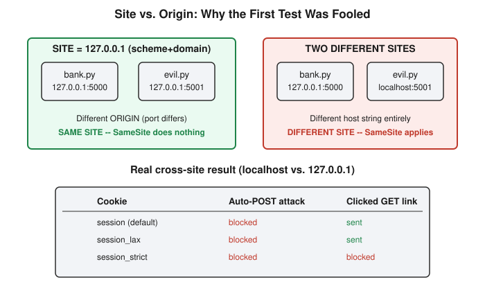

# Chapter 19: SameSite, CSRF Tokens, and the Site-vs-Origin Trap

## Learning objectives

By the end of this chapter, you will be able to:
- Explain precisely what the `SameSite` cookie attribute controls, and how it differs from `HttpOnly` (Chapter 18's distinction, now proven hands-on).
- Describe the behavioral difference between `SameSite=Lax` and `SameSite=Strict` for a forged cross-site POST versus a forged cross-site GET link click.
- Define "site" (scheme + registrable domain) precisely against "origin" (scheme + host + port), and explain why testing cookie-attribute behavior on the same host with different ports silently invalidates the test.
- Explain how a CSRF token is delivered to a legitimate browser and why an attacker's page cannot obtain a valid one, even though it can trigger a forged request.

## The concept

Chapter 18 closed with an honest loose end: asked whether `SameSite=Strict` would have stopped that chapter's cookie-theft attack, the answer given in the moment mixed up two cookie attributes that sound similar but do unrelated jobs. `HttpOnly` governs whether JavaScript can *read* a cookie's value via `document.cookie`. `SameSite` governs something else entirely: whether the browser *attaches* a cookie automatically to a request that's crossing from one site to another. This chapter builds the lab that Chapter 18 only promised — one designed specifically to put `SameSite` through its paces in isolation, with no XSS or token logic muddying the result.

`SameSite` has three possible values. `None` attaches the cookie to every request regardless of where it originates — the old, permissive default, and the reason CSRF was ever a widespread problem in the first place. `Lax` attaches the cookie on top-level navigation — the kind that happens when a user clicks a link and the browser loads a new page — but withholds it from cross-site POSTs, background `fetch()` calls, and image loads triggered from another site. `Strict` is the least forgiving of the three: it withholds the cookie from any cross-site-triggered request whatsoever, including a plain link click.

Here is the distinction worth sitting with: nothing about `SameSite` touches script execution or cookie readability. A script that runs on the vulnerable site's own page, reading that site's own cookie, was never a cross-site event in the first place — which is exactly why `SameSite`, no matter how strict its setting, had nothing to say about Chapter 18's attack. `SameSite` only has an opinion about a *request* crossing a site boundary. That is the box it lives in, and no more.

Testing that box properly turned out to require a second concept this chapter had to introduce along the way: the difference between a "site" and an "origin." Same-origin policy — the rule from earlier chapters governing what JavaScript is allowed to read across pages — defines an origin as the combination of scheme, host, and port; all three must match exactly. `SameSite`'s notion of a "site" is looser: scheme plus *registrable domain* only. Port is explicitly excluded, and so is any subdomain structure below the registrable domain — `app.example.com` and `shop.example.com` count as the same site even though they're different hosts. One consequence follows directly from this: every origin belongs to exactly one site, but a single site can contain many different origins. Two services on `127.0.0.1` differing only by port are different origins occupying the *same* site — a fact that turned this chapter's first lab run into an unplanned debugging exercise.

## Hands-on lab recap — REAL LAB

This was a real, hands-on lab, extending the Chapter 15 CSRF lab at `/yml/install/security-learn/csrf-lab/` rather than building a new one. `bank.py` kept its existing token-protected `/change-email` flow untouched, and gained three parallel cookies issued on login — `session` (no explicit `SameSite`, relying on the browser's own default), `session_lax`, and `session_strict` — plus a new endpoint, `/csrf-test`, deliberately built with **no CSRF token check at all**, so that `SameSite` would be the only variable capable of stopping a forged request against it. `evil.py` was split into two routes: `/`, which auto-submits a hidden cross-origin POST form the instant the page loads, and `/link`, a plain clickable cross-origin link to the same endpoint, added specifically so the auto-firing POST attack wouldn't navigate the page away before a link click could be tested separately.

The first run produced a genuinely confusing result: both apps were running on `127.0.0.1`, differing only by port (`5000` for the bank, `5001` for evil), and the forged POST attack came back with **all three cookies intact**, including `session_strict` — a result that should be impossible if `Strict` means what it claims to mean. The cause, reasoned through live in the session once the "site excludes port" rule was recalled, was exactly the site-versus-origin gap described above: two different ports on the same IP are two different origins but one single site, so the attack was never cross-site to begin with — there was nothing for `SameSite` to block.

The fix was to re-run the identical test with the evil app accessed as `localhost` instead of `127.0.0.1`, while the bank app stayed on `127.0.0.1` — two genuinely different host strings, hence genuinely different sites. The corrected result matched the textbook prediction exactly. The forged auto-POST came back with all three cookies `null`, including the unattributed `session` cookie — confirming that modern browsers silently default an unspecified `SameSite` to `Lax`-like behavior, which blocks cross-site POSTs regardless. The clicked-link GET attack came back with `session` and `session_lax` populated with their real value, and `session_strict` alone returned `null` — the precise asymmetry the chapter set out to demonstrate: `Lax` and the browser default both carve out an exception for a user-initiated top-level navigation like a link click, while `Strict` blocks it unconditionally.

With `SameSite` finally isolated and proven, the session circled back to the still-standing CSRF-token defense from Chapter 15 and asked a sharper question: how does a legitimate CSRF token ever reach the user's browser in the first place, and why can't an attacker obtain one? The answer traced through the actual `change-email-form` route: the server generates a random token with `secrets.token_hex(16)`, stores it against the session server-side, and embeds it as a hidden form field in the HTML of a page the *legitimate* browser requests. An attacker's page can trigger a request to the real site — that's the entire CSRF problem — but it has no way to read the *response* of a cross-origin request to extract a token from it, because that read is exactly what same-origin policy blocks. To verify the server-side check was real and not just unused code, a raw `curl` request was sent straight to the real `/change-email` endpoint with the session cookie attached but the `csrf_token` field stripped out entirely. The response came back immediately: `403 Forbidden: invalid or missing CSRF token` — confirming the check genuinely runs on every request, not merely in the happy path.

Two review-question corrections are worth recording honestly, in keeping with this book's practice of keeping real mistakes visible rather than smoothing them into clean final answers. First, asked what `HttpOnly` protects against, the first two attempts described it as stopping JavaScript from running or from reading the page generally — too broad. `HttpOnly` does one narrow thing: it hides one specific cookie's value from `document.cookie`. Script execution continues completely normally otherwise, and any *other* cookie on the same page without the flag remains fully readable. Second, asked whether a `Lax` cookie survives an auto-fired cross-site POST versus a clicked cross-site link, the first answer reached for a true but different point — that older or non-compliant browsers might not enforce `SameSite` at all — rather than describing `Lax`'s own carve-out in a compliant browser. Redirected back to the session's own test data, the correct answer followed immediately: blocked on the POST, allowed on the link click.

## Review questions

1. In one sentence each, what does `HttpOnly` protect against, and what does `SameSite` protect against?
2. Under `SameSite=Lax`, does a forged cross-site auto-submitted POST succeed in attaching the cookie? Does a forged cross-site link that the user actually clicks succeed?
3. Why did the first test in this chapter's lab — the bank app and the evil app both on `127.0.0.1`, differing only by port — fail to demonstrate any `SameSite` blocking at all, even for `session_strict`?

### Answers

1. `HttpOnly` controls whether JavaScript running on a page can read a cookie's value via `document.cookie`. `SameSite` controls whether the browser automatically attaches a cookie to a request that originates from a different site than the one the cookie belongs to.
2. The forged auto-submitted POST does not get the cookie attached — `Lax` blocks cross-site POSTs unconditionally. The forged link the user clicks does get the cookie attached, because `Lax` specifically carves out an exception for top-level navigation triggered by the user, such as following a link.
3. `SameSite`'s definition of "site" is scheme plus registrable domain, and explicitly excludes port. Two services on `127.0.0.1` differing only by port are different origins but the same site, so no request between them was ever cross-site in the first place — there was nothing for any `SameSite` value, including `Strict`, to block.

## Operational takeaway

> `SameSite`'s "site" boundary ignores port entirely, so testing cookie-attribute or CSRF behavior locally on the same host with different ports will silently give a false-negative result — always use genuinely different hostnames for that kind of test, and never assume a quick localhost check tells you the truth about cross-site protections.

## Today in the broader CEH journey

This chapter directly resolves the `SameSite`-versus-`HttpOnly` mix-up that Chapter 18 left open, completing the pair of cookie-attribute controls that Phase 4's session-security material has been building toward since Chapter 7 first introduced cookies. It also closes a loop back to Chapter 15's original CSRF defense, revisiting the token-delivery mechanism with a live tamper test that proved the check is genuinely enforced rather than theoretical. With Broken Access Control, SQL Injection, XSS, CSRF, SSRF, both session-hijacking variants, and now both major cookie-security attributes covered with real, hands-on labs, Phase 4's core web-security cluster is substantially complete — setting up a natural pivot toward Phase 5's Identity and Access Management material, where the session-anomaly detection idea previewed in Chapter 18 will finally get its proper treatment.
