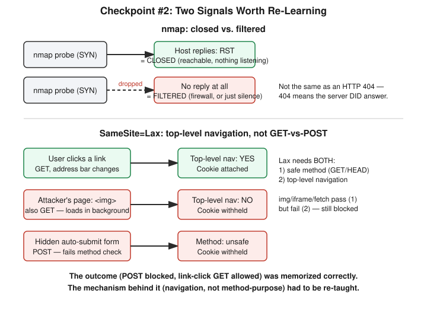

# Chapter 20: Checkpoint — What Nine Days of Web Security Actually Stuck

## Learning objectives

By the end of this chapter, you will be able to:
- Distinguish nmap's "closed" and "filtered" port states by the actual network-layer signal (or absence of one) that produces each.
- State precisely who sends the malicious request in CSRF versus SSRF, and why that distinction is the fastest way to tell the two attacks apart.
- Explain SameSite=Lax's cookie-attachment rule in terms of top-level navigation versus embedded requests, rather than a GET-versus-POST generalization.

## The concept

This chapter is different from the ones before it. There's no new attack class, no new lab, no new Flask app. This is a checkpoint — the second one in this course — and its entire purpose is to find out which of the last nine days of learning actually survived three weeks of time passing, and which only survived as long as the question was phrased exactly the way it was first taught.

Checkpoints in this course happen every eight to ten days, scoped only to material already covered, and scored with a readiness read (strong domains versus shaky domains) rather than a single pass/fail number. The first checkpoint, back on Day 10 of the broader course, caught one miss out of twelve questions: the difference between an nmap "closed" port and a "filtered" one. This second checkpoint, covering Days 12 through 19 — broken access control, SQL injection, cross-site scripting, CSRF, SSRF, session fixation, and the HttpOnly/SameSite cookie attributes — asked that same question again, deliberately, because a concept missed once and never re-tested isn't actually learned; it's just postponed.

It was missed a third time. That's the headline finding of this chapter, and it's worth sitting with rather than glossing over, because the way it was missed changed between attempts. The first time, the gap was pure unfamiliarity. This time, the answer reached for a wrong-but-plausible-sounding analogy: describing a "filtered" port the way an HTTP 404 describes a missing page. The analogy fails because it crosses layers that don't talk to each other. A 404 is proof the server is alive, received your request, parsed it, and chose to tell you "not here." A filtered nmap result is the opposite: total silence. No RST, no SYN-ACK, nothing — which is exactly why nmap can't distinguish "a firewall ate this packet" from "this host doesn't exist." A closed port, by contrast, *is* a definite signal: the host is reachable, the OS received the probe, and nothing is listening there, so it sends back an RST — the TCP equivalent of a bounced phone call that at least rings before failing.

The second finding mattered more than the first, because it's a different category of mistake. Asked to explain why `SameSite=Lax` blocks a cross-site POST but allows a cross-site GET triggered by a clicked link, the checkpoint produced the *correct outcome* immediately — that matrix had been tested hands-on back in Chapter 19's SameSite lab, and it was memorized correctly. But the *reasoning* offered for it was wrong: that GET requests are for "loading pictures and data" while POST requests "change server state." That's a tidy story, but it isn't the mechanism. A cross-site `` tag is a GET request, and it's still blocked under Lax — because Lax doesn't check what the method is typically used for. It checks two independent things: is the method safe (GET or HEAD), and is this a *top-level navigation* — meaning the browser's own address bar changes because the whole page is going somewhere new. A clicked link satisfies both. An embedded image, an iframe, or a background `fetch()` call are all GET requests that fail the second check, because the page you're looking at never actually navigates anywhere; the request just happens quietly behind the scenes. This is the clean example of having memorized a result without holding the model that produced it — and it only surfaced because the checkpoint phrased the question differently than the original lab did.

Not everything was shaky. Several Days 12–19 concepts came back clean and, more importantly, came back *transferred* to new examples rather than just recalled verbatim. Asked cold who sends the request in CSRF versus SSRF — a distinction flagged back in Chapter 16 as imprecisely worded on first attempt — the answer this time was immediate and exact: in CSRF, the victim's own browser sends the forged request, carrying the victim's real session cookie along for the ride; in SSRF, the vulnerable server itself sends the request, tricked into doing so by attacker-controlled input like a URL parameter. The session-fixation fix from Chapter 17 — regenerate the session ID at login, not just at logout — came back unprompted and complete. And the origin-versus-site distinction from Chapter 19 was applied correctly to a brand-new pair of hostnames that hadn't been used in that chapter's own lab, which is the strongest kind of evidence that a concept has actually generalized rather than just been retained as a fact.

## Hands-on lab recap — SIMULATED (quiz/checkpoint day, no lab run)

This was a pure verbal checkpoint session — no Docker container, no Flask app, no exploit run against a target. Twelve questions were worked through one at a time, each with feedback and, where needed, a retry before the correct answer was revealed, matching this course's standard "one step at a time" teaching protocol even in review form. No lab infrastructure was built or modified; all prior lab directories from Chapters 13 through 19 (`csrf-lab`, `ssrf-lab`, `xss-lab`, `session-fixation-lab`) were left exactly as they stood at the end of Chapter 19, with no teardown needed.

## Review questions

1. An nmap scan reports one port as "closed" and another as "filtered." What specific network-level event (or non-event) causes each result?
2. In CSRF, who sends the malicious request? In SSRF, who sends it? Why does that distinction matter more than remembering which attack targets which kind of victim?
3. A cookie is set with `SameSite=Lax`. Why does a cross-site `` tag pointed at that cookie's domain *not* get the cookie attached, even though it's a GET request — the same method that *does* get the cookie attached when a user clicks a plain link to that domain?

### Answers

1. "Closed" means nmap's probe reached a live host and got a TCP RST back — the OS actively refused the connection because nothing is listening on that port. "Filtered" means nmap got no response at all: no RST, no SYN-ACK, just silence, which usually (but not provably) means a firewall silently dropped the probe. Nmap cannot distinguish a dropped packet from an unreachable host, which is why "filtered" is a weaker, less certain result than "closed."
2. In CSRF, the *victim's own browser* sends the request, exploiting the fact that the browser automatically attaches the victim's valid session cookie to it. In SSRF, the *vulnerable server itself* sends the request, tricked by attacker-supplied input it trusted too much. The distinction matters because it tells you where the fix belongs: CSRF defenses (tokens, SameSite cookies) live on the client-facing request path; SSRF defenses (URL allowlisting, blocking internal IP ranges) live on the server's own outbound request logic.
3. `SameSite=Lax` requires two conditions before it attaches a cookie to a cross-site request: the method must be "safe" (GET/HEAD), *and* the request must be a top-level navigation — meaning the browser's address bar itself changes because the user is going to a new page. A clicked link satisfies both conditions. An `` tag is a GET request, but loading it never navigates the page anywhere; the browser just fetches the image quietly in the background while the user stays on the attacker's page. That fails the top-level-navigation condition, so the cookie is withheld — proving the rule is about navigation intent, not about the HTTP method's typical purpose.

## Operational takeaway

> When you're asked "why" something works in security, reach for the actual mechanism at the actual network/protocol layer where it happens — a confident, plausible-sounding analogy from the wrong layer is more dangerous than admitting you don't remember, because it sounds like knowledge right up until someone asks a follow-up question.

## Today in the broader security-tutor journey

This chapter closes out Phase 4 — Web Security for the second time, in the sense that every major concept from Chapters 13 through 19 (broken access control, SQL injection, XSS, CSRF, CORS preflight, SSRF and cloud metadata, session fixation, and the HttpOnly/SameSite cookie attributes) was independently re-tested outside the context of the lab that originally taught it, and came back either confirmed-solid or usefully exposed as memorized-but-not-understood. The nmap filtered-versus-closed gap, now missed three times across two checkpoints and nine chapters, is flagged for a different remedy next time it comes up: a real packet capture rather than a fourth verbal explanation, on the theory that some concepts need to be seen, not just told. With this consolidation done, the course turns next to Phase 5 — Identity and Access Management: authentication versus authorization (a distinction this very checkpoint showed up already reasoning about correctly, unprompted, while explaining broken access control), privilege escalation building on the cron lab from Chapter 6, credential attacks, and MFA/SSO basics.
