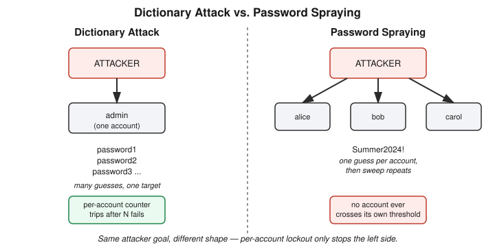

# Chapter 22: Cracking My Own Login — Dictionary Attacks, Backoff, and the Spraying Blind Spot

## Learning objectives

By the end of this chapter, you will be able to:
- Explain why online and offline credential attacks require fundamentally different defenses
- Describe how an exponential-backoff defense works and why it's preferable to a hard account lockout
- Identify password spraying as the technique that evades a per-account lockout or backoff defense, and why
- Explain why a sleep-based delay can be defeated by request concurrency, and why rejecting requests outright is more robust

## The concept

Chapter 21 gave Phase 5 its vocabulary — authentication versus authorization, vertical versus horizontal privilege escalation, and a named list of credential-attack techniques: brute force, dictionary attacks, credential stuffing, password spraying. All of it taught verbally, no infrastructure built. Day 22 picked one of those techniques and built it for real.

The first thing worth separating out, before any attack script runs, is **online versus offline** credential attacks. An online attack means every guess has to travel to the target server and get a response — that's the only kind of attack a server can see, throttle, or reject, because the server is a necessary participant in every single attempt. An offline attack is a different animal entirely: the attacker already holds something like a stolen password hash, usually from a breach, and cracks it on their own hardware with no further contact with the original system at all. Once an attacker has the hash offline, no rate limit, no lockout, and no backoff timer on the original server can slow them down — they've left the building. The only defenses that help against an offline attack are upstream of the attack itself: a genuinely unpredictable password, and the server using a deliberately slow hashing algorithm (bcrypt, scrypt, argon2 — never a fast general-purpose hash like plain SHA-256) so that each individual guess, even run on dedicated cracking hardware, costs real computing time. Today's lab lives entirely on the online side of that line.

A dictionary attack is the practical middle ground between brute force and real human behavior. Brute force tries every possible character combination — exhaustive, guaranteed to eventually succeed, but punishingly slow against anything beyond a short password. A dictionary attack instead tries a curated list of passwords people actually pick: common words, leaked-breach favorites, predictable patterns like a season plus a year plus a punctuation mark. It trades completeness for speed, betting correctly that most real passwords aren't randomly distributed across the keyspace — they cluster.

The lab target was built to prove that bet correct. A small Flask application exposed a single hardcoded login: username `admin`, password `Summer2024!` — a password that satisfies every complexity rule a corporate password policy typically enforces (uppercase, lowercase, digit, symbol) while still following an entirely predictable pattern. The target ran inside a Docker container on a network created with the `--internal` flag, meaning that network has no route to the internet at all; it can talk only to other containers placed on it, which is the containment this course insists on for every hands-on exploit. A second container ran the attacker: a short Python script that read a ten-entry wordlist and POSTed each candidate password, in turn, to the target's `/login` endpoint — resolving the target not by IP address but by its container name, using Docker's built-in network DNS.

Against the undefended server, the attack succeeded in well under a second. Five common passwords failed; the sixth, `Summer2024!`, returned a 200 and `LOGIN OK`. The lesson sits exactly where it's supposed to: password complexity rules constrain the *character set*, not the *predictability* of the pattern, and dictionary attacks are built specifically to exploit predictability, not weak character sets.

The fix applied was **exponential backoff**, not a hard account lockout. The server keeps an in-memory counter of consecutive failed logins per username, and before responding to the *next* attempt for that username, it sleeps for `2^(failures - 1)` seconds — zero delay after the first failure, then one second, two, four, eight, sixteen, capped. The choice not to use a flat lockout was deliberate: a hard lockout after N failed attempts is itself a denial-of-service vector, since anyone who knows a victim's username can lock them out of their own account on purpose, with no need to guess a single character of the password. Backoff avoids that failure mode — a legitimate user who mistypes their password once or twice barely notices a one- or two-second pause, while an attacker running hundreds of guesses gets crushed by the exponent.

Rebuilding the container with this fix and re-running the identical attack, wrapped in the shell's `time` command, produced a real, measured result: 31.725 seconds total, matching the predicted cumulative delay of 1 + 2 + 4 + 8 + 16 = 31 seconds almost exactly. The attack still eventually succeeded — the password itself was never changed, only the defense — but a ten-word dictionary attack that took under a second now takes half a minute. Scaled to a real dictionary of ten thousand entries, the same defense turns a feasible attack into one that takes hours, which is the entire point: exponential backoff doesn't make compromise impossible, it makes it not worth the attacker's time.

But the defense has a precise, named blind spot, and finding it is where the day's best teaching moment happened.

## Hands-on lab recap — REAL LAB

This was a genuine Docker exercise, not a walkthrough: a vulnerable Flask login target and a Python attacker script, both built, containerized, and run on a dedicated `--internal` Docker network with no internet access. The undefended attack was run and observed to succeed in under one second against the weak-but-complexity-compliant password `Summer2024!`. The server was then patched with an exponential-backoff defense (a per-username failure counter driving `time.sleep(2**(failures-1))` before each response), rebuilt, and the identical attack was re-run and timed — 31.725 seconds, matching the predicted cumulative delay within rounding. The lab was torn down cleanly at the end of the session (`docker rm -f`, `docker network rm`, `docker image rm`), with the lab files retained on disk for potential reuse in a future password-spraying exercise.

Two reasoning gaps surfaced and were corrected live, in the style this book has kept honest since Chapter 13's AND/OR precedence catch. First, asked what gap exists in a defense keyed strictly to username, the first instinct reached for IP rotation — a reasonable-sounding guess, but the wrong target, since the backoff counter never looks at source IP at all; rotating IPs changes nothing about a per-username counter. The actual answer, reached after a one-word hint pointing back at the prior session's vocabulary, was password spraying: instead of many passwords against one username, try one password against many usernames. Each individual username only ever sees a single attempt, so no account's counter ever accumulates enough failures to trigger a delay — the attacker sweeps the whole username list with one password, then starts over with the next candidate. Second, asked whether a sleep-based delay survives an attacker sending many requests *concurrently* rather than one at a time, the first answer assumed requests would simply queue and still be delayed in sequence — true only because this lab's Flask development server happens to be single-threaded. A production server running multiple worker threads or processes handles concurrent requests in parallel, which means concurrent sleeps overlap rather than stack: fifty simultaneous guesses might all complete in roughly sixteen seconds total, not fifty times sixteen. That's precisely why production rate limiting is usually implemented as an outright rejection past a threshold, tracked in a shared store like Redis, rather than as a response delay — rejection doesn't fall apart under parallelization the way a timer does.

## Review questions

1. Why can an online credential attack be throttled by the server, while an offline attack (cracking a stolen hash) cannot?
2. What specific weakness does exponential backoff avoid that a hard account lockout after N failures does not?
3. Why does password spraying evade a defense that tracks failed-login counts per username?

### Answers

1. An online attack requires every guess to round-trip through the target server, which gives the server the opportunity to see, slow, or reject each attempt. An offline attack happens entirely on the attacker's own hardware against an already-stolen hash, with no further contact with the original server at all — there's nothing left for the server to throttle.
2. A hard lockout after N failed attempts can be weaponized by anyone who knows a victim's username: deliberately failing a login N times locks the real user out of their own account, without ever needing to guess the password. Exponential backoff slows an attacker down without ever fully blocking access, so it carries no equivalent denial-of-service risk against legitimate users.
3. The backoff counter only increments when the *same* username fails repeatedly. Password spraying tries one password against many different usernames instead of many passwords against one, so each username only ever records a single attempt — never enough to cross its own threshold — even as the attacker makes thousands of attempts across the system as a whole.

## Operational takeaway

> A defense that only watches one account at a time will always have a blind spot for an attacker who spreads their guesses thin across many — catching that requires looking at login attempts in aggregate, not account by account.

## Today in the broader Security Tutor journey

Chapter 21 named the credential-attack vocabulary; this chapter built the first one for real, and in doing so, surfaced the honest limits of the obvious fix. Online-versus-offline framing from this chapter will matter again the moment the course reaches password hashing and storage in more depth, and the backoff-versus-lockout tradeoff is a pattern — slow the attacker without breaking the legitimate user — that will reappear in detection and rate-limiting contexts in later phases. The password-spraying gap, left unresolved as a built exercise rather than just a reasoned-through answer, is flagged in `progress.md` as a strong candidate for a short follow-up lab: inverting today's target and wordlist structure to spray one password across many usernames and watch the per-account defense do nothing about it. From there, Phase 5 still has the Day 6 cron-privesc lab worth revisiting for a hands-on vertical-privilege-escalation anchor, and the formal mechanics of MFA, SSO protocols (SAML, OAuth, OIDC), and AAA (Authentication, Authorization, Accounting) framing still ahead.
