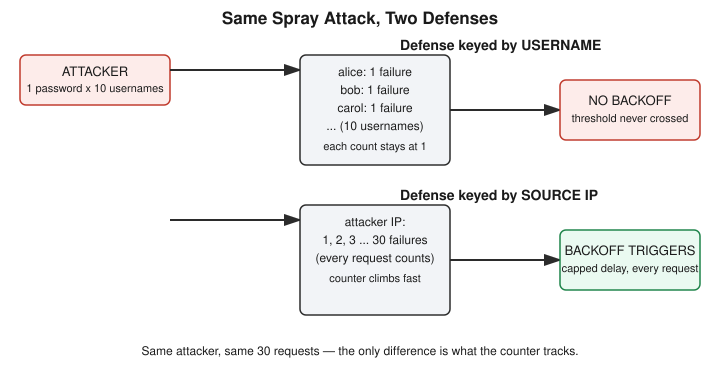

# Chapter 23: Spreading It Thin — How Password Spraying Beats a Working Lockout

## Learning objectives

By the end of this chapter, you will be able to:
- Explain the structural difference between brute-force and password-spraying attacks in terms of which axis each one repeats
- Describe why a failure counter keyed by username is blind to spraying, regardless of how aggressive its backoff curve is
- Explain why keying the same defense by source IP closes that gap, and what real-world tradeoffs that fix introduces
- Reason about the effect of an explicit cap on an otherwise-exponential delay formula

## The concept

Chapter 22 built a real defense and proved it worked: exponential backoff, keyed by username, turned a sub-second dictionary attack into one that took half a minute. The chapter closed by naming the defense's blind spot without yet building it. This chapter builds it.

The key distinction is which axis an attack repeats. A brute-force or dictionary attack repeats the *password* axis — many guesses, one username — and a per-username counter catches that cleanly, because the same account keeps failing over and over. **Password spraying** repeats the opposite axis: a small number of commonly-used passwords, tried against a large number of different usernames. Each individual account only ever sees one or two failed attempts — never enough to cross any per-account threshold — while the attacker is still making hundreds or thousands of attempts across the system as a whole. It's the same arithmetic fact reasoned through verbally at the end of Chapter 21 and confirmed again in Chapter 22's review questions, now built and run for real.

To make the gap concrete, the lab modeled a small department of ten employee accounts. Eight picked strong, unique, randomly-generated passwords. Two — call them Bob and Erin — happened to reuse the same common password, `Summer2024!`. This isn't a contrived detail; breach data consistently shows that in any organization large enough, somebody reuses a password from the handful that show up on every "most common passwords" list. The target ran the exact same per-username exponential-backoff code from Chapter 22, unmodified. The attacker script took a short list of three common passwords and, for each one, swept it across all ten usernames before moving to the next password — one round per password, not one round per username.

Against the undefended target, the result arrived in under a second: Bob and Erin's accounts both returned `LOGIN OK` on the very first password tried, before the backoff counter had accumulated anything at all for either of them — a single attempt on a never-before-seen username never crosses a threshold meant to catch a *second* failure. The other eight accounts correctly resisted all three guesses, but that's a weaker win than it sounds, since none of those eight were ever actually guessable with this wordlist in the first place.

The next step was to quantify exactly how much friction the per-username defense really imposed, rather than just observing that it "worked a little." For the eight accounts that failed every round, each one accumulates one additional failure per round: zero delay on the first failure, then a one-second delay before the second failed attempt, then two seconds before the third. Across eight affected accounts, that totals twenty-four seconds of defense-imposed friction on a thirty-request attack — predicted by hand, then confirmed by timing the actual run at 26.69 seconds, the small gap being ordinary network and container overhead rather than a flaw in the model. The number that matters, though, isn't the twenty-four seconds; it's that the delay landed entirely on accounts that were never going to be compromised by this wordlist, while the two accounts actually at risk paid no cost at all.

The fix follows directly from naming the blind spot precisely: if the defense can't key on username anymore, key it on something that stays constant across a spray instead — the requester's source IP address. The code change needed was exactly one line: swap the dictionary key from the submitted username to `request.remote_addr`, Flask's built-in property for the connecting client's address. Every other part of the backoff formula — the exponential curve, the sixteen-second cap — stayed identical. Run the same thirty-request spray against this version, and nearly every request after the very first now carries prior failure history, because all thirty requests originate from the same attacker. The failure count climbs past the point where the formula's cap matters within the first ten or so requests, after which nearly every remaining request costs the full sixteen-second maximum rather than a continuously growing number — pushing the full attack from under a second to an estimated five to six minutes.

That "estimated" is worth sitting with, because getting that number right required catching a mistake. Asked to ballpark the new attack's total duration, the first instinct reached for the raw exponential math without checking whether the code had a ceiling — reasoning toward something astronomically large (on the order of two-to-the-eighteenth seconds) rather than the actual bounded figure. The correction wasn't just "that number is too big" — it was a reusable habit: before extrapolating any exponential formula in a real system, check whether the code defines an explicit cap, because most production systems deliberately bound otherwise-unbounded growth, and the lab's own `MAX_DELAY_SECONDS = 16` was sitting directly in the code the whole time.

Per-IP throttling isn't a perfect, final answer, and the chapter closed by naming its own limits honestly. Behind a shared corporate NAT, many legitimate employees can present the same outward-facing IP address — so a pure per-IP defense risks delaying or blocking a whole office over one person's mistyped password, a real false-positive cost. And a well-resourced attacker isn't stuck with one IP: a botnet, a pool of rented proxies, or a batch of cheaply spun-up cloud instances lets the same spray get distributed thin enough that no single IP ever crosses the threshold either. Real production defenses respond to this by layering signals — IP, account, device fingerprint, and the login endpoint's aggregate failure rate — rather than betting everything on any one axis. That layering is detection-engineering territory the course will return to directly in Phase 7.

## Hands-on lab recap — REAL LAB

This was a genuine Docker exercise extending Chapter 22's lab directory rather than a fresh one: a ten-account Flask login target (`app_spray.py`) with two accounts sharing a weak reused password, a spray script (`spray.py`) sweeping three common passwords across all ten usernames, and both running as containers on a new isolated `--internal` network. A real bug surfaced on the first run — the attacker script's hardcoded target hostname was a leftover from Chapter 22's dictionary-attack script, so the first attempt failed outright with a DNS resolution error rather than a login failure, caught and fixed in one pass once reported with the full traceback. The undefended spray then ran as designed: two of ten accounts compromised in under a second, with zero backoff ever triggered on either. The predicted twenty-four seconds of total backoff friction on the eight resistant accounts was confirmed by a timed re-run at 26.69 seconds. A second version of the target (`app_spray_defended.py`) was then built with the failure counter re-keyed from username to source IP address, and its expected impact — roughly five to six minutes for the full spray, bounded by the sixteen-second cap — was reasoned through rather than run live, once the magnitude-estimation mistake described above had been caught and corrected; the live multi-minute run was judged unnecessary once the math was solid. Both containers, the network, and all three images were torn down at session end, with all lab files kept on disk alongside Chapter 22's for possible future extension (a combined per-IP-and-per-username defense, or a simulated multi-IP spray to demonstrate botnet-style evasion, are both natural next steps named in `progress.md`).

## Review questions

1. Why does an attacker's choice between brute-forcing and spraying determine whether a per-username or a per-IP failure counter is the one that actually catches them?
2. If a company deploys solid per-IP throttling on its login endpoint, what's the most direct way a well-resourced attacker tries to route around it, and what resource does that require?
3. If the backoff formula in this lab had no cap at all, and an account's failure counter reached forty, how would the resulting delay compare in practice to the server simply rejecting further attempts outright?

### Answers

1. Brute-force repeats the same username with many passwords, so a counter keyed by username sees the repeated failures directly. Spraying repeats the opposite axis — one or two passwords across many usernames — so each username only ever logs a single failure, never crossing its own threshold; only a counter keyed by something the attacker can't spread out, like source IP, catches the aggregate pattern.
2. The attacker distributes the same spray across a large pool of source IP addresses — via a botnet of compromised devices, rented proxy or VPN services, or cloud instances spun up in bulk — so that no single IP ever accumulates enough failures to trigger the per-IP threshold, even though the overall attack volume is unchanged.
3. Without a cap, a delay of roughly `2^39` seconds is effectively infinite in practical terms — tens of billions of years, not just "a long wait." But an uncapped sleep also ties up a server thread or connection for that entire duration, which is a resource-exhaustion problem for the server itself, not just an inconvenience for the attacker. Rejecting the request outright (for example, an HTTP 429 response with the connection closed immediately) costs the server almost nothing per request, which is why production systems reject past a threshold instead of letting a delay grow without bound.

## Operational takeaway

> A rate-limiting defense is only as good as the key it tracks — always ask what the attacker controls and what they don't before deciding what to throttle by.

## Today in the broader Security Tutor journey

Chapter 22 built the first real credential-attack defense and named its blind spot in passing; this chapter built that blind spot into a real, working exploit and then closed it, continuing the book's pattern of not leaving a reasoned-through gap unbuilt for long. The exponential-backoff machinery carries forward unchanged from Chapter 22 — what changed was only the key, which is the real lesson: the shape of the attack, not the strength of the math, determines whether a defense catches it. The NAT false-positive and botnet-evasion limits named here are deliberately left open rather than resolved, since closing them properly requires the multi-signal detection concepts that Phase 7 will cover directly. Phase 5 still has the Day 6 cron-privilege-escalation lab worth revisiting for a hands-on vertical-privilege-escalation anchor, and the formal mechanics of MFA, SSO protocols (SAML, OAuth, OIDC), and AAA (Authentication, Authorization, Accounting) framing still ahead — along with a CEH checkpoint quiz covering Chapters 21 through 23, now due.
