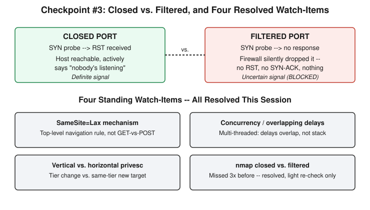

# Chapter 24: Checkpoint — The Third Attempt and Four Resolved Watch-Items

## Learning objectives

By the end of this chapter, you will be able to:
- Distinguish authentication from authorization and explain why conflating the two is a common real-world security mistake.
- Label a privilege-escalation scenario as vertical or horizontal correctly, against a scenario you have not seen before.
- Explain, at the packet level, why an nmap "closed" result is actually a more informative signal than a "filtered" one — not just recite the definitions.

## The concept

This chapter, like Chapter 20 before it, introduces nothing new. It is the third checkpoint in this course, and its entire job is to find out which pieces of the last several days — Chapters 21 through 23, covering authentication and authorization, privilege escalation, and credential attacks — actually survived, and which only survived as long as nobody asked the question a second way.

Checkpoints in this course run every eight to ten sessions, scoped to material already taught, and scored with a readiness read rather than a raw number. This one carried unusual weight, because it wasn't just testing Phase 5's three days of new material — it was also carrying four open "watch-items" forward from the last two checkpoints: things that had been corrected in the moment but never confirmed to have actually stuck. A mistake that gets corrected once and never re-tested isn't resolved. It's postponed.

The headline finding this time is the opposite of Chapter 20's. All four watch-items closed out clean.

The oldest and most stubborn of them was nmap's closed-versus-filtered distinction — missed at the very first checkpoint, missed again twice at the second, three misses running. This time, there was a near-miss in the room: describing a blocked port as the one that sends back a reset, when it's actually the reverse. A closed port is the one that sends a reset — a TCP RST packet — because the host is alive, reachable, and actively telling you "nothing is listening here." A filtered port is the one that's actually being blocked, and it tells you that through total silence: no RST, no SYN-ACK, nothing at all, because a firewall or ACL swallowed the probe before it reached anything capable of responding. The near-miss was called out, self-identified as a slip of the tongue rather than a conceptual gap, and the correct mapping was restated cleanly on the spot. Given the history — three real misses before this session — one honest slip that gets caught immediately and explained correctly afterward reads differently than a fourth genuine miss. It's downgraded from the course's highest-priority watch-item to one more light confirmation, queued for whenever the topic naturally resurfaces, rather than escalated to the real packet-capture demonstration that had been the fallback plan if a verbal re-check failed a fourth time.

The second watch-item was `SameSite=Lax`'s actual mechanism, which Chapter 20 had flagged as "memorized the outcome, not the model" — the right answer (cross-site POST blocked, link-click GET allowed) delivered with the wrong reasoning (an appeal to what GET and POST are "typically for," rather than the real top-level-navigation rule). This time, given a fresh form-POST-versus-link-click scenario, the explanation led with exactly the right mechanism: the cookie gets attached when the user's click causes a genuine top-level navigation — the browser's address bar itself changes — and withheld for anything that fires quietly in the background without the page actually going anywhere. No comparison table was needed this time; the model had actually transferred.

The third watch-item, from Chapter 22, concerned a subtler idea: what happens when an attacker sends many login attempts concurrently instead of one at a time, against a sleep-based rate limiter. The original answer treated "concurrent" and "sequential" as producing the same outcome — true only by coincidence, because that lab's target happened to run on a single-threaded development server, where every request really is handled one at a time regardless of how it was sent. Two weeks later, given a fresh version of the same question, the correct general model came back unprompted: on a single-threaded server, delays stack because only one request is ever being processed at a time; on a real multi-threaded or multi-worker production server, concurrent requests are handled in genuine parallel, so their delays overlap in wall-clock time rather than piling up — which is exactly why production systems reject requests past a threshold instead of relying on sleep-based throttling alone.

The fourth watch-item was a labeling slip from Chapter 21: correctly describing a root-cron-job privilege escalation in concept, but calling it "horizontal" when it is actually vertical — a change in privilege tier, not a move sideways to someone else's resource at the same tier. This checkpoint tested the labels directly, with two fresh scenarios side by side: the cron-to-root escalation, and a URL-parameter `user_id` swap that lets one employee read a coworker's data. Both were labeled correctly and justified correctly — vertical for the tier change, horizontal for the same-tier different-target case — confirming the earlier slip was exactly what it looked like: a naming mix-up under the pressure of answering two examples back to back, not a gap in the underlying concept.

Beyond the watch-items, the checkpoint also tested Phase 5's actual new material from Chapters 21 through 23, and it held up well. Authentication and authorization were correctly distinguished on the first scenario, with the core difference — "who are you" versus "what are you allowed to do" — stated precisely and without hesitation. All three credential-attack techniques were correctly named from behavioral descriptions alone: many passwords against one username as brute force, real leaked username-password pairs replayed on a different site as credential stuffing, and a small number of passwords sprayed across hundreds of usernames as password spraying — along with a clear explanation of why spraying specifically evades a per-username lockout, since no single account ever accumulates enough failed attempts to trip the defense. A full synthesis scenario, combining a spraying compromise with a SUID privilege escalation on a company portal tied together by SSO, was worked through correctly in one pass: spraying for the credential attack, vertical for the SUID escalation, and the SSO blast-radius reasoning (one compromised identity reaching all forty downstream apps) for why the setup made the initial breach more dangerous than it would have been on a standalone application.

Two small, low-priority looseness points surfaced and were corrected in the same breath they appeared. A wordlist attack against a single username was initially called generic "brute force" rather than the more precise "dictionary attack" — brute force, strictly, means exhausting every possible combination, while a dictionary attack tries a curated list of likely real passwords — and the distinction was accepted immediately as something already understood, just stated loosely under the pace of the quiz. And SSO's security benefit was first described in terms of its convenience benefit (one login for everything) before being refined to the actual security-specific case: a single hardened credential is easier to protect well than dozens of scattered ones, and offboarding an employee means revoking access everywhere at once, at the identity provider, rather than hunting down accounts app by app.

## Hands-on lab recap — SIMULATED (quiz/checkpoint day, no lab run)

This was a pure verbal checkpoint session — no Docker container, no Flask app, no exploit run against a target. Ten questions were worked through one at a time, each with feedback and room for correction before the right answer was confirmed, matching this course's standard "one step at a time" protocol even in review form. No lab infrastructure was built or modified in this session. The Day 22 and Day 23 credential-attack lab directories remain on disk exactly as they were left at the end of Chapter 23, available for reuse if a future session wants to build a combined per-IP-and-per-username defense or a multi-attacker-IP simulation.

## Review questions

1. Why does a TCP reset (RST) packet actually tell you more about a target's security posture than a timeout (no response at all) does?
2. A root-owned cron job that a low-privilege user can modify is one example of privilege escalation; a user changing a URL parameter to view a coworker's account is another. What makes one vertical and the other horizontal?
3. Why does password spraying evade a defense that successfully blocks a dictionary attack, even though both are "try many passwords" techniques?

### Answers

1. A reset means the host is reachable and responded definitively: nothing is listening on that port, and the operating system said so outright. A timeout means nmap's probe simply vanished — no confirmation the host even exists, let alone whether something is blocking the connection or there's nothing there at all. The reset is a known fact; the timeout is an absence of information, which is why "filtered" results are inherently less certain than "closed" ones.
2. Vertical privilege escalation crosses a privilege tier — the cron-job exploit takes a low-privilege user all the way to root, a different, higher tier of access entirely. Horizontal privilege escalation stays within the same tier but reaches a different target at that tier — the `user_id` swap doesn't grant the attacker any new permission level, it just lets an ordinary user read another ordinary user's data they were never supposed to see.
3. A dictionary attack concentrates many attempts on one username, which quickly trips a per-username lockout or backoff defense. Password spraying spreads a small number of attempts across many usernames instead, so no single account ever accumulates enough failures to cross that threshold — the defense is watching the wrong axis entirely, which is why a per-source-IP defense, not a per-username one, is needed to catch it.

## Operational takeaway

> Confirming a corrected mistake means testing the same concept with a new example, not re-asking the original question — the second produces an answer you can recite from memory, the first proves whether you can actually apply the idea anywhere else.

## Today in the broader security-tutor journey

This chapter closes out the opening stretch of Phase 5 — Identity and Access Management, consolidating Chapters 21 through 23's authentication/authorization distinction, privilege escalation, and credential attacks, while also retiring every open watch-item carried since Chapter 20: nmap's closed-versus-filtered signal, `SameSite=Lax`'s real mechanism, the overlapping-versus-stacking model for concurrent rate-limited requests, and the vertical-versus-horizontal privilege escalation labels. Two older items from even earlier chapters — clickjacking's overlay mechanism from Chapter 12 and the structural difference between escaping and parameterized queries from Chapter 14 — were also re-tested and resolved in the same session, which is the cleanest result any checkpoint in this course has produced so far. With the open-items ledger effectively cleared, the course turns next to the material Phase 5 hasn't covered yet: SSO protocol mechanics (SAML, OAuth, OIDC) and formal AAA (Authentication, Authorization, Accounting) framing, along with a likely hands-on privilege-escalation lab revisiting Chapter 6's cron exploit as a capstone before the course moves on to Phase 6 — Cloud Security.
