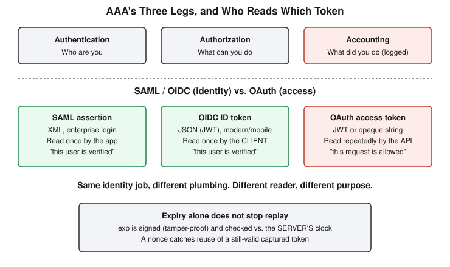

# Chapter 25: Who Reads the Token — AAA, SAML, OAuth, and OIDC

## Learning objectives

By the end of this chapter, you will be able to:
- Name the third leg of AAA beyond authentication and authorization, and explain the specific incident-response failure that results when it's missing.
- Distinguish what SAML, OAuth, and OIDC each actually do, rather than treating them as interchangeable SSO buzzwords.
- Explain why an OIDC ID token and an OAuth access token are built for two different readers, and why that audience difference — not just "one gets reused and one doesn't" — is the real distinction between them.

## The concept

By this point in the course, authentication and authorization are old news: who you are, versus what you're allowed to do. This chapter adds the third leg of the formal AAA framework — Accounting — and then spends most of its time on a genuinely dense piece of IAM mechanics: the real difference between SAML, OAuth, and OpenID Connect, three protocol names that get used almost interchangeably in casual conversation despite doing three different jobs.

Accounting means logging and tracking what actually happened — who did what, when, for how long — and it's the leg of AAA that real systems most often under-invest in. A VPN connection is a clean example: the server authenticates you with a password or certificate, authorizes which internal subnets you're allowed to reach, and then accounts for the session itself — connect time, bytes transferred, disconnect time. That log trail is what lets anyone reconstruct events after the fact. The reason this matters in practice is that each leg of AAA fails in a distinct way, and the accounting failure is the quiet one. A broken authentication means someone got in who shouldn't have. A broken authorization means someone already inside did something they shouldn't have. A broken accounting system means that during an actual incident, you can prove who connected, but you have no way to prove what they did — which means you can't even distinguish "a legitimate user did something malicious" from "a legitimate user's session was hijacked and someone else did it in their name." That distinction becomes critical much later in this course, in the incident response phase, where reconstructing exactly what happened is the entire job.

The bulk of this chapter is SAML, OAuth, and OIDC, and the honest way to teach it is to show where the confusion actually happens, because it happened in this very session before landing correctly.

SAML (Security Assertion Markup Language) is the older, XML-based protocol built for enterprise single sign-on: logging a human into a web application through a trusted identity provider, like Okta or Azure AD. The identity provider builds a signed XML document called an assertion — "this user is jane.doe@company.com, role is Sales, verified right now" — and the browser carries that assertion back to the application, which trusts it because it's cryptographically signed by a provider it already trusts.

OAuth 2.0 is a different kind of protocol entirely, and this is the part that trips up almost everyone the first time: OAuth is not a login protocol. It's a delegation protocol. Its entire purpose is letting one application access specific data on another service, on your behalf, without ever handing that application your password for the other service. "Allow this app to read your Google Calendar" is the canonical example — the app gets a scoped, reusable access token for that one task and nothing more.

OpenID Connect (OIDC) is a thin identity layer built directly on top of OAuth, adding back the one thing OAuth never provided: a way to actually prove who the person is. It does this through a signed ID token. This is what "Sign in with Google" actually uses under the hood, and the common real-world confusion — people saying "we use OAuth to log users in" when they mean OIDC — exists precisely because OAuth alone was never designed to answer the identity question at all.

The sharpest moment of this session was working through exactly what an ID token is and isn't. The first description offered was that the ID token lets the app "act as you" — which sounds plausible but conflates it with what an OAuth access token does. An access token is a scoped key: it lets an app perform a specific, bounded action — read this calendar, post to this account — repeatedly, until it expires. An ID token is categorically different: it's a one-time, signed statement, read exactly once at the moment of login, that says "the identity provider verified this specific person is at this browser right now." Once the app reads it and establishes a login session, the ID token's job is finished. It grants no ongoing ability to touch anything on the identity provider's systems afterward. A natural follow-up question — "doesn't a verified identity claim just mean it is me?" — pushed the explanation to its real foundation: yes, the ID token does mean "it's you," but only as a one-time proof used to establish a session in that one application's own system, never as a reusable capability. The actual distinction between the two tokens isn't reuse-versus-single-use as a rule in itself; it's that the ID token is meant for the client application to read, while the access token is meant for the resource server — the API — to read. Two different consumers, solving two different problems, and the reuse pattern falls naturally out of that deeper split.

Once that distinction held, placing SAML into the same picture became straightforward: a SAML assertion does the same conceptual job as an OIDC ID token — prove identity, consumed once, by the application that needs to know who's logging in. The difference is purely plumbing and era — XML versus JSON, a direct POST versus a redirect-based token exchange — and SAML has no native equivalent to OAuth's access token at all, because it was never built to support delegated, ongoing API access the way OIDC's OAuth foundation naturally does.

A real-world side-by-side makes the two identity flows concrete. In a SAML flow — logging into Salesforce through a company's Okta — the browser is redirected to Okta, authenticates there, receives a signed XML assertion, and POSTs it back to Salesforce, which trusts the signature and logs the user in with the attributes Okta vouched for. In an OIDC flow — "Sign in with Google" on a third-party site — the browser is redirected to Google, the user consents, and Google returns an ID token (plus, separately, an access token if the app also requested extra scopes like Contacts access). The app reads the ID token once to establish its own login session, and if it also needs ongoing access to Google data, it uses the completely separate access token for that, independent of the login event.

A genuinely unplanned but valuable tangent closed out the session: a question about whether changing a device's local clock could extend or forge a token's validity. It can't, for two independent reasons. First, a token's expiry timestamp is part of what's covered by its cryptographic signature — editing it invalidates the signature, and the token gets rejected outright as tampered. Second, whoever validates the token checks the claim against their own server clock, not the client device's clock, so a user's local time has no bearing on what the verifying server believes the current time to be. The real defense against someone replaying a stolen-but-not-yet-expired token is a separate mechanism called a nonce: a random, one-time value the application generates before a login attempt begins, which the identity provider embeds in the resulting token. A replayed token carries the wrong (or already-consumed) nonce and gets rejected immediately, entirely independent of whether it's still inside its expiry window.

## Hands-on lab recap — SIMULATED (conceptual session, no lab run)

This was a purely conceptual/verbal session, continuing directly from Chapter 21's initial MFA/SSO discussion rather than a hands-on lab day. No Docker container, no application code, no real token exchange was built or captured — the SAML and OIDC flows above are described from protocol mechanics, not from a lab the user ran. The Day 22/23 credential-attack lab directories remain on disk, untouched, available for the still-open hands-on privilege-escalation lab planned as Phase 5's capstone exercise.

## Review questions

1. A company's SIEM logs every login attempt but not what users did after authenticating. Which AAA leg is missing, and what specific incident-response capability does that gap remove?
2. A mobile app needs to both log a user in and read their calendar data. Would SAML or OIDC-plus-OAuth be the right fit, and why?
3. An attacker captures a valid OIDC ID token in transit and replays it a minute later, well before its expiry. What mechanism should catch this, and why doesn't the expiry timestamp alone catch it?

### Answers

1. The missing leg is Accounting — logging what was actually done, not just who logged in. Without it, an investigator can confirm which accounts authenticated, but cannot reconstruct what those sessions actually did, which makes it impossible to distinguish a legitimate user behaving maliciously from a hijacked session being used by someone else entirely.
2. OIDC plus OAuth is the right fit. SAML could technically still handle the login half on its own, but it has no native mechanism for delegated, ongoing API access — it was never built for that. OIDC provides the identity proof for login (the ID token), and OAuth separately provides the scoped, reusable access token needed to read the calendar afterward, and both are designed to work cleanly on mobile, which SAML's browser-redirect/XML model was never well-suited for.
3. A nonce — a random, one-time value generated by the application before the login attempt and embedded in the resulting token by the identity provider — should catch this, because a replayed token will carry a nonce that's either wrong or already consumed. The expiry timestamp alone doesn't help here because the replay happens well within the valid time window; expiry only protects against tokens being reused *after* they've gone stale, not against a still-valid token being captured and reused by someone other than its intended recipient.

## Operational takeaway

> Don't assume a token's expiry timestamp alone protects you from a replay attack — replay protection is a separate, independent mechanism (typically a nonce), and it has to be checked on its own terms regardless of whether the token is still technically valid.

## Today in the broader security-tutor journey

This chapter fills in the last piece of Phase 5's planned conceptual material: the formal AAA framework (extending the authentication/authorization distinction from Chapter 21 with the accounting leg) and the mechanics behind SSO protocols that Chapter 21 only named in passing. It also continues a pattern that's run through several recent chapters — a concept initially stated with the right outcome but imprecise reasoning (here, "the ID token lets the app act as you"), pushed to a correct and durable model through a direct follow-up question rather than simply accepted on the first explanation. With AAA and SSO mechanics now covered, Phase 5's one remaining open item is a hands-on lab: revisiting Chapter 6's cron-based privilege escalation as a practical capstone before the course moves on to Phase 6 — Cloud Security, where many of today's identity concepts (especially OIDC, federated identity, and token-based access) reappear directly in the context of cloud IAM.
