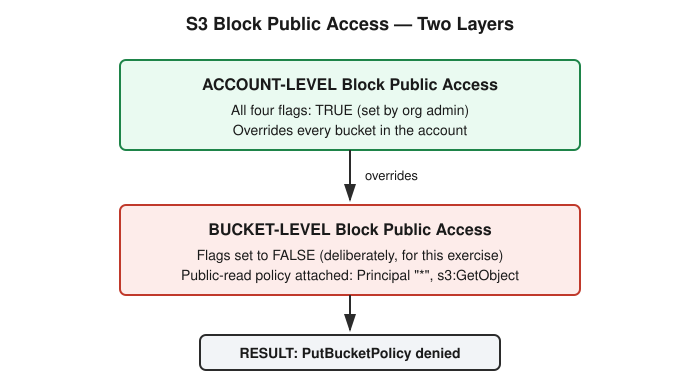

# Chapter 27: The Shared Responsibility Model — A Real S3 Misconfiguration Lab

## Learning objectives

By the end of this chapter, you will be able to:
- Explain the shared responsibility model and how the provider/customer split shifts across IaaS, PaaS, and SaaS.
- Correctly identify which party is responsible for infrastructure patching versus access configuration for a given AWS service.
- Describe the signature pattern of a public-S3-bucket misconfiguration and why it remains one of the most common real-world cloud breaches.
- Explain the difference between bucket-level and account-level S3 Block Public Access, and why the account level takes precedence.

## The concept

When you use a cloud provider like AWS, Azure, or GCP, security responsibility doesn't sit entirely with the provider or entirely with you — it's split, and exactly where that split falls depends on which type of service you're using.

At the provider's end, this is often called "security *of* the cloud": the physical data centers, the host hardware, the hypervisor, and the global network infrastructure. At the customer's end — "security *in* the cloud" — the exact scope shifts with the service model. For Infrastructure as a Service (IaaS), such as an EC2 virtual machine, AWS's responsibility stops at the hypervisor. Everything above that — the guest operating system, patching it, configuring firewall rules, managing your data, and controlling access — is yours. Move up to Platform as a Service (PaaS), such as a managed database like RDS, and AWS now also covers the operating system and database engine patching; your responsibility narrows to configuration, access control, and your data. At Software as a Service (SaaS), such as Gmail or Microsoft 365, the provider covers almost everything on the infrastructure side, leaving you responsible mainly for your data and your users' access settings.

This matters in practice because the overwhelming majority of real-world cloud breaches reported in the news are not failures on the provider's side of this line. They are misconfigured storage buckets, overly permissive identity and access management (IAM) policies, and exposed secrets — all squarely the customer's responsibility, regardless of which service model is in play.

A direct way to test this model is to ask: who patches the operating system running on an EC2 instance — AWS, or the customer? Since EC2 is IaaS, the answer is the customer. AWS's job ends at the hypervisor; the guest OS, and everything running on it, is the customer's to maintain. This is exactly why unpatched EC2 instances turn up so often in real security audits — the responsibility is unambiguous, but easy to neglect.

## Hands-on lab recap — REAL LAB

This was a real, hands-on exercise run against an actual AWS account — not a local Docker lab, and the first cloud-focused exercise of the course. Because the account in question is a genuinely shared one (hosting several development clusters alongside the learner's own dedicated test-sandbox cluster, rather than being a fully isolated personal sandbox), the exercise was deliberately scoped to a brand-new, disposable S3 bucket created and owned solely for this exercise, with explicit confirmation sought before any step that would involve public exposure, however briefly.

The exercise set out to reproduce one of the most common real-world cloud breach patterns: a publicly exposed S3 bucket. The first check confirmed the bucket was private by default, with all four "Block Public Access" settings — `BlockPublicAcls`, `IgnorePublicAcls`, `BlockPublicPolicy`, and `RestrictPublicBuckets` — set to `true`. This feature exists precisely because of a long history of accidental public-bucket breaches; even if a policy later tries to grant public access, these flags are designed to block it.

The next step disabled Block Public Access at the *bucket* level, which succeeded — all four flags flipped to `false`. A bucket policy was then written granting `Principal: "*"` and `Action: s3:GetObject`, meaning anyone on the internet, with no authentication at all, could download any object in the bucket. This exact combination — a wildcard principal paired with `GetObject` — is the signature behind nearly every "leaked S3 bucket" breach reported publicly.

Attaching that policy failed. The error was explicit: "public policies are prevented by the `BlockPublicPolicy` setting in S3 Block Public Access" — even though the bucket-level setting had just been disabled. The explanation turned out to be a second, separate layer: AWS maintains Block Public Access at both the bucket level *and* the account level, and the account-level setting overrides whatever an individual bucket specifies. A check of the account-level configuration confirmed all four flags were `true`, locked down by the organization — meaning that even a deliberate, technically correct attempt to expose the bucket was stopped by a guardrail outside the bucket itself.

This is a concrete illustration of *defense-in-depth*: a security posture that doesn't depend on any single engineer getting every individual setting right, every time. Since the live exposure couldn't be reproduced on this account by design, the exercise pivoted to the more broadly useful real-world skill: auditing for this kind of exposure rather than causing it. The command `aws s3api get-bucket-policy-status` returns a single computed field, `IsPublic`, which factors in the bucket's ACL, its policy, the bucket-level Block Public Access settings, and the account-level settings all together — the one authoritative answer, rather than requiring a human to manually reconcile all four layers by reading raw policy JSON. This was tested against a real, pre-existing bucket in the account and correctly returned `IsPublic: false`, confirming the account-wide guardrail was functioning beyond just the disposable test bucket. At scale, this is exactly the mechanism that tools like AWS IAM Access Analyzer and Trusted Advisor automate across every bucket in an account.

The exercise closed with full cleanup: the bucket-level Block Public Access was restored to secure defaults, the disposable bucket was deleted, and the local policy file was removed, leaving no resources behind in the shared account.

## Review questions

1. In the shared responsibility model, who is responsible for patching S3's own underlying infrastructure — AWS or the customer? Is that different from who is responsible for a bucket's access configuration?
2. When a bucket-level setting and an account-level setting conflict, as they did in this exercise, which one wins, and why does that design make sense from a security perspective?
3. If you needed to audit five hundred buckets across an account for public exposure, would you rather script a loop reading each bucket's raw policy JSON, or use `get-bucket-policy-status`? Why?

### Answers

1. AWS is responsible for patching S3's own infrastructure, because S3 is a fully managed service — there is no customer-visible operating system or server at all, unlike EC2, which is true IaaS and requires the customer to manage and patch the guest OS. This is a genuinely easy distinction to get wrong, as this chapter's own session did initially, by classifying S3 as IaaS; the infrastructure-patching answer and the bucket-configuration answer are separate questions, and the second one — bucket permissions, policy, and data — remains the customer's responsibility regardless of which service model applies.
2. The account-level setting wins. This design makes sense because it lets an organization establish a guardrail that no individual engineer, working on any individual bucket, can accidentally or deliberately override — exactly the scenario demonstrated in this chapter, where a correctly executed attempt to expose a bucket was still blocked.
3. `get-bucket-policy-status` is the better choice, because it returns a single, authoritative, pre-computed answer that already accounts for every relevant layer — ACL, bucket policy, bucket-level Block Public Access, and account-level Block Public Access — rather than requiring a human to manually reconstruct that same logic by reading raw JSON for each of five hundred buckets, a process that's both slower and more error-prone.

## Operational takeaway

> When auditing cloud resources for misconfigurations, always check for guardrails at multiple layers — resource-level and account-level — before concluding something is exposed or safe; a single-layer check can mislead you in either direction.

## Today in the broader Security Tutor journey

This chapter opens Phase 6 — Cloud Security, following directly on from Phase 5's close with the cron privilege-escalation capstone (Chapter 26). Many of the same underlying questions carry forward into this new, cloud-native setting: just as Chapter 26 turned on who could *write* to a file a privileged process trusted, this chapter turns on who controls a setting a storage service trusts — and, notably, on recognizing that more than one layer of control can exist at once. The shared responsibility model introduced here is the foundation for everything else in this phase; the next sessions move into IAM in the cloud — policies, roles, and least privilege — and into cloud misconfigurations beyond storage, where this same instinct to check multiple layers before trusting a result will keep resurfacing.
