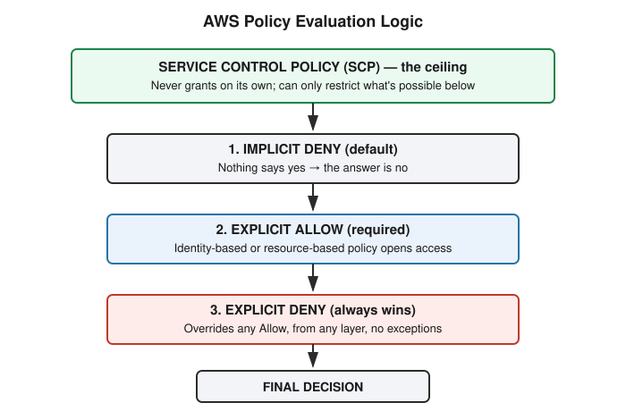

# Chapter 28: AWS IAM — Users, Roles, and Policy Evaluation Logic

## Learning objectives

By the end of this chapter, you will be able to:
- Distinguish an IAM user's long-lived credentials from an IAM role's temporary, assumable credentials, and explain why that difference matters for risk.
- Describe the three parts of an IAM policy statement (Effect, Action, Resource) and apply the principle of least privilege to one.
- State AWS's policy evaluation logic precisely: implicit deny by default, explicit allow required, and explicit deny always wins — including how Service Control Policies fit into that logic as a ceiling rather than a grant.
- Use `aws iam simulate-custom-policy` to test what a policy would actually allow, without creating any real resource.

## The concept

Continuing directly from Chapter 27's look at the shared responsibility model, this chapter turns to the mechanism that actually enforces the customer's half of that split in AWS: Identity and Access Management, or IAM.

Every actor in an AWS account — a person, or a piece of software — needs an identity before it can do anything, and AWS offers two main shapes for that identity. An **IAM user** is a persistent identity, typically representing a human, carrying long-lived credentials: a password, and often access keys. Those keys do not expire on their own. If they leak — committed accidentally to a public code repository, for instance, which happens with real regularity — they remain valid until a person notices and manually revokes them.

An **IAM role**, by contrast, is a temporary identity that something *assumes* rather than *holds*. A user, an EC2 instance, a Lambda function, or even a principal in another AWS account can assume a role and receive short-lived credentials in return, typically valid for about an hour. No long-lived secret sits on the role itself at all.

This distinction carries real security weight. A compromised role's credentials carry a built-in expiration working against an attacker. A compromised user's long-lived keys carry no such clock — they stay valid for as long as it takes someone to find and kill them, which could be minutes or could be months.

What actually governs what a user or role is permitted to do is a **policy** — a JSON document built from a small number of parts. A minimal example:

```json
{
  "Version": "2012-10-17",
  "Statement": [
    {
      "Effect": "Allow",
      "Action": "s3:GetObject",
      "Resource": "arn:aws:s3:::my-bucket/*"
    }
  ]
}
```

`Effect` is either `Allow` or `Deny`. `Action` names the specific API call or calls being governed. `Resource` scopes the statement to specific objects, using an Amazon Resource Name (ARN), rather than leaving it open-ended. The principle of **least privilege** is simply the discipline of keeping all three of these as tight as the actual job requires — granting exactly `s3:GetObject` on exactly one bucket, for example, rather than reaching for a wildcard out of convenience.

That wildcard version is where real danger lives. A policy of `"Action": "*"`, `"Resource": "*"` does not mean "read one bucket." It means "do anything, to anything, anywhere in the account" — and it is a pattern that shows up in real production accounts far more often than it should.

Underpinning all of this is AWS's policy evaluation logic, which decides the outcome of every single API call made in an account, and is worth holding in memory precisely:

1. The default is **implicit deny**. If nothing explicitly permits an action, it is denied.
2. An explicit **Allow**, wherever it appears — a user's own policy, a role's policy, a resource-based policy — opens that door.
3. An explicit **Deny**, wherever it appears, always wins. No number of stacked Allow statements can override a single Deny.



Organizations add one further layer on top of this with **Service Control Policies (SCPs)**, which apply across entire AWS accounts within an AWS Organization. An SCP can declare that no principal in an account may ever perform some action, and that restriction overrides even a full-access Allow underneath it. The important subtlety, easy to miss, is that an SCP by itself never *grants* anything — it only sets a ceiling. A principal still needs an actual IAM-level Allow beneath that ceiling, or the answer remains no regardless of what the SCP permits.

## Hands-on lab recap — REAL LAB

This exercise used `aws iam simulate-custom-policy`, a real AWS CLI command that evaluates a policy document against a list of actions and returns `allowed` or an explicit deny decision — without ever creating, modifying, or touching any actual IAM user, role, or resource. This made it a genuinely safe way to run the exercise directly against the learner's real, shared AWS account, continuing the pattern established in Chapter 27 of preferring diagnostic, non-destructive tooling on an account that is not a fully isolated personal sandbox.

The first run tested the overly broad policy — `"Action": "*"`, `"Resource": "*"` — against three deliberately risky actions: deleting an S3 bucket, creating a new IAM user, and terminating EC2 instances. All three came back with an `EvalDecision` of `allowed`. This is not a hypothetical claim; it is the real AWS policy evaluation engine confirming, on command, that a single overbroad policy attached to any compromised principal would permit wiping out storage, spinning up a new identity for persistence (a classic move — if the original foothold gets discovered and closed, a freshly created admin user is a backup way back in), and tearing down compute resources, all at once.

The second run tested a tightened, least-privilege version of the policy: `s3:GetObject` scoped to a single named bucket. Before running the simulation, the prediction was made explicitly — only the read action would be allowed, and the other three actions would fall to implicit deny. The real output matched that prediction exactly: `GetObject` returned `allowed`, and bucket deletion, user creation, and instance termination all returned `implicitDeny`, with no explicit Deny statement needed anywhere in the policy. Restricting `Action` and `Resource` to only what was necessary was, by itself, sufficient to contain the blast radius down to one action on one object.

A genuine debugging detour occurred along the way, worth recording honestly rather than smoothing over. The first attempt to run the simulator pointed at a policy file on disk using `--policy-input-list file:///tmp/policy.json`, and it failed every time with a terse `InvalidInput: invalid content` error — despite the JSON in that file being completely valid, confirmed independently with Python's `json.tool`. Isolating the problem required ruling out one variable at a time: first confirming the JSON itself parsed cleanly, then testing a deliberately simpler single-action policy to rule out the wildcard syntax as the cause, and only then suspecting the file reference mechanism itself. Passing the same policy as an inline JSON string, rather than a file reference, resolved it immediately. No real lesson about IAM specifically was buried in this detour — the lesson was about debugging method: when a tool's error message is vague, isolate variables methodically rather than assuming the most obvious suspect (in this case, the policy content) is automatically at fault.

No cleanup was required at the end of this exercise. Because `simulate-custom-policy` only evaluates policy documents and never creates real IAM resources, there was nothing in the account to remove.

## Review questions

1. If an identity-based policy grants `s3:*` with an explicit Allow, and a separate resource-based bucket policy carries an explicit Deny for that same principal, what is the final decision, and why?
2. Why is an IAM role generally considered lower-risk than an IAM user holding long-lived access keys?
3. Why was `simulate-custom-policy` used in this exercise instead of actually creating a real IAM user or role with the overly broad policy attached and testing it live?

### Answers

1. The final decision is Deny. An explicit Deny always wins over any explicit Allow, regardless of which layer it comes from — identity-based policy, resource-based policy, or an organization-level Service Control Policy. There are no exceptions to this rule.
2. A role's credentials are temporary and expire automatically, typically within about an hour of being assumed, which limits the window of usefulness to an attacker even if the role is compromised and the compromise goes unnoticed for a time. A user's long-lived access keys carry no such built-in expiration; if they leak, they remain valid until a person manually finds and revokes them, which could take far longer.
3. `simulate-custom-policy` runs the same evaluation logic AWS would use to enforce the policy for real, so the result is trustworthy — but because it only evaluates a policy document rather than creating an actual IAM principal or resource, it leaves no footprint and carries no risk to the account, even when testing a deliberately dangerous policy.

## Operational takeaway

> Before attaching any IAM policy to anything, run it through the policy simulator against your highest-risk actions first — catch "this is far too broad" before you grant it, not after an incident report asks why it was ever possible.

## Today in the broader Security Tutor journey

This chapter continues Phase 6 — Cloud Security, moving from Chapter 27's shared responsibility model into the mechanism AWS actually uses to enforce the customer's half of that split: identity and policy. The same instinct Chapter 27 surfaced — check for guardrails at more than one layer before trusting a result — reappears here almost exactly, in the form of Service Control Policies layered on top of ordinary IAM policies, and again in the discipline of simulating a policy's effect before ever attaching it for real. The next sessions in this phase move beyond storage and identity basics into broader cloud misconfigurations — overly permissive network rules, exposed secrets, and the kind of privilege-escalation chains that combine several small, individually-reasonable-looking permissions into something far more dangerous than any one of them alone.
