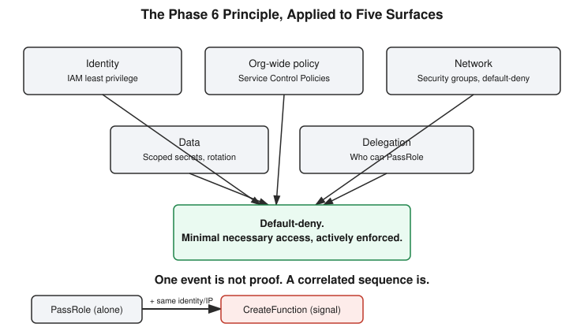

# Chapter 31: One Principle, Five Surfaces — Phase 6 Wrap-Up and the Start of Detection

## Learning objectives

By the end of this chapter, you will be able to:
- State the single unifying principle behind every Phase 6 cloud misconfiguration (S3 exposure, open security groups, exposed secrets, IAM privilege escalation) and explain why "least privilege" alone doesn't fully cover it.
- Name the four main categories of log sources and explain why no single one sees a complete attack.
- Read a real AWS CloudTrail event and identify the fields a detection rule would actually use.
- Explain why correlating a sequence of events (not alerting on any single event) is the core idea behind effective detection.

## The concept

Four days of real, hands-on AWS cloud security work — shared responsibility, IAM policy evaluation, misconfigured security groups, and a full identity-based privilege escalation chain — deserved one honest question before moving on: do these four lessons actually share a single underlying idea, or are they four unrelated facts worth memorizing separately?

The first instinct was to reach for "least privilege." That's true as far as it goes, but it has a real gap. Least privilege explains why handing someone excessive IAM permissions is dangerous. It doesn't, on its own, explain why a security group left open to the entire internet on port 22 is dangerous — nobody's *permissions* are being over-granted in that scenario. The security group isn't a question of who can do what; it's a question of what's reachable at all.

Pushing one level deeper produces the real unifying principle: **nothing is open, granted, or reachable by default. Everything has to be explicitly and narrowly scoped to what's actually needed, and that scope has to be actively enforced — not just assumed.** That single sentence explains all four Phase 6 lessons at once, each as a different *surface* the same principle gets applied to:

- IAM least privilege enforces it for **identity** — who is allowed to do what.
- Service Control Policies (SCPs) enforce it **account-wide**, acting as a ceiling that catches a mistake even if an individual IAM policy was written wrong later.
- Security groups with default-deny and only the required ports open enforce it for **network reachability**.
- Secrets scoping, audit logging, and automatic rotation enforce it for **data access**.
- Restricting who can call `iam:PassRole` enforces it for **delegation** — who's allowed to hand off a role's capabilities to something else.

The diagram below shows all five surfaces converging on the same principle.



A useful follow-up question sharpens the picture further: of everything covered in Phase 6, which single feature acts as a safety net *even when* an individual policy is written badly? The answer is SCPs — not because they replace good IAM hygiene, but because they set an organization-wide ceiling that no individual policy, however carelessly written, can ever exceed. Least privilege is the discipline; SCPs are the backstop for when that discipline slips.

With Phase 6 closed out, the course turned to **Phase 7 — Detection**, and the opening idea there is just as foundational as "least privilege" was for Phase 6: you cannot detect what you cannot see, and visibility comes from different layers of logging, each of which only shows part of the picture.

Four categories of log sources matter most:

- **OS and authentication logs** — who logged in, from where, and whether privileges changed (think Linux `auth.log` or the Windows Security Event Log).
- **Application logs** — what the application itself did: requests served, errors raised, business logic executed.
- **Network and firewall logs** — what traffic crossed a boundary, and whether it was allowed or denied.
- **Cloud control-plane logs** — every API call made *against* the cloud provider itself, distinct from anything happening *inside* a server. In AWS, this is CloudTrail.

The critical idea tying these four together: no single source sees a whole attack. A real intrusion typically leaves footprints across several of these layers at once, which is exactly why a SIEM — Security Information and Event Management system — exists. Its job is to centralize and correlate all of these sources so a human analyst isn't manually cross-referencing ten disconnected systems by hand every time something looks off.

## Hands-on lab recap — REAL LAB

This session's exercise was real, not simulated: a live, read-only query against the user's actual AWS account's CloudTrail history, using the real `icd` profile. The command:

```
aws cloudtrail lookup-events \
  --profile icd \
  --lookup-attributes AttributeKey=EventName,AttributeValue=SimulateCustomPolicy \
  --max-results 10
```

This pulled back three genuine events — the exact `iam:simulate-custom-policy` calls run two sessions earlier during the IAM privilege-escalation lesson (Chapter 30). Reading the real JSON output surfaced several fields that matter directly for detection work:

- `userIdentity` showed the call came through an *assumed role* via the organization's ADFS federation setup, not a static long-lived IAM user — a `sessionIssuer` block nested inside confirmed exactly which role was assumed and when the session was created.
- `sourceIPAddress` pinned the exact origin of the call.
- `mfaAuthenticated: false` — a field a real detection rule could reasonably flag on for sensitive API calls, since many organizations expect privileged actions to come from MFA-authenticated sessions.
- `requestParameters` came back redacted, tagged `"isRedacted": true, "reason": "HIDDEN_DUE_TO_SECURITY_REASONS"` — AWS itself hides the actual simulated policy content here, since a simulated policy document could describe sensitive hypothetical permissions.
- `readOnly: true` and `eventCategory: "Management"` are CloudTrail's own built-in classification of the event.

The natural next question: if a real attacker had actually executed `iam:PassRole` followed by `lambda:CreateFunction` — not simulated it — would that show up in CloudTrail the same way? Yes. CloudTrail records the API call itself, regardless of the caller's intent. It has no concept of "authorized security researcher" versus "attacker" — it simply logs that the call happened, who made it, from where, and when. That's precisely why the CloudTrail event shape for a real exploitation attempt and a simulated test call are identical in structure.

This set up the chapter's central detection insight. If CloudTrail logs *every* API call, why isn't CloudTrail alone a complete detection solution? Because logging and detecting are two separate jobs — a log is a record of what happened, but detection requires someone, or some system, to notice a dangerous *pattern* in that record and act on it. Asked which specific fields a detection rule should be built around to catch a real `PassRole`-into-`CreateFunction` escalation, the right answer names `eventTime`, `sourceIPAddress`, and `userIdentity` — but the key insight isn't checking these fields in isolation. It's **event correlation**: looking for multiple events that share the same identity and source IP, occurring within a short time window, where the sequence of event names matches a known-dangerous pattern.

This matters enormously for accuracy. `PassRole` alone is often completely routine — it's a normal part of deploying infrastructure, and alerting on every single instance of it would flood a security team with false positives. But `PassRole` followed within seconds by `CreateFunction`, from the same identity and the same IP address, is a specific, narrow sequence that's a genuine signal. One event proves almost nothing on its own. A correlated pattern across events is what a SIEM is actually built to catch — and it's the reasoning a future detection-engineering chapter will build on directly.

## Review questions

1. In one sentence, what is the unifying principle behind all four Phase 6 misconfiguration categories (S3 exposure, open security groups, exposed secrets, PassRole escalation)?
2. If CloudTrail logs every single API call, why isn't CloudTrail by itself a complete detection solution?
3. Why does a detection rule that correlates `PassRole` and `CreateFunction` together produce far fewer false positives than a rule that alerts on any `PassRole` call alone?

### Answers

1. Nothing is open, granted, or reachable by default — everything must be explicitly and narrowly scoped to what's actually needed, and that scope must be actively enforced, not merely assumed. This single principle is applied across five different surfaces: identity (IAM least privilege), org-wide policy (SCPs as a ceiling), network (security groups, default-deny), data (secrets scoping and rotation), and delegation (restricting who can `PassRole`).
2. CloudTrail logging an event is not the same thing as someone noticing it and acting on it. A log is a passive record; detection requires actively watching that record for dangerous patterns, correlating related events, and raising an alert a human can triage. Without that layer on top, a perfectly complete log is just a very large haystack.
3. `PassRole` alone is routine and happens constantly during normal infrastructure deployment — alerting on it in isolation would generate overwhelming noise. But `PassRole` followed immediately by `CreateFunction`, from the same identity and source IP, is a specific and far rarer sequence that matches a known escalation pattern, so a rule built around that correlated sequence flags genuinely suspicious activity far more precisely than a rule watching any single action alone.

## Operational takeaway

> A single log event is almost never proof of an attack by itself — real detection comes from correlating identity, source, and the sequence of actions across multiple events, not from reacting to any one API call in isolation.

## Today in the broader security-tutor journey

This chapter closes Phase 6 — Cloud Security, which ran from Chapter 27's shared-responsibility-model opening through Chapter 30's full identity-based privilege-escalation chain, all exercised against a real, live AWS account rather than purely hypothetical examples. The wrap-up here isn't just a recap; it's the moment where four separately-taught lessons resolve into one transferable mental model, which is exactly the kind of synthesis a CEH-level practitioner needs to carry forward into unfamiliar scenarios, not just the four specific examples taught. The second half of this chapter opens **Phase 7 — Detection**, a natural next step given how often earlier chapters' hands-on labs (Chapter 26's cron privilege escalation, Chapter 25's token-tampering tangent) already provoked unprompted "would this get flagged?" questions. Phase 7 continues from here with SIEM concepts proper, alert triage workflow, and detection engineering fundamentals — all building on this chapter's foundational idea that visibility and detection are two different problems, and that one event rarely tells the whole story.
