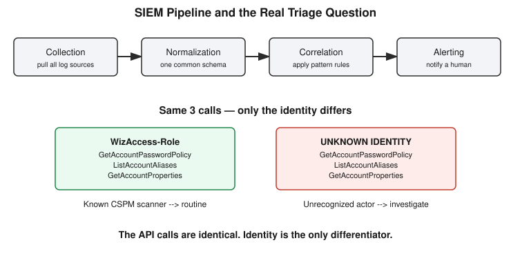

# Chapter 32: Same Calls, Different Actor — The SIEM Pipeline and Real Alert Triage

## Learning objectives

By the end of this chapter, you will be able to:
- Name the four stages of a SIEM pipeline, in order, and explain what each one does.
- Explain why normalization must happen before correlation, and what specifically breaks when it doesn't.
- Read real, unscripted CloudTrail data and identify a correlation cluster worth triaging.
- Explain why identity and provenance — not the API calls themselves — are the real signal in alert triage.

## The concept

Chapter 31 introduced the idea that a single log event is rarely proof of anything — real detection comes from correlating patterns across multiple events. This chapter goes one level deeper: what does a SIEM (Security Information and Event Management system) actually *do* with all that log data, and what happens once a correlation rule genuinely fires?

A SIEM performs four distinct jobs, always in this order:

1. **Collection** — pulling logs from every relevant source (CloudTrail, OS authentication logs, firewall logs, application logs) into one central place.
2. **Normalization** — rewriting differently-formatted fields from different sources into one common schema, so the "same" fact can be compared across sources at all.
3. **Correlation** — applying rules across that now-consistent data to spot patterns, such as the same identity performing unusual, related actions.
4. **Alerting** — when a correlation rule matches, notifying a human analyst. Critically, this is a handoff, not a verdict — the SIEM flags a case; a person still has to investigate it.

The stage that's easiest to underestimate is normalization, and it's precisely why correlation is possible at all. Consider a concrete scenario: CloudTrail calls a field `sourceIPAddress`. A Linux authentication log might call the same concept `remote_addr`. A firewall log might call it `src_ip`. If a correlation rule is written to flag "the same IP appearing across CloudTrail, auth logs, and firewall logs within five minutes," and the SIEM hasn't normalized these three field names into one common field first, the rule will **literally never match** — even when the underlying IP value is identical across all three sources. This isn't a case of the system getting confused about which field holds the IP; each source's own schema is fine in isolation. The failure is specific to cross-source correlation: a rule comparing literal field names silently fails to connect values that are, in fact, the same fact described three different ways. A real attack spanning multiple log types could sit undetected in plain sight — not because anything crashed or errored, but because the correlation engine was quietly comparing the wrong things the entire time.



## Hands-on lab recap — REAL LAB

This chapter's exercise used genuinely live, unscripted data from the user's own AWS account — not a curated example built to teach a clean lesson. The command:

```
aws cloudtrail lookup-events \
  --profile icd \
  --lookup-attributes AttributeKey=EventSource,AttributeValue=iam.amazonaws.com \
  --max-results 20
```

This returned 20 real IAM-related events, which were then reduced to the fields relevant for correlation — event time, event name, source IP, and identity — via a real `jq` extraction pipeline run directly against the JSON output.

The real data that came back was authentically messy: routine automated infrastructure noise from `Karpenter` autoscaler roles and `EKS` service roles doing normal cluster-scaling work, a real human logging in through the organization's ADFS federation, and two different security-tooling service accounts going about their business — an `algosec` compliance-tool role, and one cluster that stood out clearly: a `WizAccess-Role` identity firing three calls within the same second — `GetAccountPasswordPolicy`, `ListAccountAliases`, `GetAccountProperties` — all from the same source IP.

Finding that cluster in live, unscripted account data (rather than a pre-arranged example) was the point of the exercise: a naive correlation rule watching for "multiple API calls, same identity, same IP, tight time window" would flag exactly this pattern, and the task was to locate it without being told precisely where to look.

The real triage test followed immediately: is this cluster something a security team should actually investigate? The first-pass answer focused on what the calls themselves checked — a password policy inquiry sounded sensitive enough to warrant investigation. That's a reasonable instinct, but it misses the deeper lesson. `WizAccess-Role` is the name of a real cloud security posture management (CSPM) vendor's scanning role — Wiz continuously audits account configuration for misconfigurations, and these three specific calls are exactly the kind of baseline check such a tool performs routinely.

Here's the insight that actually matters for detection work, though: those same three calls are also textbook attacker reconnaissance. A compromised credential being used to check an account's security posture and identifying details looks, in CloudTrail, structurally identical to a legitimate CSPM scan — same read-only nature, same tight timing, same kind of information gathered. The API calls carry no signal distinguishing one from the other.

The real differentiator is **identity and provenance**: is this a known, named, expected actor with an established baseline of exactly this behavior, or an unrecognized credential acting outside any known pattern? This is the actual reason real SIEMs maintain baselines of known-good identity behavior — the identical correlated pattern, coming from an identity outside that baseline, is what earns genuine investigation.

The chapter's final piece of reasoning extended this naturally: how would an attacker try to blend in as a trusted identity like `WizAccess-Role`? Two strategies surfaced in discussion. Stealing the real role's credentials is by far the more dangerous option — the `userIdentity.arn` field would show the exact legitimate ARN, and the behavior would be genuinely indistinguishable from authentic Wiz scanning, which ties directly back to Chapter 22 and 23's credential-attack material on why protecting service-account credentials matters as much as protecting human ones. Creating a similarly-named lookalike role, by contrast, is much weaker: the full ARN includes the account ID and exact role path, so a lookalike name alone doesn't produce a matching identity, and — just as importantly — the `CreateRole` action required to set it up is itself a novel, loggable CloudTrail event that doesn't match any established baseline, meaning the attacker's own evasion attempt generates a fresh signal. This echoes Chapter 30's lesson that creating new infrastructure to attack through tends to leave its own trail.

## Review questions

1. Name the four stages of a SIEM pipeline, in order, and what each one does.
2. Why does the `WizAccess-Role` cluster illustrate that the real differentiator in alert triage is identity and provenance, not the API calls themselves?
3. Between stealing the real `WizAccess-Role` credentials and creating a similarly-named lookalike role, which is the more effective evasion strategy for an attacker, and why?

### Answers

1. Collection (pulling logs from every source into one place), normalization (rewriting differently-formatted fields into a common schema so they can be compared across sources), correlation (applying rules across normalized data to spot patterns), and alerting (notifying a human analyst when a rule matches — a handoff for investigation, not an automatic verdict).
2. The three calls made by `WizAccess-Role` — checking the account's password policy, aliases, and properties — are exactly the kind of read-only reconnaissance a genuine attacker would also perform after compromising a credential. The CloudTrail event shape for a legitimate CSPM scan and real attacker recon is structurally identical; the only thing that separates them is whether the identity performing the calls is a known, expected actor with an established baseline, or an unrecognized credential acting outside any known pattern.
3. Stealing the real role's credentials is far more effective: the `userIdentity.arn` would show the genuine, trusted ARN, and the behavior would be indistinguishable from legitimate activity. Creating a lookalike role is much weaker — the full ARN (including account ID and role path) wouldn't actually match the real role even with a similar name, and the `CreateRole` action itself is a novel, loggable event that stands out against any established baseline, meaning the evasion attempt generates its own detectable signal.

## Operational takeaway

> The same API calls can be either routine automation or genuine attacker reconnaissance — the signal that tells them apart isn't the action itself, it's whether the identity performing it is a known, expected actor behaving within its normal baseline.

## Today in the broader security-tutor journey

This chapter is the second installment of Phase 7 — Detection, building directly on Chapter 31's foundation that no single log source sees a whole attack and that one event is rarely conclusive proof. Where Chapter 31 established the *why* of correlation, this chapter supplies the *how*: the four-stage pipeline that turns raw, disconnected logs into something an analyst can actually act on, and a genuinely real example — found in live, unscripted account data rather than a staged scenario — of what triage actually looks like once a correlation rule fires. The identity-over-action principle established here sets up the next step in Phase 7: detection engineering basics, where the course moves from recognizing patterns by hand to actually writing and tuning detection rules for false positives, using the real CloudTrail data already gathered in this session as a starting point.
