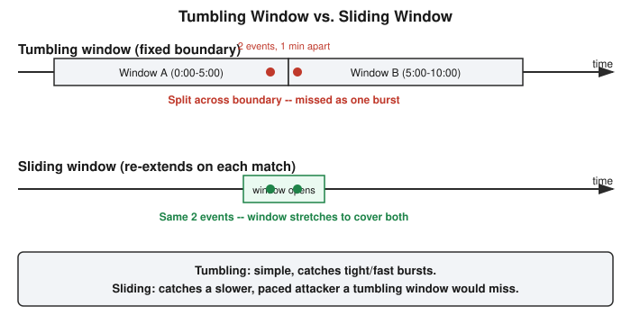

# Chapter 33: Three Alerts, Zero Threats — Writing a Real Detection Rule

## Learning objectives

By the end of this chapter, you will be able to:
- Describe a detection rule as the combination of a condition, a scope, and a threshold.
- Explain the practical difference between a tumbling window and a sliding window, and when each is the right choice.
- Distinguish a volume-based detection rule from a sequence-based one, and explain why each needs a different threshold.
- Explain why a technically correct detection rule can still be useless in production, and what fixes that (not smarter time math, but tuned suppression).

## The concept

In the last chapter, I found a real suspicious-looking cluster of API calls in a live AWS account by eyeballing twenty events and reasoning my way to the right one. That's a fine way to learn alert triage, but it doesn't scale — nobody reviews raw logs by hand in a real SOC. Today's job was to build the thing that does that work automatically: an actual detection rule.

Strip away the jargon, and a detection rule is just three decisions. First, a **condition** — what pattern of events actually counts as suspicious. Second, a **scope** — what time window you group events within to decide whether they "belong together." Third, a **threshold** — how many matching events have to show up before the rule actually fires an alert. Everything else in detection engineering — all the tuning, all the false-positive chasing — is really just adjusting these three knobs.

The scope decision turned out to be more interesting than I expected. There are two common ways to define a time window. A **tumbling window** is fixed: it opens at a certain moment and closes exactly N minutes later, no matter what. The problem is boundary luck — if a real attack's three calls land at, say, 4:59, 5:00, and 5:01, and your window happened to close at 5:00, you've split one obvious burst into two unremarkable halves and your rule sees nothing. A **sliding window** avoids this by not having a fixed closing time at all: it opens on the first suspicious event and keeps re-extending as long as new matching events keep showing up close together. That also means a sliding window catches a different, more dangerous kind of attacker — someone who deliberately paces their calls out to avoid looking like an obvious tight burst. A tumbling window built to catch a one-second burst will completely miss a patient attacker spacing the exact same calls out over several minutes; a sliding window follows them regardless of pace.

There's a second, less obvious design choice buried in the threshold: not every dangerous pattern needs the same minimum count. A **volume-based** rule — "three or more calls from the same identity and IP within five minutes" — needs a reasonably high threshold, because it doesn't care *which* calls happened, just how many. Set it too low and you'll flag ordinary, routine activity constantly. But a **sequence-based** rule — "this exact identity called `iam:PassRole` and then `lambda:CreateFunction` within the window," the privilege-escalation chain from an earlier chapter — can fire on just two events, because the signal isn't volume, it's the specific, known-dangerous combination of actions. A rule that only ever counts events, without ever looking at *which* events, can't express that second kind of logic at all. Real detection programs run both kinds side by side.

## Hands-on lab recap — REAL LAB

This was a genuinely real exercise, not a worked example: I wrote and ran an actual Python script, function by function, against the real twenty-event CloudTrail export pulled from a live AWS account in the previous chapter.

The first function, `parse_event`, pulls the fields we need out of one raw CloudTrail record. The gotcha here is that AWS CLI's `lookup-events` output wraps the full event as a field called `CloudTrailEvent` — but that field is a *string* containing escaped JSON text, not a nested object. Reach for `userIdentity.arn` directly and you get an error; you have to call `json.loads()` on that string first to turn it into a real dictionary, and only then can you pull out the identity ARN and source IP.

The second function, `group_events`, buckets every event by a tuple key: `(identity, source_ip)`. I'd originally thought about this the way you'd think about a SQL `GROUP BY`, and Python's closest built-in equivalent, `itertools.groupby`, has a real trap: it only groups *consecutive* matching rows, not all matching rows anywhere in the list. A plain dictionary keyed by the tuple sidesteps that entirely — you just append to whichever bucket an event belongs to, in any order.

The third function, `find_bursts`, is the actual tumbling-window logic: walk through a group's events sorted by time, open a window at the first unclaimed event, pull in everything within five minutes of that window's start, and flag the bucket if it collected three or more events. The one line that made this correct rather than buggy was `i = j` at the end of each pass — jumping the outer pointer forward past everything just consumed by the window, rather than advancing it one event at a time. Without that, the loop would re-examine events already inside a window it just built and spin up overlapping, duplicate alerts for the same burst.

Running the finished rule against the real twenty-event file, with a five-minute window and a three-event threshold, it fired on exactly three groups. Every one of them was legitimate, known automation: a cloud security posture scanner, a compliance-auditing tool, and AWS's own EKS autoscaler making routine lookups. Zero real attackers — a hundred percent false-positive rate, on real data, from a rule that did exactly what it was designed to do. That's the central lesson of the day: the rule correctly found every burst in the data (a true positive at the *pattern* level), but "a burst happened" and "a burst that matters happened" are not the same claim, and no amount of refining the time window changes that. What actually closes the gap is a suppression layer sitting on top of the detection logic — an allowlist of identities known to behave this way routinely.

## Review questions

1. Why does a tumbling window risk missing a slower, deliberately-paced attacker, and what kind of window would catch that instead?
2. Why did `parse_event` need to call `json.loads()` a second time on `event["CloudTrailEvent"]`, when the rest of the event's fields didn't need that extra step?
3. If an attacker steals the credentials for a trusted, allowlisted role and starts making unusual calls from a brand-new IP address, would the detection rule built in this chapter catch it? What does the answer depend on?

### Answers

1. A tumbling window has a fixed start and end; if a real attack's events happen to straddle that fixed boundary, they get split into two unremarkable-looking groups instead of one obvious burst, and the rule misses it purely on timing luck. A sliding window, which re-opens and keeps extending as long as new matching events keep arriving, doesn't have this fixed cutoff — it naturally follows an attacker who spaces their calls out to avoid looking like a tight, obvious burst.
2. Because `CloudTrailEvent` in the AWS CLI's `lookup-events` output isn't a nested object — it's a string containing a second, separate block of escaped JSON text. Every other field in the outer event (like `EventTime` or `EventName`) is already a native value you can read directly; `CloudTrailEvent` has to be parsed a second time with `json.loads()` before you can reach fields like `userIdentity.arn` or `sourceIPAddress` inside it.
3. It depends entirely on how the allowlist is scoped. If the allowlist checks identity alone ("this role is trusted, full stop"), the stolen-credential activity sails through completely suppressed, because the rule never notices the IP changed — a real and dangerous blind spot. If the allowlist is scoped to the exact same key the detection rule itself groups on — identity *and* IP together — then a brand-new IP for that identity simply doesn't match any existing allowlist entry, the rule treats it as a new, unrecognized group, and it fires normally. The suppression logic has to be exactly as specific as the detection logic, or it silently recreates the blind spot the rule was built to close.

## Operational takeaway

> Your allowlist has to be scoped exactly as tightly as your detection rule's own grouping logic — or you quietly rebuild the exact blind spot the rule was supposed to close.

## Today in the broader security-tutor journey

This chapter is the natural next step after Chapter 32's alert-triage exercise: having learned to *recognize* a suspicious cluster by eye, this session built the machinery that finds one automatically, and then — just as importantly — ran headfirst into the real-world problem every detection engineer eventually hits, where a perfectly correct rule turns out to be operationally useless without tuning. The allowlist-plus-watchlist design worked out here, closing the "trust isn't static" gap first raised in Chapter 32's discussion of stolen credentials, sets up the natural next move for Phase 7: either extending this same script with a sequence-based rule for the PassRole-to-CreateFunction chain introduced back in the cloud security chapters, or sitting the next CEH-readiness checkpoint now that Detection's core ideas — log sources, the SIEM pipeline, alert triage, and now rule-writing itself — are reasonably well covered.
