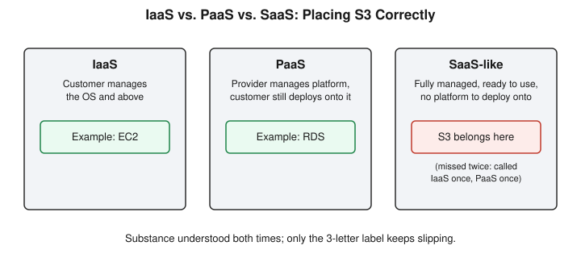

# Chapter 34: Checkpoint — Nine for Nine, and One Repeat Worth Stopping For

## Learning objectives

By the end of this chapter, you will be able to:
- Explain why a concept surviving a brand-new, unprompted scenario is stronger evidence of understanding than a correct answer to a familiar question.
- Distinguish AWS's informal service-model labels (IaaS/PaaS/SaaS) well enough to classify a service like S3 correctly, not just describe its responsibility split.
- Articulate why two genuine misses on the same concept, spaced weeks apart, call for a dedicated re-teach rather than another light quiz re-check.

## The concept

This chapter, like Chapters 20 and 24 before it, introduces no new material. It is the fourth checkpoint in this course — twelve questions, nine of them covering nine different sessions since the last checkpoint (Chapters 25 through 33: AAA and SSO, the cron-privilege-escalation capstone, cloud shared responsibility, IAM policy evaluation and privilege escalation, cloud misconfigurations, and the full arc of Phase 7's Detection material), plus three standing watch-items carried forward from earlier sessions.

The headline result is the strongest the checkpoint series has produced on core material. All nine questions spanning genuinely different topics — the Accounting leg of AAA, the root cause of the cron-privilege-escalation lab, the cloud shared-responsibility model, AWS's explicit-deny policy evaluation, why an exposed SSH port is worse than an exposed HTTP port, the PassRole-plus-CreateFunction escalation chain, the SIEM pipeline's four stages, and the alert-fatigue tradeoff in detection-rule thresholds — came back either fully correct or needing only a light sharpening, never a real correction. The standout among these was the SSH-versus-HTTP port-exposure question, which had needed a nudge the first two times it came up across earlier chapters and this time came back fully unprompted and precise: the real test isn't whether a port is open, it's whether that port is the intended public access path or an admin-only one, and whether a breach there yields shell-level access or merely app-level access.

Not every answer was clean, though, and the two misses that did surface are each worth examining on their own terms, because they illustrate two very different kinds of gap.

The first was a labeling slip rather than a substance gap. Asked who's responsible for patching S3's underlying infrastructure, the shared-responsibility reasoning was sound, but S3 itself got classified as "PaaS." That's the wrong label, though not for the reason it might first seem: S3 isn't something you deploy a platform onto the way you would with a genuine PaaS example like RDS, where AWS manages the database engine but you still interact with it as a database server. S3 is closer to a fully managed, ready-to-use service with no infrastructure layer exposed to the customer at all — more SaaS-like in spirit, even if AWS's own marketing doesn't formally categorize it that way. This is the second time this exact service has been misclassified, following an earlier miss calling it "IaaS" instead. In both cases, the actual substance — zero customer-side infrastructure patching responsibility — was understood correctly. Only the three-letter label keeps landing on the wrong answer, which is itself a useful distinction: understanding a concept and being able to reliably attach the right formal name to it are not quite the same skill, and the second one sometimes needs its own deliberate practice.

The second miss was the one that actually changed the plan for the next session. Several chapters earlier, OAuth and OIDC's two token types got conflated — describing the ID token as something closer to a capability that "lets the app act as you," rather than a one-time identity proof. That was corrected in the moment it came up. This checkpoint tested the same underlying distinction again, and it came back wrong a second time, in the same direction: the access token was called "one-time-use" (it's actually the reusable one) and the ID token was described as granting "full access to the service" (it grants none at all). A single miss on a concept is ordinary — everyone needs at least one real correction before something sticks. Two genuine misses on the identical concept, weeks apart, is a different signal entirely. It means the first correction didn't actually change the underlying mental model, it just supplied the right words for one conversation. That distinction — between a concept that's been explained once and a concept that's actually been internalized — is exactly what a spaced-out checkpoint is designed to catch, and catching it here is what triggered a full dedicated re-teach rather than a third light verbal re-check.

A smaller, related pattern also resurfaced during the detection-triage question: asked what the first question should be when evaluating a cluster of suspicious API calls, the answer led with checking whether the source IP matched a known pattern, rather than naming identity and provenance directly as the primary signal. IP-matching is a real and useful corroborating detail, but it's secondary — the first question is always "do I recognize who's doing this." This is the third time this specific shape of mistake has appeared across different topics: reaching for a supporting signal before the primary one. Each occurrence so far has been a single clean correction on a different subject, so it isn't being escalated yet, but naming the recurring shape out loud is itself useful, since recognizing a pattern across unrelated topics is often the first step to actually fixing it.

One of the three watch-item re-checks resolved itself mid-answer in an interesting way: asked again whether an AWS policy simulator evaluates a real role's actual permissions or a hypothetical policy document, the first words sounded like the same mix-up from an earlier session — but were immediately followed by an unprompted self-correction: the understanding was right, the phrasing was just clumsy. That's a materially different event than a genuine second conceptual miss, and it's the kind of self-awareness that makes a wording slip easy to downgrade rather than escalate — catching your own error before someone else points it out is itself a form of mastery.

## Hands-on lab recap — SIMULATED (quiz/checkpoint day, no lab run)

This was a pure verbal checkpoint session — no Docker container, no AWS CLI call, no exploit run against any target. Twelve questions were worked through one at a time, each with feedback and room to self-correct, matching this course's standard protocol even in review form. No lab infrastructure was built, modified, or touched; the reusable `siem-alert.py` script from Chapter 33 and all prior lab directories remain exactly as they were left.

## Review questions

1. What's the real test for whether an open port is actually dangerous, as opposed to merely open?
2. Why is "PaaS" the wrong classification for a storage service like S3, even though a customer clearly doesn't manage it at the OS level?
3. Between an ID token and an access token, which one would a resource API ever actually reject — and why does that question not even apply to the other one?

### Answers

1. The real test isn't whether the port is open, it's whether that port is the service's intended public access path or an administrative one, and what tier of access a breach there grants — shell-level system access (SSH, RDP) is categorically worse than app-level access (HTTP/HTTPS), even though both can technically be exposed to 0.0.0.0/0.
2. PaaS means the provider manages a platform the customer still deploys onto and interacts with directly, the way RDS exposes a database engine. S3 has no such platform layer — it's a fully managed, ready-to-use service with no infrastructure the customer configures or patches at all, which places it closer to a SaaS-like model even though AWS doesn't formally use that label.
3. An access token would be rejected by a resource API if it were invalid, expired, or scoped to the wrong permissions — that's its entire purpose, to be presented to and evaluated by an API. An ID token is never shown to any API at all; it's read exactly once, by the client application itself, purely to establish who logged in. The question "would an API reject this" simply doesn't apply to something an API never sees.

## Operational takeaway

> One miss on a concept is normal and expected. Two genuine misses on the exact same concept, spaced weeks apart, means the first correction only supplied the right words for one conversation — it's time to stop re-checking and actually re-teach.

## Today in the broader security-tutor journey

This chapter closes out the second full arc of Phase 7 — Detection material (Chapters 31 through 33) along with the earlier Phase 6 Cloud Security content (Chapters 27 through 30) and Phase 5's AAA/SSO conceptual groundwork (Chapter 25) and privilege-escalation capstone (Chapter 26), confirming that all of it held up well under a spaced-out, mixed-topic quiz. The two real findings — a persistent IaaS/PaaS/SaaS labeling slip on S3, and a second genuine OAuth/OIDC token-confusion miss — set the agenda directly for what comes next: Chapter 35 is built entirely around fixing the token confusion properly, while the service-model labeling question remains open for a future session that brings in a genuine PaaS example like RDS for contrast rather than re-asking about S3 a third time.
