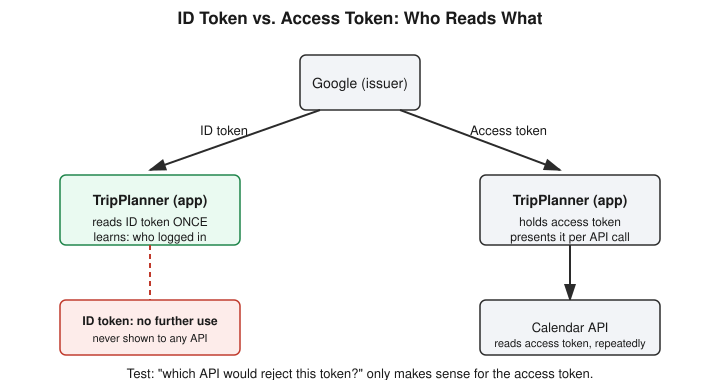

# Chapter 35: Wrong Twice, Right Today — OAuth and OIDC, Properly

## Learning objectives

By the end of this chapter, you will be able to:
- Explain the audience distinction between an OAuth access token and an OIDC ID token, and state a one-line test for telling them apart.
- Describe why separating tokens by audience prevents direct attacker-to-API calls but does not, by itself, prevent session hijacking at the application layer.
- Distinguish what a nonce protects against from what PKCE protects against, and identify the specific scenario in which PKCE's protection fails.
- Recognize the difference between a security claim that is an absolute guarantee and one that is a conditional mitigation.

## The concept

Some chapters in this book cover new ground. This one covers old ground, revisited on purpose, because the first two passes didn't actually stick. Back in Chapter 25, I was taught the distinction between an OAuth access token and an OIDC ID token, and got it backwards in the moment — describing the ID token as something closer to a capability than an identity proof. Weeks later, at a checkpoint quiz, I got the exact same question wrong again, in the exact same direction: calling the access token "one-time-use" and the ID token "full access to the service" — both swapped. Two genuine misses on the same question is a different kind of problem than one slip, and it called for a different kind of fix: not another quiz, but a session built entirely around getting it right this time, with enough depth that a third miss would be genuinely surprising.

The fix started with a concrete scenario instead of another definition. Imagine an app called TripPlanner. You tap "Sign in with Google." Google verifies you, then issues two tokens back to TripPlanner — but the two tokens are addressed to two completely different audiences, and that audience distinction is the entire point.

The **ID token** is addressed to TripPlanner itself. It's a signed statement that says, in effect, "this really is you, verified just now." TripPlanner reads it exactly once, at the moment of login, to learn who just arrived. After that, it has no further job — it carries no power to make anything happen on its own. Think of it as a one-time identity receipt.

The **access token** is addressed somewhere else entirely: Google's Calendar API. TripPlanner never looks inside this one. It just holds onto it and presents it to the Calendar API every time it needs your schedule. Unlike the ID token, it's reusable until it expires, and it's a capability rather than a proof of identity.

The test that would have caught both of my earlier mistakes is simple: ask "which API would reject this token?" That question only makes sense for an access token — an ID token is never shown to an API at all, so the question doesn't even apply to it.

That distinction alone wasn't the end of the session, though, because testing it against a harder scenario surfaced something genuinely new. If an attacker steals only the ID token, the straightforward answer is that they can log in as the user but can't read the calendar, since they don't have the access token. But TripPlanner's server is the one holding the access token, and it's TripPlanner's server that calls the Calendar API on the logged-in user's behalf. So if an attacker manages to hijack the login session itself — using that stolen ID token to get authenticated — then clicking "show my calendar" inside the app would work exactly as it would for the real user, because the app doesn't know a different person is now driving the session. It just does its normal job: pulls the access token it already has, calls the API, and shows whoever's logged in the result.

This is worth sitting with, because it reframes what the audience separation actually buys you. Splitting tokens by audience stops an attacker from calling Google's API *directly* — they simply don't have the right token for that. It does nothing to stop an attacker from riding *inside* a hijacked application session, where the legitimate app does all the calling on their behalf. These are two different problems with two different fixes; conflating them is exactly the kind of gap that a definitional-only understanding misses.

That naturally raised the next question: in a real, correctly built OAuth/OIDC flow — the Authorization Code Flow, the modern standard — neither token ever actually touches the user's browser. The browser only ever receives a short-lived, single-use authorization code. TripPlanner's own server then exchanges that code for both tokens directly with Google, over a private, server-to-server channel the browser never sees. So the realistic interception surface isn't "catch the token in transit" at all — it mostly lives in the older, now-discouraged *implicit flow*, which used to put tokens directly into the browser's URL (leaking via browser history, server logs, or the `Referer` header), or in the authorization code itself, which a different app on the same device might theoretically grab before the legitimate app uses it.

That second scenario is exactly what two further mechanisms exist to close, and this session covered both carefully since they'd been slightly conflated before. A **nonce** is a random value the app generates before the redirect to Google; Google embeds that exact value inside the ID token it issues, and the app checks on return that the value matches. This stops an old, previously issued token from being replayed into a fresh login attempt. **PKCE** solves a different problem at a different moment: the app generates a secret (`code_verifier`) before the redirect, sends only a hashed version (`code_challenge`) up front, and must produce the original secret again when exchanging the authorization code for tokens. A different app that intercepted only the code, without that secret, gets refused by Google at the exchange step.

The sharpest moment of the session came from pushing PKCE one step further: what if an attacker captures *both* the code and the `code_verifier`? The honest answer is that PKCE no longer helps — it was built to stop a different app from using a stolen code without the matching secret, not to survive a full interception of both halves at once. That's a job for transport-layer encryption (TLS), not for PKCE. This led directly into a closing review question that exposed one more genuine, useful mistake: asked whether "PKCE guarantees a stolen code can never be used by an attacker" is true or false, the first answer was "true, if the attacker lacks the verifier and doesn't win the race" — which sounds reasonable but is actually the wrong answer to the question as posed. A defense that only works under specific conditions is not a guarantee; the honest answer is false. That distinction — between an absolute security claim and a conditional, scoped one — turned out to be the real lesson underneath everything else covered today.

## Hands-on lab recap — SIMULATED

This was a purely conceptual, Socratic session with no Docker lab, no AWS calls, and no code written. The entire exercise was a structured walkthrough of a hypothetical (but realistic) OAuth/OIDC flow — the TripPlanner-signs-in-with-Google scenario — reasoned through step by step rather than built and run. No infrastructure existed to run; the depth came entirely from following the mechanism through a sequence of "what if" questions, several of which were raised independently rather than scripted in advance.

## Review questions

1. In one sentence each, who reads the ID token and who reads the access token?
2. What specifically does a nonce protect against, and what specifically does PKCE protect against?
3. True or false, with justification: "PKCE guarantees that a stolen authorization code can never be used by an attacker."

### Answers

1. The ID token is read by the client application itself, once, to learn who just logged in. The access token is read by the resource API (e.g. Google's Calendar API), repeatedly, as proof the application is authorized to act on the user's behalf.
2. A nonce protects against a previously issued ID token being replayed into a new login session — the app checks that the value embedded in the token matches the one it generated for this specific attempt. PKCE protects against a different application using a stolen authorization code to complete the token exchange — Google verifies the app presents a secret (`code_verifier`) matching the hash it was given upfront.
3. False. PKCE is a strong, specific mitigation — it stops a different app from exchanging a stolen code without the matching `code_verifier` — but it is not an unconditional guarantee. If an attacker captures both the code and the `code_verifier` together, the exchange succeeds; that gap is closed by transport-layer encryption (TLS), not by PKCE itself.

## Operational takeaway

> Don't ask "is this secure" — ask exactly what this control stops, and what's just outside its boundary.

## Today in the broader security-tutor journey

This chapter is a deliberate pause rather than a step forward in the syllabus — Phase 6 (Cloud Security) and Phase 7 (Detection, through Chapter 33) remain exactly where they were left. The reason for the pause is itself worth stating plainly: a concept that's been missed twice on real checkpoints doesn't deserve a third light touch, it deserves a session built specifically to close the gap, and this one did — every check today landed cleanly, and the depth went well past where the original Chapter 25 lesson stopped. The next chapter picks back up with fresh material: either extending the real detection-rule script built in Chapter 33, going deeper into Phase 7, or opening Phase 8 — Incident Response.
